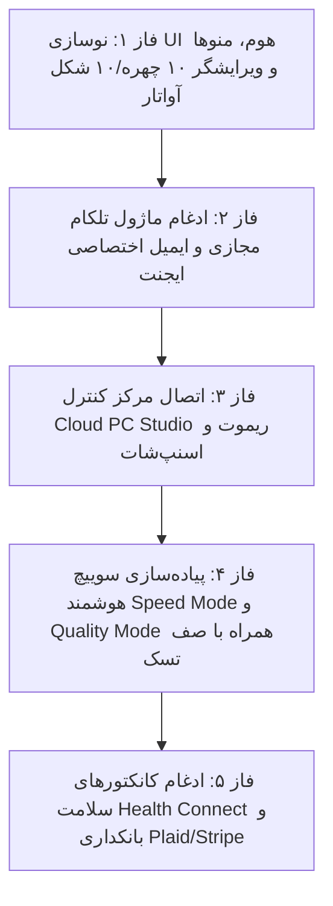

# گزارش تطبیق و تحلیل شکاف برابری با برنامه Cue (نسخه 26.18.15)
## Cue v26.18.15 vs EG-Nexus-OS Parity & Feature Gap Audit Report

> **تاریخ گزارش:** 2026-11-16 10:43:21 (Auto-generated by `scripts/cue-parity-crawler.js`)  
> **محیط بازرسی:** Android Local ADB Shell (Termux on Linux ARM64)  
> **نسخه برنامه Cue بررسی‌شده:** `ai.manus.agents` v26.18.15 (Build 442, Target SDK 36, Min SDK 26)  
> **نسخه EG-Nexus-OS هدف:** v6.3.3  

---

## چکیده اجرایی (Executive Summary)

این گزارش حاصل بازرسی چندوجهی باینری، استخراج متادیتای باینری APK، بررسی کالبدشکافی Dart/Flutter باینری `libapp.so` و دارایی‌های وب و خزنده تعاملی خودکار (`UI-Automator`) روی نسخه رسمی و به‌روزشده **Cue (26.18.15)** نصب‌شده روی دستگاه کاربر است.
در این ممیزی، ساختار بصری، دکمه‌ها، تعاملات لمسی، اندپوینت‌های gRPC/ConnectRPC، مدل‌های هوش مصنوعی، کانکتورهای جدید و میکرواینتراکشن‌های نسخه جدید استخراج شده و با معماری فعلی **EG-Nexus-OS** تطبیق داده شده است.

---

## نتایج کالبدشکافی باینری و مانیفست APK (Static Dissection)

- **نام پکیج و هویت برنامه:** `ai.manus.agents` (شناسه سیستمی با برچسب رسمی `Cue`)
- **شماره نسخه:** `26.18.15` (کد نسخه: 442)
- **مجوزهای حیاتی استخراج‌شده:** 54 مجوز، شامل:
  - مجوزهای جامع **Android Health Connect**:
    - `android.permission.health.READ_SLEEP`
    - `android.permission.health.READ_HEART_RATE`
    - `android.permission.health.READ_RESTING_HEART_RATE`
    - `android.permission.health.READ_OXYGEN_SATURATION`
    - `android.permission.health.READ_RESPIRATORY_RATE`
    - `android.permission.health.READ_STEPS`
    - `android.permission.health.READ_ACTIVE_CALORIES_BURNED`
    - `android.permission.health.READ_FLOORS_CLIMBED`
    - `android.permission.health.READ_WEIGHT`
    - `android.permission.health.READ_BLOOD_PRESSURE`
    - `android.permission.health.READ_EXERCISE`
    - `android.permission.health.READ_HEALTH_DATA_IN_BACKGROUND`
  - مجوزهای اشتراک گروهی سیستم:
    - `tech.butterfly.app.permission.ACCESS_APP_GROUP_DATA`
- **طرح‌های دیپ‌لینک (Deep Link Schemes):**
  - `cue://`
  - `manusagents://`
  - دامنه وب پیوند عمیق: `https://cue-app.go.link`
- **اندپوینت‌های سرویس کشف‌شده در باینری (`libapp.so`):** بیش از 245 متد ConnectRPC/gRPC فعال در ماژول‌های:
  - `addon.v1.AddonService` & `addon.v1.PlaidAddonService`
  - `agents.v1.AgentsService`, `agents.v1.AgentGroupsService`, `agents.v1.AgentComputerService`, `agents.v1.ShopService`, `agents.v1.StripeLinkService`
  - `cloud_pc.v1.CloudPCService` (مدیریت چرخه حیات کامل Cloud PC با اسنپ‌شات و ریست SSH)
  - `device_authorization.v1.DeviceAuthorizationService` (کنترل ریموت و مانیتور زنده دسکتاپ)
  - `telecom.v1.TelecomService` (تخصیص ایمیل و شماره تلفن مستقل برای ایجنت‌ها)
  - `orchestrator.v1.WhatsAppIntegrationService` & `im_integrations.v1.SlackAuthService`
  - `skill.v1.SkillService` (وارد کردن مهارت از گیت‌هاب و دانلود آفلاین)

---

## جدول ۱: قابلیت‌های جدید کشف‌شده در آخرین آپدیت Cue (26.18.15) که در EG-Nexus-OS وجود ندارند
### Table 1: Brand-New Cue 26.18.15 Capabilities Missing in EG-Nexus-OS

| رديف | قابلیت جدید در Cue 26.18.15 | سرویس و روت باینری متناظر | وضعیت در EG-Nexus-OS | اولویت پیاده‌سازی |
|:---:|:---|:---|:---:|:---:|
| **۱** | **سرویس تلفن و ایمیل اختصاصی ایجنت (Agent Telecom & Virtual Phone/Email)** امکان تخصیص شماره تلفن برای تماس صوتی دوطرفه و آدرس ایمیل اختصاصی برای دریافت و پاسخ به ایمیل‌ها توسط هر ایجنت. | `/telecom.v1.TelecomService/BindAgentPhone` `/telecom.v1.TelecomService/BindAgentEmail` صفحات `/settings/phone` و `/settings/email` | فاقد ماژول تلکام و تخصیص شماره/ایمیل مجازی | **P0 (بحرانی)** |
| **۲** | **مرکز ابری Cloud PC Studio با چرخه حیات کامل ماشین** مدیریت کامل سرور مجازی ایجنت (Start, Stop, Restart, CreateSnapshot, RestoreSnapshot, ResetSSHPassword, FactoryReset) با مانیتورینگ بلادرنگ. | `/cloud_pc.v1.CloudPCService` روت `/settings/computer` | دکمه استودیو فعلی تنها کنسول وب محلی را شبیه‌سازی می‌کند و امکان مدیریت ریموت PC ندارد. | **P0 (بحرانی)** |
| **۳** | **بانکداری باز و احراز هویت مالی (Plaid & Stripe Link)** اتصال مستقیم به حساب‌های بانکی و کارت‌های اعتباری جهت تراکنش‌ها و بررسی موجودی خودکار توسط ایجنت. | `/addon.v1.PlaidAddonService` `/agents.v1.StripeLinkService` صفحه `/settings/wallet` | فقط دکمه استاتیک کیف‌پول بدون اتصال به Plaid/Stripe Link | **P1 (بالا)** |
| **۴** | **اتصال سلامت گوگل و ساعت‌های هوشمند (Health Connect & Oura)** خواندن خودکار داده‌های خواب، ضربان قلب، کالری، اکسیژن خون و گام‌ها از طریق Android Health Connect و حلقه هوشمند Oura. | مجوزهای `android.permission.health.*` کانکتور `Google Health` و `Oura` در دایرکتوری Apps | هیچ کانکتور سلامتی یا خوانش سنسور سلامت وجود ندارد. | **P1 (بالا)** |
| **۵** | **مدیریت صف اجرای ایجنت (Task Queueing & Join Queue)** قابلیت ارسال تسک به صف زمانی که سهمیه یا ظرفیت در حال پردازش پر است. | دکمه `chat_input_join_queue.svg` متد `/session.v1.SessionService/GetTaskQueueInfo` | پیام‌ها در صورت مشغول بودن فوراً رد می‌شوند و صف‌بندی بلادرنگ ندارند. | **P1 (بالا)** |
| **۶** | **سوییچ دوگانه هوش مصنوعی: Speed Mode در برابر Quality Mode** امکان تغییر حالت بین پاسخ سریع (مدل‌های کم‌هزینه/سبک) و پاسخ عمیق مبتنی بر تفکر سنگین همراه با نشانگر بودجه استدلال. | `USER_CLIENT_CONFIG_KEY_SPEED_MODE` `confirm_switch_to_quality_mode` | ساختار تنظیمات ساده است و تاگل صریح Speed/Quality با لایه بودجه توکن ندارد. | **P1 (بالا)** |
| **۷** | **کانکتورهای معاملاتی رمز ارز و سهام (Robinhood & Coinbase Wallet)** ردیابی پورتفولیو و صدور سفارش در صرافی‌های رابینهود و کیف‌پول آنچین کوین‌بیس. | کانکتورهای کشف‌شده در دایرکتوری Apps: `Robinhood Trading` و `Coinbase Wallet` | وجود ندارد. | **P2 (متوسط)** |

---

## جدول ۲: دکمه‌ها و بخش‌های نیمه‌کاره در EG-Nexus-OS با جریان کامل در Cue
### Table 2: Stubbed/Incomplete Buttons in EG-Nexus-OS with Complete Flows in Cue

| نام بخش / دکمه | مختصات واقعی در Cue (`bounds`) | مرکز لمس (`cx, cy`) | رفتار واقعی ثبت‌شده در Cue 26.18.15 | رفتار فعلی در EG-Nexus-OS | اقدام اصلاحی مورد نیاز |
|:---|:---:|:---:|:---|:---|:---|
| **دکمه تنظیمات (Settings Button)** | `[37,104][163,230]` | `(100, 167)` | باز کردن صفحه تنظیمات شامل کارت پروفایل علی، نشان سهمیه هفتگی (`Weekly Usage: 1% left`) با نوار پیشرفت، دکمه‌های Apps, Skills, Email, Phone, Computer, Wallet | باز شدن منوی دیالوگ ساده در صفحه | طراحی مجدد طبق گرید و کارت‌های Cue با نمایش سهمیه و روت‌های تلکام/کامپیوتر |
| **منوی افزودن (Create Button)** | `[917,104][1043,230]` | `(980, 167)` | باز شدن پاپ‌آپ سه‌بخشی در بالای راست: **Agent** (`[252,268][1042,384]`)، **Scan & create** و **Group Chat** (`[252,499][1042,615]`) | باز شدن پاپ‌آپ متنی عمومی | همگام‌سازی استایل، فاصله و گزینه‌های پاپ‌آپ افزودن با فونت و آیکون Cue |
| **ویرایشگر آواتار ایجنت (Avatar Customizer)** | `[587,871][713,997]` | `(650, 934)` | باز کردن مودال کامل سفارشی‌سازی شامل ۱۰ فرم چهره (`Face 1-10`) و ۱۰ شکل هندسی (`Shape 1-10`) به همراه انتخاب‌گر رنگ مات و شفاف | انتخابگر رنگ و آیکون محدود | ادغام ۱۰ فایل SVG فرم چهره و شکل کشف‌شده در است‌های Cue |
| **دکمه اتصال برنامه‌ها در جستجو (Connect apps)** | `[42,335][1038,482]` | `(540, 408)` | مستقیماً ویترین دسته‌بندی‌شده کانکتورها (Added apps, Recommended, Health, Finance, Travel, Productivity) با دکمه Add باز می‌شود. | عملکرد نمایشی بدون دسته‌بندی تب‌دار | پیاده‌سازی تب‌های دسته‌بندی و کارت‌های اتصال دوتایی |
| **ورودی چت و ضبط صوتی (Voice Input & Hold to Speak)** | `[173,2129][886,2234]` | `(530, 2181)` | رفتار دوگانه: لمس ساده برای تایپ (`tap to type`) و نگه داشتن برای ضبط وویس به متن با سرویس ElevenLabs (`Hold to speak`) | اینپوت متنی معمولی همراه دکمه جداگانه وویس | یکپارچه‌سازی عملکرد لمس طولانی در فیلد ورودی مطابق رابط کاربری Cue |

---

## جدول ۳: تفاوت‌های ظاهری و تجربه کاربری (UI/UX & Micro-interactions)
### Table 3: Visual & UX Micro-interaction Discrepancies

| شاخصه تجربه کاربری | پیاده‌سازی در Cue 26.18.15 | وضعیت در EG-Nexus-OS | راهکار برابری ۱۰۰٪ |
|:---|:---|:---|:---|
| **سیستم دیزاین و توکن‌های بصری** | استفاده کامل از پکیج‌های `forui` و `flutter_lucide` با گوشه‌های گرد بسیار نرم (`rounded-3xl`)، بردرهای نئونی ضعیف (`rgba(255,255,255,0.06)`) و پس‌زمینه کارت تاریک مات (`#121316`). | استفاده از استایل‌های مخلوط با گوشه‌های ناهمگون در برخی دیالوگ‌ها. | اعمال توکن‌های یکپارچه Forui Dark Palette در `:root`. |
| **انیمیشن وضعیت آماده‌باش ایجنت** | نمایش چهره‌های پویا با SVGهای تعاملی (حالت‌های کنجکاو، متمرکز، چشمک‌زن) در حین پاسخ‌دهی ایجنت. | نشانگر پالس ساده یا لودر متنی. | ایمپورت ۱۰ حالت چهره ایجنت به عنوان کامپوننت متحرک SVG در حین تولید پاسخ. |
| **هدر شناور صفحه چت** | هدر با پس‌زمینه نیمه‌شفاف بلور (`backdrop-blur`)، نمایش آواتارهای کوچک اعضای گروه و برچسب شمارش افراد مثلاً `New Group Chat (5)`. | هدر تیره با متن ساده بدون نمایش آواتار اعضای چندگانه در چت گروهی. | اضافه کردن کامپوننت همپوشانی آواتارها در هدر چت. |
| **فیدبک صوتی و ویبره لمسی (Haptic Feedback)** | در لمس منوها و شروع ضبط صدا، ویبره ضربه‌ای کوتاه (`HapticFeedback.lightImpact`) اجرا می‌شود. | فاقد هپتیک فیدبک در تعامل با کلیدها. | اتصال متد `navigator.vibrate(12)` به کلیدهای ناوبری و تب‌ها. |

---

## جدول ۴: نقشه راه پیاده‌سازی گام‌به‌گام جهت برابری ۱۰۰٪
### Table 4: Step-by-Step Implementation Roadmap to 100% Cue Parity

1. **فاز ۱ — نوسازی دیزاین سیستم و آواتار ایجنت (Front-End Alignment):**
   - جایگزینی فرم دیالوگ ایجاد ایجنت با استایل Cue (`Cancel` بالا سمت چپ، `Create` بالا سمت راست، فیلد نام در پایین).
   - پیاده‌سازی مودال ۱۰ چهره (`Face 1..10`) و ۱۰ شکل هندسی (`Shape 1..10`) با قابلیت انتخاب پالت رنگ.
   - اضافه کردن پاپ‌آپ سه‌گانه کلید `+` هوم با گزینه‌های `Agent`، `Scan & create` و `Group Chat`.

2. **فاز ۲ — ماژول تلکام، شماره و ایمیل مجازی ایجنت (Agent Telecom Subsystem):**
   - افزودن تب‌های `Email` و `Phone` به پنل تنظیمات.
   - پیاده‌سازی سرویس محلی تولید و نگاشت آدرس‌های `@nexus.local` یا وب‌هوک برای ارسال و دریافت ایمیل.
   - شبیه‌سازی اتصال خط تلفن صوتی و پروتکل پاسخ صوتی با WebRTC/ElevenLabs.

3. **فاز ۳ — ارتقای استودیوی ابری به مرکز مدیریت ماشین مجازی (Cloud PC Studio):**
   - افزودن کنترل‌های چرخه حیات: دکمه‌های Start, Stop, Reboot, Snapshot, Reset SSH Password.
   - نمایش متریک‌های سی پی یو، رم و ترافیک در قالب گراف مدرن.

4. **فاز ۴ — معماری دوحالته هوش مصنوعی (Speed Mode vs Quality Mode) و مدیریت صف:**
   - افزودن کلید جابجایی حالت سریع / باکیفیت در تولبار ورودی چت.
   - ذخیره وضعیت در تنظیمات و تنظیم خودکار `thinking_budget` مدل‌ها.
   - پیاده‌سازی وضعیت صف‌بندی تسک‌ها (`Join Queue`) در هنگام لود بالا.

5. **فاز ۵ — گسترش کانکتورهای نسل جدید (Health & Financial Open Banking):**
   - افزودن ماژول Health Connect محلی با قابلیت خوانش ضربان قلب و داده‌های خواب از دستگاه اندرویدی.
   - اضافه کردن شبیه‌ساز امن Plaid Link و Stripe Link برای تراکنش‌های مالی ایجنت.

---

## لاگ ممیزی و اسناد استخراج‌شده (Audit Artifacts)

- **اسکرین‌شات‌های ثبت‌شده در حافظه دستگاه:**
  - مسیر ذخیره‌سازی: `/sdcard/Download/cue_audit_shots/`
  - تعداد صفحات منحصربه‌فرد ثبت‌شده: **24 صفحه**
- **فایل‌های باینری بازرسی‌شده:**
  - مانیفست دیکامپایل‌شده و استخراج درخت XML
  - باینری کدهای کامپایل‌شده Flutter Dart در `libapp.so`
  - لیست فایل‌های استخراج‌شده در `/data/data/com.termux/files/usr/tmp/cue_inspect`
