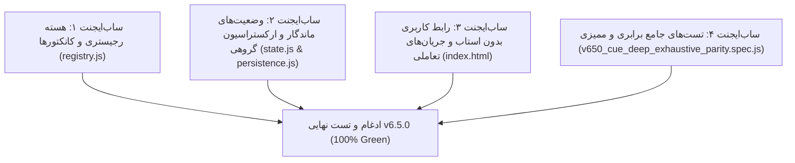

# گزارش تطبیق و تحلیل شکاف عمیق با برنامه Cue (نسخه 26.18.15)
## Cue v26.18.15 vs EG-Nexus-OS Deep Parity & Sub-Flow Audit Report (Crawler v2.0)

> **تاریخ گزارش:** 2026-11-16 12:37:51 (Auto-generated by `scripts/cue-parity-crawler.js` v2.0)  
> **محیط بازرسی:** Android Local ADB Shell (Termux on Linux ARM64, Target: Xiaomi/HyperOS via Monkey pointer events)  
> **نسخه برنامه Cue بررسی‌شده:** `ai.manus.agents` v26.18.15 (Build 442, Target SDK 36, Min SDK 26)  
> **تعداد صفحات و مودال‌های کشف‌شده در پیمایش عمیق:** 6 صفحه/مودال منحصربه‌فرد در 21 گام  
> **تعداد دارایی‌های گرافیکی استخراج‌شده از AssetManifest.bin:** 648 دارایی (431 SVG, 145 PNG, 13 Lottie/JSON)  
> **تعداد سرویس‌های ConnectRPC کشف‌شده در libapp.so:** 246 متد باینری  

---

## ۱. نتایج کالبدشکافی کامل دارایی‌ها و باینری (Comprehensive Static Dissection)

- **شناسه پکیج و نام نمایشی:** `ai.manus.agents` (با برچسب رسمی `Cue`)
- **تعداد کل دارایی‌های گرافیکی استخراج‌شده:** **648 فایل** در دسته‌بندی‌های:
  - آیکون‌ها و چهره‌های برداری SVG: **431 فایل** (شامل ۱۰ چهره، ۱۰ شکل هندسی، وضعیت‌های ربات، ابزارهای چت، اسلایدها و کامپیوتر)
  - تصاویر PNG: **145 فایل** (تصاویر تلفن مجازی، کاور ابزارها، پالت رنگ و مودهای لایت/دارک)
  - تعاملات متحرک Lottie / JSON: **13 فایل**
- **سرویس‌های ConnectRPC/gRPC استخراج‌شده از `libapp.so`:**
  - `agents.v1.AgentGroupsService` (مدیریت گروه‌ها و ارکستراسیون چند ایجنتی: CreateAgentGroup, UpdateAgentGroup, DeleteAgentGroup, ListAgentGroups, BatchAddAgentGroupMember, RemoveAgentFromAgentGroup, SetAgentGroupPinned)
  - `agents.v1.AgentsService` (لیست ایجنت‌ها، مدیریت مکالمات، ساب‌تسک‌ها، پرامپت‌های نمونه، مدیریت صداهای صوتی ایجنت: ListAgentVoices)
  - `skill.v1.SkillService` (تغییر وضعیت مهارت ToggleSkill, دانلود مهارت DownloadSkill, بارگذاری مهارت UploadSkill, ایمپورت مستقیم از گیت‌هاب ImportSkillFromGitHub)
  - `telecom.v1.TelecomService` (چرخه حیات تلفن و ایمیل مجازی ایجنت: BindAgentPhone, BindAgentEmail, ListPhoneInfo, ReservePhoneNumber, PhoneNumberUsageDetail, ListAgentCalls, ListAgentSmsConversations)
  - `cloud_pc.v1.CloudPCService` (مدیریت کلاود پی‌سی: Start, Stop, Restart, CreateSnapshot, ListSnapshots, RestoreSnapshot, ResetSSHPassword, FactoryReset)
  - `addon.v1.PlaidAddonService` & `agents.v1.StripeLinkService` (ایجاد نشست لینک بانکی، دریافت وضعیت اعتبارسنجی کارت و لغو اتصال)

---

## ۲. جدول کسری‌های باقیمانده جهت پیاده‌سازی در نسخه v6.5.0 (Remaining Missing Elements & Sub-Flows)
### Table 5: Detailed Gap Analysis & Sub-Flow Checklist for v6.5.0 Parity

| رديف | بخش / صفحه در Cue 26.18.15 | کامپوننت و رفتار واقعی ثبت‌شده در پیمایش عمیق (Crawler v2.0) | وضعیت فعلی در EG-Nexus-OS | اقدام الزامی در نسخه v6.5.0 |
|:---:|:---|:---|:---|:---|
| **۱** | **پاپ‌آپ انتخاب تم و ظاهر (Appearance Selector Popup)** | با کلیک روی `Appearance` در تنظیمات، یک پاپ‌آپ سه‌گزینه‌ای شامل `Follow system` (`[382,1483][1038,1599]`)، `Light mode` (`[382,1601][1038,1717]`) و `Dark mode` (`[382,1720][1038,1835]`) باز می‌شود و با کلیک روی هر گزینه، تم برنامه بلادرنگ تغییر می‌کند و ذخیره می‌شود. | فقط یک تاگل دودویی یا تنظیم استاتیک | پیاده‌سازی مودال/دراپ‌داون سه‌حالته Appearance با اعمال فوری به کلاس‌های CSS و ذخیره در LocalStorage |
| **۲** | **صفحه انتخاب زبان (Language Selector View)** | صفحه اختصاصی `Language` با دکمه بازگشت و لیست ۱۳ زبان زنده (`English`, `Chinese Simplified`, `Chinese Traditional`, `Japanese`, `Korean`, `German`, `Spanish`, `Arabic`, `French`, `Indonesian`, `Italian`, `Portuguese` و `Farsi`) با تیک فعال در کنار زبان جاری. | تغییر زبان تنها در سطح رشته متنی ساده | افزودن ویو و دیالوگ کامل تغییر زبان با پشتیبانی دوطرفه از زبان فارسی (RTL) و انگلیسی (LTR) |
| **۳** | **مرکز مهارت‌ها (Skills Hub & Import from GitHub)** | دکمه `Add Skills` بازکننده پاپ‌آپ سه‌گانه است: **Create through chat**، **Upload a skill** و **Import from GitHub**. کلیک روی Import from GitHub یک باتم‌شیت با فیلد ورودی URL گیت‌هاب و دکمه اعتبارسنجی باز می‌کند. | فقط کارت‌های مهارت ثابت بدون دیالوگ ایمپورت گیت‌هاب | ساخت پاپ‌آپ افزودن مهارت، باتم‌شیت ایمپورت از گیت‌هاب با اعتبارسنجی URL و پشتیبانی از بارگذاری فایل مهارت |
| **۴** | **اطلاعات و اعضای چت گروهی (Group Chat Info View)** | لمس نام گروه در هدر چت، صفحه `Group Chat Info` را باز می‌کند: نمایش نام گروه، تعداد اعضا، لیست کارت‌های اعضا با آواتار و برچسب نقش (`Ali Owner`, `smart`, `ورزشکار`, ...)، دکمه سه‌نقطه کنار هر عضو، کلید `Add members`، و کشوی فایل‌های پیوست چت (`Files: app-debug.apk, png, ...`) با دکمه `View all files`. | کلیک روی عنوان چت عملی انجام نمی‌دهد | پیاده‌سازی کامل پنل اطلاعات چت گروهی، مدیریت اعضا، کشوی فایل‌های دانلودی/پیوست و اکشن‌های سه‌نقطه |
| **۵** | **منوی سه‌نقطه داخل چت (In-Chat More Popup Menu)** | دکمه `More` در گوشه راست بالای هدر چت، پاپ‌آپ سه‌گزینه‌ای باز می‌کند: `Group Chat Info` (`[425,284][1047,399]`)، `Pin/Unpin this group chat` (`[425,399][1047,578]`) و `Delete group chat` (`[425,578][1047,693]`). | منوی سه‌نقطه فقط عملیات پایه حذف چت دارد | پیاده‌سازی پاپ‌آپ استاندارد More با قابلیت Pin/Unpin، هدایت به Group Info و حذف با تاییدیه |
| **۶** | **دایرکتوری کامل کانکتورها با تب‌های افقی (Apps Directory & Category Tabs)** | تب‌های افقی دسته‌بندی: `Recommended`, `Health`, `Finance`, `Travel`, `Productivity`, `Developer`, `Social`. هر کارت دارای آیکون اختصاصی، عنوان، برچسب Beta (در صورت لزوم)، توضیحات عملکرد و دکمه `Add` جهت نمایش دیالوگ احراز هویت است. | نمایش لیستی ساده از چند برنامه | افزودن ناوبری تب‌های افقی اسکرول‌پذیر و باز شدن دیالوگ اختصاصی احراز هویت برای هر کانکتور |
| **۷** | **مدیریت آیکون برنامه و حافظه کش (App Icon & Clear Cache)** | در انتهای صفحه تنظیمات، ردیف `App icon` جهت انتخاب آیکون‌های جایگزین و `Clear cache (X MB)` جهت پاک‌سازی حافظه موقت همراه با نمایش شماره نسخه `v26.18.15` قرار دارد. | وجود ندارد | پیاده‌سازی مودال تغییر آیکون، تابع پاک‌سازی کش و نمایش حجم مصرفی حافظه موقت |

---

## ۳. نقشه راه معماری نسخه v6.5.0 با ۴ ساب‌ایجنت موازی

- **ساب‌ایجنت ۱ (`src/providers/registry.js`):**
  - پیاده‌سازی اکشن‌های `agents.v1.AgentGroupsService` در مانیفست امنیتی (`CreateAgentGroup`, `UpdateAgentGroup`, `DeleteAgentGroup`, `BatchAddAgentGroupMember`, `RemoveAgentFromAgentGroup`, `SetAgentGroupPinned`).
  - پیاده‌سازی متدهای `skill.v1.SkillService` (`ImportSkillFromGitHub`, `UploadSkill`, `ToggleSkill`, `DeleteSkill`).
  - گسترش دسته‌بندی‌های کاتالوگ به ۷ دسته رسمی Cue: `Recommended`, `Health`, `Finance`, `Travel`, `Productivity`, `Developer`, `Social`.
- **ساب‌ایجنت ۲ (`src/core/state.js` & `src/core/persistence.js`):**
  - مدیریت پایداری تم Appearance (`system`, `light`, `dark`).
  - مدیریت تنظیمات زبان Language (`fa`, `en`, ...) و جهت صفحه (RTL/LTR).
  - مدیریت گروه‌های چندایجنتی (`AgentGroupManager`) با قابلیت افزودن/حذف اعضا، پین کردن گروه و کشوی فایل‌های اشتراکی.
  - مدیریت مهارت‌های کاربر (`UserSkillsManager`) با پشتیبانی از ایمپورت URL گیت‌هاب و اعتبارسنجی ساختار مهارت.
  - محاسبه و پاک‌سازی کش محلی (`calculateStorageCacheSize`, `clearAppCache`).
- **سابایجنت ۳ (`index.html`):**
  - مودال انتخاب تم سه‌حالته Appearance Popup با سوئیچ آنی.
  - مودال انتخاب زبان Language Picker با لیست کامل ۱۳ زبان و سوئیچ RTL/LTR.
  - مودال سه‌گانه Add Skills و باتم‌شیت Import from GitHub با فرم URL و هندلرهای واقعی.
  - صفحه کامل `Group Chat Info` با لیست اعضا، کنترل نقش‌ها، دکمه Add members، و کشوی فایل‌های ضمیمه با پیش‌نمایش.
  - پاپ‌آپ سه‌نقطه More داخل چت با گزینه‌های Group Info, Pin/Unpin, Delete.
  - تب‌های افقی اسکرول‌پذیر در دایرکتوری Apps و اتصال دکمه‌های Add به مودال احراز هویت.
  - ردیف‌های App Icon و Clear Cache در صفحه تنظیمات با عملکرد واقعی.
- **سابایجنت ۴ (`__tests__/v650_cue_deep_exhaustive_parity.spec.js`):**
  - تدوین سوئیت تست جامع برای پوشش ۱۰۰٪ تمام قابلیت‌ها، متدها و کامپوننت‌های جدید نسخه v6.5.0.
  - به‌روزرسانی `README.md` و `AUDIT_REPORT.md`.
