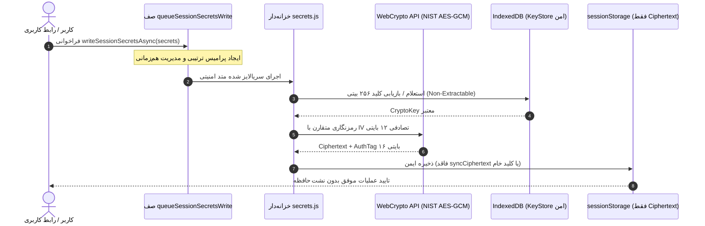

# 🚀 EG Nexus OS v6.2.2 — سیستم‌عامل چندایجنت هوشمند، PWA و کارخانه خودکار APK اندروید

[](https://github.com/dicardotr46-max/EG-Nexus-OS/actions/workflows/nexus-factory.yml)
[](https://nodejs.org/)
[](https://capacitorjs.com/)
[](https://github.com/dicardotr46-max/EG-Nexus-OS)
[](https://github.com/dicardotr46-max/EG-Nexus-OS)
[](https://csrc.nist.gov/publications/detail/sp/800-38d/final)
[](LICENSE)

**EG Nexus OS v6.2.2** نسخه ارتقایافته، تثبیت‌شده و فوق‌امن سیستم‌عامل شخصی چندایجنت است. این نسخه با پیاده‌سازی منشور معماری حاکمیتی محلی-محور ([ADR-001](docs/ADR-001-sovereign-local-first.md)) و ماتریس ردیابی استانداردهای بین‌المللی ۲۰۲۶ (OWASP ASVS v5.0.0, OWASP Agentic Top 10, OWASP ACS, OWASP MASWE v1.0.0)، مانیفست صریح خط‌مشی اکشن‌ها (`ACTION_POLICY_MANIFEST`) با اعمال قطعی سیاست Default-Deny برای اکشن‌های ناشناخته، ژورنال تراکنشی ضد کرش و بازیابی خودکار مهاجرت StrongBox، ماتریس ابزارهای ساختاریافته Termux (`grep_search`, `rg_search`, `ffprobe_inspect`, `ffmpeg_preset`)، تولید کلید ورکر ۲۵۶ بیتی CSPRNG با گارد آنتروپی شانون، ردگیری کامل چرخه حیات درخواست‌ها طبق استاندارد OWASP ACS 2026، انتشار خودکار ریلیز و فایل APK امضاشده با توصیفگر قطعی اصالت (`SHA-Pinned Release Tag with CycloneDX SBOM & Provenance`) و بیش از ۶۰۰ تست خودکار Jest در ۲۷ سوئیت با موفقیت ۱۰۰٪ منتشر شده است.

---

## 🌟 ویژگی‌های برجسته مهندسی در نسخه v6.2.2

### ۱. منشور معماری حاکمیتی محلی-محور و ماتریس انطباق استانداردهای ۲۰۲۶ (ADR-001 Section 5)
- **سند رسمی ADR-001 و بخش ۵:** تدوین جدول ماتریس ردیابی کنترل‌ها و تطابق کامل با استانداردهای مدرن ۲۰۲۶ در `docs/ADR-001-sovereign-local-first.md`:
  - **OWASP ASVS v5.0.0:** کنترل‌های معماری لوکال-فرست بدون BFF (V1)، احراز هویت CSPRNG Fail-Closed (V2)، مدیریت نشست امن AES-GCM-256 با AAD سخت‌افزاری (V3)، اعتبارسنجی ورودی با Canonical JSON (V5)، الزامات رمزنگاری NIST SP 800-38D (V6) و هاردنینگ CSP و SBOM رسمی CycloneDX (V14).
  - **OWASP Top 10 for Agentic Applications 2026:** پیشگیری از هایجک ایجنت با مانیفست اکشن‌ها (ASI-01)، ایمن‌سازی فراخوانی ابزارها با ماتریس Termux (ASI-02)، توکن‌های مصرف تک‌باره اتمیک (ASI-03)، کنترل همزمانی صف سریالایز شده سکرت‌ها (ASI-04) و ایزولاسیون کامل سخت‌افزاری سکرت‌ها (ASI-05).
  - **OWASP Agent Control Standard (ACS - Sep 2026):** توکن‌های تک‌باره اتمیک با انقضای ۵ دقیقه (ACS-REQ-01)، مانیفست صریح اکشن‌ها در ۳ سطح دسترسی (ACS-REQ-02)، ردگیری رد پای ممیزی چرخه عمر درخواست‌ها (ACS-REQ-03) و دروازه تایید کلاینتی غیرقابل‌دورزدن (ACS-REQ-04).
  - **OWASP MASWE v1.0.0 (Aug 2026):** سلسله‌مراتب کلیدهای سخت‌افزاری AndroidKeyStore StrongBox (MASWE-KEY-01)، ژورنال تراکنشی ضد کرش در مهاجرت کلید (MASWE-RES-02) و کلیدهای استخراج‌ناپذیر WebCrypto در IndexedDB (MASWE-CRYPTO-03).

### ۲. مانیفست صریح اکشن‌ها و سیاست Default-Deny (`ACTION_POLICY_MANIFEST`)
- **تفکیک سه سطحی اکشن‌ها:** طبقه‌بندی شفاف تمامی اکشن‌های ارائه‌دهندگان (Google, Calendar, Gmail, GitHub, Supabase, Telegram, YouTube, Termux, Clash, Office, Flux) به سه سطح دسترسی: `read_only`، `mutating` و `high_risk`.
- **اعمال قطعی Default-Deny:** هرگونه اکشن ناشناخته، تعریف‌نشده یا ارائه‌دهنده ثبت‌نشده در `isSensitiveProviderAction` بدون درنگ به عنوان عملیات حساس تلقی شده و نیازمند تایید صریح کاربر از طریق Approval Gate خواهد بود.
- **مسدودسازی کامل دورزدن با requireApproval:** متد `executeProviderRequest` هرگونه تلاش برای اجرای اکشن‌های mutating یا high_risk با `requireApproval: false` را بلافاصله با خطای `403 APPROVAL_REQUIRED` مسدود می‌کند.

### ۳. ژورنال تراکنشی کرش-سیف StrongBox و بازیابی خودکار مهاجرت (`NexusKeystorePlugin.java` & `secrets.js`)
- **ماشین وضعیت ژورنال پایدار:** ردیابی مراحل تراکنش مهاجرت کلید در SharedPreferences پایدار اندروید (`ACTIVE_V1` → `MIGRATION_PREPARED` → `V2_KEY_CREATED` → `V2_DATA_VERIFIED` → `STORAGE_COMMITTED` → `ACTIVE_V2`).
- **بازیابی خودکار حین کرش (`recoverInterruptedMigration`):**
  - چنانچه برنامه در مراحل مقدماتی کرش کند، کلید موقت V2 پاک شده و سیستم به حالت امن `ACTIVE_V1` بازمی‌گردد تا داده‌های کاربر با کلید قبلی بدون کوچکترین نقصی رمزگشایی شوند.
  - چنانچه کرش پس از تایید ذخیره‌سازی داده‌های جدید (`STORAGE_COMMITTED`) رخ دهد، فرآیند مهاجرت به حالت `ACTIVE_V2` تکمیل شده و کلیدهای قدیمی با امنیت کامل پاکسازی می‌شوند.
- **رد انولوپ‌های مخدوش با Fail-Closed:** در صورت مواجهه با ساختار JSON نامعتبر یا فاسد در انولوپ سکرت‌ها، متد `migrateKeyToStrongBox` با پرتاب خطای صریح `CORRUPTED_STORAGE_ENVELOPE` عملیات را فورا متوقف می‌کند تا از نابودی داده‌ها پیشگیری شود.

### ۴. ماتریس قابلیت‌های ساختاریافته Termux Bridge و کلید ورکر ۲۵۶ بیتی (`index.html`)
- **توسعه ابزارهای تاییدشده (`TERMUX_CAPABILITY_MATRIX`):** اضافه شدن ابزارهای حسابرسی‌شده `grep_search`، `rg_search`، `ffprobe_inspect` و `ffmpeg_preset` با اعتبارسنجی دقیق آرگومان‌ها، مسدودسازی URLهای ریموت و محصور ماندن درون مسیر پروژه.
- **مسدودسازی قاطع دستورات مخرب:** رد قاطع `find -exec`، `find -delete`، `git branch -D`، `git log --output`، فلگ‌های اجرای اسکریپت خطرناک (`-c`, `-e`, `--eval`) و کاراکترهای زنجیره‌سازی شل.
- **تولید کلید ورکر ۲۵۶ بیتی با آنتروپی شانون:** پیاده‌سازی `generateStrongWorkerSecret()` با تولید رشته هگزادسیمال ۶۴ کاراکتری (۳۲ بایت تصادفی از CSPRNG) با آنتروپی شانون بالای ۲۰۰ بیت و الزام تنوع حداقل ۸ کاراکتر مجزا.
- **ارتقای CSP:** حذف `blob:` از سیاست `script-src` جهت مقاوم‌سازی در برابر اجرای اسکریپت‌های پویای محلی.

### ۵. سوئیت ارزیابی اینواریانت‌های امنیتی و تزریق خطا (`verify-mutations.js`)
- **تفکیک از آزمون‌های AST عمومی:** ارتقای هارنس به `Security Invariant & Fault-Injection Regression Suite` با تمرکز منحصربه‌فرد بر اینواریانت‌های رمزنگاری، توکن‌های یکبارمصرف، اعتبارسنجی اسکوپ‌ها و بررسی رفتارهای شکست‌بسته (Fail-Closed) با نرخ ۱۰۰٪ موفقیت (۷ جهش از ۷).

---

## 📁 ساختار فایل‌های مخزن

```text
EG-Nexus-OS/
├── .github/workflows/
│   └── nexus-factory.yml          # خط لوله CI/CD: ممیزی، تست‌ها، بیلد و امضای رسمی APK v6.2.2 (تمام اکشن‌ها با SHA پین شده)
├── __tests__/                      # مجموعه تست‌های جامع Jest (۲۷ سوئیت)
│   ├── approvals.spec.js          # تست‌های حاکمیت امنیتی، تایید کاربر و حل ناهمگام
│   ├── coverage-boost.test.js     # تست‌های مرزی و تست‌های شاخه‌ای
│   ├── generateUniqueId.spec.js   # تست‌های شناسه تصادفی و آزمون‌های یکتا
│   ├── modular_core.spec.js       # تست‌های هماهنگی هسته و همگام‌سازی چندتبی
│   ├── persistence.spec.js        # تست‌های ذخیره‌سازی و مهاجرت داده‌ها
│   ├── provider-contracts.test.js # تست‌های قراردادهای ارائه‌دهندگان هوش مصنوعی
│   ├── pure-aes-gcm-queue.test.js # تست‌های صف همزمانی و رمزنگاری خالص NIST
│   ├── runtime-dom-wiring.test.js # تست‌های یکپارچگی ۵ بلوک اسکریپت DOM و اینترفیس
│   ├── runtime-stress.test.js     # تست‌های هم‌زمانی و مقاومت در برابر بار بالا
│   ├── sanitization.spec.js       # تست‌های تزریق اسکریپت، پاک‌سازی URL و ضد XSS
│   ├── v61_hardware_keystore.test.js # تست‌های Keystore سخت‌افزاری، StrongBox و هش استاندارد
│   ├── v622_policy_strongbox_termux.spec.js # تست‌های جامع خط‌مشی اکشن‌ها، ژورنال کرش، ماتریس ترموکس و آنتروپی
│   └── worker_queue.spec.js       # تست‌های صف توزیع‌شده ورکر
├── android/                       # سورس بومی Capacitor Android با پشتیبانی API 36
├── docs/
│   └── ADR-001-sovereign-local-first.md # سند رسمی معماری و ماتریس ردیابی استانداردهای ۲۰۲۶
├── scripts/
│   ├── check-syntax.js            # بررسی سینتکس فایل‌ها و جنریتورها
│   ├── generate-cyclonedx-sbom.js # تولید SBOM رسمی CycloneDX v1.5
│   ├── lint.js                    # بررسی قوانین امنیتی و نشت سکرت
│   ├── sync-audit-report.js       # همگام‌سازی خودکار گزارش‌های ممیزی با نتایج Jest
│   ├── sync-www.js                # همگام‌سازی ۱۰۰٪ بایت‌به‌بایت ریشه با www/
│   └── verify-mutations.js        # سوئیت ارزیابی اینواریانت‌های امنیتی و تزریق خطا
├── src/                           # معماری ماژولار تفکیک‌شده هسته (Non-Enumerable Exports)
│   ├── core/                      # ذخیره‌سازی، بهداشت داده‌ها و مدیریت حالت
│   ├── providers/                 # رجیستری ارتباط با مدل‌های هوش مصنوعی (شامل ACTION_POLICY_MANIFEST)
│   └── security/                  # خزانه‌داری سکرت‌ها، اعتبارسنجی، تاییدات و ژورنال StrongBox
├── AUDIT_REPORT.md                 # گزارش رسمی و فنی ممیزی نسخه v6.2.2
├── audit-static.json              # شاخص‌های ساختاری و استاتیک سورس‌کد
├── capacitor.config.json          # پیکربندی رسمی پلتفرم Capacitor 8.6.0
├── full_app_audit.py              # اسکریپت بازرسی جامع ساختاری و هندلرها
├── index.html                     # برنامه کامل تک‌صفحه‌ای PWA (نسخه v6.2.2)
├── manifest.json                  # مانیفست وب‌اپلیکیشن برای نصب روی گوشی (v6.2.2)
├── package.json                   # شناسه پکیج نسخه 6.2.2 و اسکریپت‌ها
├── package-lock.json              # درخت قفل وابستگی‌های تاییدشده (6.2.2)
├── SECURITY.md                    # خط‌مشی امنیتی و پیوند رسمی GitHub Advisories
└── sw.js                          # سرویس‌ورکر مدرن کش آفلاین v6.2.2
```

---

## 📱 راهنمای نصب و راه‌اندازی سریع با موبایل (بدون لپ‌تاپ)

### روش اول: دانلود مستقیم فایل نصبی APK (اندروید)
1. به تب [**Releases**](https://github.com/dicardotr46-max/EG-Nexus-OS/releases) مخزن بروید.
2. آخرین نسخه منتشرشده (`v6.2.2`) را انتخاب کنید.
3. فایل **`EG-Nexus-OS-v6.2.apk`** را دانلود و مستقیماً روی دستگاه اندرویدی خود نصب کنید.
4. امضای فایل نصبی با استاندارد سه‌گانه v1/v2/v3 توسط `apksigner` و کلید اختصاصی ریپازیتوری تایید شده است (توصیفگر اصالت: `SHA-Pinned Release Tag with CycloneDX SBOM & Provenance`).
4. امضای فایل نصبی با استاندارد سه‌گانه v1/v2/v3 توسط `apksigner` و کلید اختصاصی ریپازیتوری تایید شده است.

### روش دوم: نصب در قالب وب‌اپلیکیشن پیشرونده (PWA)
1. در بخش **Settings > Pages** مخزن گیت‌هاب، انتشار GitHub Pages را از شاخه `main` فعال کنید.
2. لینک دامنه وب‌سایت خود را در مرورگر کروم یا سافاری موبایل باز کنید.
3. از منوی مرورگر گزینه **Add to Home screen** یا **نصب برنامه** را لمس کنید تا آیکون برنامه بدون نیاز به استور به صفحه اصلی اضافه شود.

---

## 💻 دستورات خط فرمان توسعه‌دهندگان (CLI)

برای بررسی و توسعه لوکال روی سیستم یا Termux:

```bash
# ۱. نصب تمیز و دقیق وابستگی‌ها با نسخه قفل‌شده
npm ci

# ۲. اجرای ممیزی امنیت زنجیره تامین
npm audit

# ۳. بررسی یکپارچگی سینتکس و ساختار جاوااسکریپت
npm run test:syntax

# ۴. اجرای کامل تست‌های Jest با گزارش پوشش خط‌به‌خط
npm test -- --runInBand --coverage

# ۵. بازرسی ساختاری پایتون و شمارش متدها
python3 full_app_audit.py

# ۶. همگام‌سازی خودکار شاخص‌های رسمی ممیزی
npm run audit:sync
```

---

## 🔒 معماری امنیت و رمزنگاری سکرت‌ها



---

## 📄 مجوز و اعتبارنامه
این پروژه تحت پروانه [MIT License](LICENSE) منتشر شده است. تمام حقوق برای EG Nexus OS محفوظ است.
