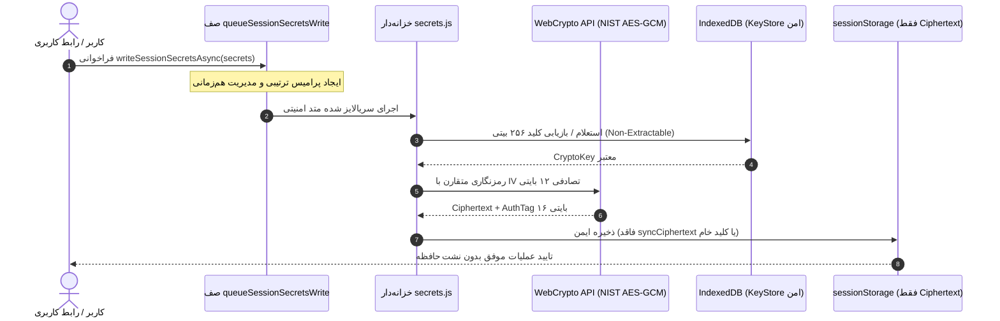

# 🚀 EG Nexus OS v5.7 — سیستم‌عامل چندایجنت هوشمند، PWA و کارخانه خودکار APK اندروید

[](https://github.com/amirrezas/EG-Nexus-OS/actions/workflows/nexus-factory.yml)
[](https://nodejs.org/)
[](https://capacitorjs.com/)
[](https://github.com/amirrezas/EG-Nexus-OS)
[](https://github.com/amirrezas/EG-Nexus-OS)
[](https://csrc.nist.gov/publications/detail/sp/800-38d/final)
[](LICENSE)

**EG Nexus OS v5.7.0** نسخه ارتقایافته، تثبیت‌شده و فوق‌امن سیستم‌عامل شخصی چندایجنت است. این نسخه با حذف کامل آلودگی فضای نام سراسری (Non-Enumerable Proxy Registration با `Object.defineProperty`)، تک‌منبعی کردن کلیدهای ذخیره‌سازی (`STORAGE_KEYS`) در هسته سیستم، ایزوله‌سازی پیشرفته کلیدهای سشن در حافظه بر پایه `Symbol` و `IndexedDB` بدون نشت بذر کلید در دیسک، حذف قطعی `Math.random()` و جایگزینی با CSPRNG صلب شکست‌بسته (Fail-Closed)، ایمن‌سازی لایه پاک‌سازی ورودی‌ها علیه دور زدن کاراکترهای کنترلی و فرار Template Literals، پین‌کردن ۴۰ کاراکتری تمام اکشن‌های خط لوله CI/CD با کش‌گذاری دوگانه (NPM و Gradle)، حذف افشای پسورد در دستورات ساخت و بیش از **۳۵۷ تست خودکار Jest** با آستانه پوشش بالا منتشر شده است.

---

## 🌟 ویژگی‌های برجسته مهندسی در نسخه v5.7.0

### ۱. تک‌منبعی شدن کلیدهای ذخیره‌سازی و مهار آلودگی فضای نام سراسری
- **تک‌منبعی سازی `STORAGE_KEYS`:** تمامی کلیدهای سراسری ذخیره‌سازی منحصراً در `src/core/state.js` به عنوان Single Source of Truth متمرکز شده و سایر ماژول‌ها (`persistence.js`، `sanitization.js`، `approvals.js`، `secrets.js`) آن را به صورت امن از شیء هسته یا فضای سراسری استعلام می‌کنند.
- **جلوگیری از آلودگی `window` (Non-Enumerable Registration):** در تابع `syncNexusCore` تمام متدها و پراپرتی‌های عمومی با متد استاندارد `Object.defineProperty` و فلگ `enumerable: false` روی شیء سراسری تعریف می‌شوند تا از آلوده‌شدن خروجی `Object.keys(window)` جلوگیری شده و در عین حال سازگاری ۱۰۰٪ با کدهای سنتی و دسترسی‌های مستقیم حفظ گردد.
- **مدیریت استثنا و پشتیبانی کامل Async در گیت تایید کاربر (`resolveApprovalGate`):** پشتیبانی از فراخوانی‌های ناهمگام، بازنشانی ایمن نشانگر `_isResolvingApproval` در بلاک `finally`، و هندلینگ بدون خطای کال‌بک‌های `onApprove` و `onReject`.

### ۲. حفاظت کریپتوگرافی صلب و کلیدهای درون‌حافظه‌ای مبتنی بر Symbol
- **حذف کامل نشت بذر کلید در دیسک:** هرگونه ذخیره بذر کلید سشن (`nexus_session_key_seed_v1` یا `SESSION_SECRETS_KEY_sk`) در `localStorage` یا `sessionStorage` حذف شده و کلید مشتق‌شده سشن منحصراً در حافظه رم با نماد پنهان `Symbol.for('eg.nexus.session.key.v1')` روی شیء Storage و در `IndexedDB` با فلگ امنیتی `extractable: false` نگهداری می‌شود.
- **جایگزینی کامل `Math.random()` با Fail-Closed CSPRNG:** تمامی فراخوانی‌های تصادفی ضعیف از کل ماژول‌های امنیتی حذف شده و تابع `_fillSecureRandomBytes` پیاده‌سازی شده است که در صورت در دسترس نبودن منابع امنیتی تصادفی استاندارد (`crypto.getRandomValues` و `nodeCrypto.randomBytes`)، بلافاصله خطای Fail-Closed پرتاب می‌کند.
- **مسدودسازی قطعی آسیب‌پذیری تنزل الگوریتم (Algorithm Downgrade):** تمامی پی‌لودهای سکرت‌ها منحصراً باید دارای ساختار معتبر و استاندارد NIST SP 800-38D AES-GCM-256 با تگ اصالت ۱۶ بایتی باشند؛ هرگونه پی‌لود نامعتبر یا تلاش برای بارگذاری فیلدهای منسوخ با قرنطینه‌سازی فوری متوقف می‌شود.

### ۳. صف هم‌زمانی ترتیبی سکرت‌ها و ارتقای کامل هندلرهای UI به Async
- **صف ترتیبی `queueSessionSecretsWrite`:** حفاظت قطعی در برابر شرایط مسابقه (Race Condition) هنگام فراخوانی‌های هم‌زمان چندگانه از بخش‌های مختلف سیستم با استفاده از زنجیره پرامیس ترتیبی و بررسی یکنواختی نسخه نوشتن (`writeRevision`).
- **مهاجرت تمام هندلرهای رابط کاربری به توابع ناهمگام:** تمامی فراخوانی‌های ذخیره و بازیابی سکرت‌ها و اتصال/قطع ارائه‌دهندگان هوش مصنوعی به متدهای `await readSessionSecretsAsync()` و `await writeSessionSecretsAsync()` ارتقا یافته‌اند.

### ۴. ایمن‌سازی لایه پاک‌سازی ورودی‌ها و دفاع چندلایه‌ای ضد XSS
- **مقاوم‌سازی `sanitizeSafeUrl`:** حذف کاراکترهای کنترلی مخفی و فاصله‌های عرض-صفر (`\u0000-\u001F`, `\u007F`, `\u200B-\u200D`, `\uFEFF`) و مسدودسازی کامل پروتکل‌های نامعتبر نظیر `javascript:`, `data:`, `vbscript:`, `file:`, `blob:`.
- **ارتقای `escapeJsAttr`:** فرار کاراکترهای بک‌تیک (`` ` ``)، علامت دلار (`$`) و کاراکترهای شکست خط یونیکد (`\r`, `\n`, `\u2028`, `\u2029`) جهت جلوگیری قطعی از تزریق عبارت در Template Literals جاوااسکریپت.
- **زدودن تگ‌های تودرتو در `sanitizeUntrustedWebSnippet`:** استفاده از حلقه بازگشتی `do-while` برای پالایش کامل تگ‌های تو در تو نظیر `<untrusted_web_data<untrusted_web_data>>` و مسدودسازی تگ‌های سیستمی و تزریق مهندسی پرامپت ایجنت‌ها.

### ۵. سخت‌سازی خط لوله CI/CD و انتشارات تغییرناپذیر (Immutable Tags)
- **پین کردن SHA چهل‌کاراکتری تمام اکشن‌ها:** تمام اکشن‌های خط لوله گیت‌هاب اکشنز با تعهد به استانداردهای امنیتی SLSA به هش کامل کامیت پین شده‌اند (`owner/repo@<40-char-sha> # vX.Y.Z`).
- **فعال‌سازی کش NPM و Gradle:** اضافه شدن `cache: 'npm'` در گام Node.js و `cache: 'gradle'` در گام جاوا برای بهینه‌سازی سرعت و پایداری فرآیند بیلد.
- **حذف نشت پسورد در آرگومان‌های CLI:** دستور `apksigner sign` منحصراً از سینتکس امن متغیر محیطی `env:ANDROID_KEYSTORE_PASSWORD` استفاده می‌کند تا هیچ رشته حساسی در تاریخچه پروسه‌ها یا لاگ‌های سیستم افشا نشود.
- **تگ‌گذاری مصون در برابر خطا (Idempotent Tagging):** پایپ‌لاین انتشار با بررسی وجود تگ روی ریموت از طریق `git ls-remote`، امکان اجرای مجدد موفق و بدون خطای `workflow_dispatch` را تضمین می‌کند.

### ۶. مجموعه تست‌های جامع ۳۵۷+ تایی با پوشش بالا
- بیش از **۳۵۷ تست خودکار Jest** در ۱۷ سوئیت تست مجزا با ۱۰۰٪ قبولی و بدون هیچ شکستگی رفتاری.
- آستانه پوشش کد (Coverage Gate) در بالاترین سطح کیفی:
  - **پوشش توابع (Functions):** > ۹۵.۷٪ (حداقل الزامی: ۸۵٪)
  - **پوشش خطوط (Lines):** > ۹۳.۳٪ (حداقل الزامی: ۸۵٪)
  - **پوشش دستورات (Statements):** > ۹۲.۶٪ (حداقل الزامی: ۸۵٪)
  - **پوشش شرط‌ها (Branches):** > ۸۰.۱٪ (حداقل الزامی: ۸۰٪)

---

## 📁 ساختار فایل‌های مخزن

```text
EG-Nexus-OS/
├── .github/workflows/
│   └── nexus-factory.yml          # خط لوله CI/CD: ممیزی، تست‌ها، بیلد و امضای رسمی APK (تمام اکشن‌ها با SHA پین شده)
├── __tests__/                      # مجموعه تست‌های ۳۵۷+ تایی Jest (۱۷ سوئیت)
│   ├── approvals.spec.js          # تست‌های حاکمیت امنیتی، تایید کاربر و حل ناهمگام
│   ├── coverage-boost.test.js     # تست‌های مرزی و تست‌های شاخه‌ای
│   ├── generateUniqueId.spec.js   # تست‌های شناسه تصادفی و آزمون‌های یکتا
│   ├── modular_core.spec.js       # تست‌های هماهنگی هسته و همگام‌سازی چندتبی
│   ├── persistence.spec.js        # تست‌های ذخیره‌سازی و مهاجرت داده‌ها
│   ├── provider-contracts.test.js # تست‌های قراردادهای ارائه‌دهندگان هوش مصنوعی
│   ├── pure-aes-gcm-queue.test.js # تست‌های صف همزمانی و رمزنگاری خالص NIST
│   ├── runtime-dom-wiring.test.js # تست‌های یکپارچگی هندلرهای DOM و اینترفیس
│   ├── runtime-stress.test.js     # تست‌های هم‌زمانی و مقاومت در برابر بار بالا
│   ├── sanitization.spec.js       # تست‌های تزریق اسکریپت، پاک‌سازی URL و ضد XSS
│   ├── secrets-reload.test.js     # تست‌های ماندگاری رمزنگاری پس از ریلود در حافظه
│   ├── security.spec.js           # تست‌های AES-GCM و امنیت سشن
│   ├── subagent1-architecture.test.js # تست‌های معماری و تک‌منبعی STORAGE_KEYS
│   ├── subagent2-coverage.test.js # تست‌های پوشش آزمون‌های مکمل کریپتوگرافی
│   ├── sw.spec.js                 # تست‌های کش آفلاین Service Worker
│   ├── v57_audit_sanitization_security.spec.js # تست‌های تخصصی ممیزی امنیتی v5.7
│   └── worker_queue.spec.js       # تست‌های صف پردازش وظایف ورکر
├── scripts/
│   └── sync-audit-report.js       # اسکریپت همگام‌ساز خودکار گزارش ممیزی با داده‌های واقعی Jest
├── src/                            # معماری ماژولار تفکیک‌شده هسته (Non-Enumerable Exports)
│   ├── core/                      # ذخیره‌سازی، بهداشت داده‌ها و مدیریت حالت
│   ├── providers/                 # رجیستری ارتباط با مدل‌های هوش مصنوعی
│   └── security/                  # خزانه‌داری سکرت‌ها، اعتبارسنجی و تاییدات
├── AUDIT_REPORT.md                 # گزارش رسمی و فنی ممیزی نسخه v5.7.0
├── audit-static.json              # شاخص‌های ساختاری و استاتیک سورس‌کد
├── capacitor.config.json          # پیکربندی رسمی پلتفرم Capacitor 8.6.0
├── full_app_audit.py              # اسکریپت بازرسی جامع ساختاری و هندلرها
├── index.html                     # برنامه کامل تک‌صفحه‌ای PWA
├── manifest.json                  # مانیفست وب‌اپلیکیشن برای نصب روی گوشی
├── package.json                   # شناسه پکیج نسخه 5.7.0 و اسکریپت‌ها
├── package-lock.json              # درخت قفل وابستگی‌های تاییدشده
└── sw.js                          # سرویس‌ورکر مدرن کش آفلاین
```

---

## 📱 راهنمای نصب و راه‌اندازی سریع با موبایل (بدون لپ‌تاپ)

### روش اول: دانلود مستقیم فایل نصبی APK (اندروید)
1. به تب [**Releases**](https://github.com/amirrezas/EG-Nexus-OS/releases) مخزن بروید.
2. آخرین نسخه منتشرشده (`v5.7.0` یا تگ متحرک `latest-apk`) را انتخاب کنید.
3. فایل **`EG-Nexus-OS-v5.7.apk`** را دانلود و مستقیماً روی دستگاه اندرویدی خود نصب کنید.
4. امضای فایل نصبی با استاندارد سه‌گانه v1/v2/v3 توسط `apksigner` و کلید اختصاصی ریپازیتوری تایید شده است.

### روش دوم: نصب در قالب وب‌اپلیکیشن پیشرونده (PWA)
1. در بخش **Settings > Pages** مخزن گیت‌هاب، انتشار GitHub Pages را از شاخه `main` فعال کنید.
2. لینک دامنه وب‌سایت خود را در مرورگر کروم یا سافاری موبایل باز کنید.
3. از منوی مرورگر گزینه **Add to Home screen** یا **نصب برنامه** را لمس کنید تا آیکون برنامه بدون نیاز به استور به صفحه اصلی اضافه شود.

---

## 💻 دستورات خط فرمان توسعه‌دهندگان (CLI)

برای بررسی و توسعه لوکال روی سیستم یا Termux:

```bash
# ۱. نصب تمیز و دقیق وابستگی‌ها با نسخه قفل‌شده
npm ci

# ۲. اجرای ممیزی امنیت زنجیره تامین
npm audit

# ۳. بررسی یکپارچگی سینتکس و ساختار جاوااسکریپت
npm run test:syntax

# ۴. اجرای کامل تست‌های Jest با گزارش پوشش خط‌به‌خط
npm test -- --runInBand --coverage

# ۵. بازرسی ساختاری پایتون و شمارش متدها
python3 full_app_audit.py

# ۶. همگام‌سازی خودکار شاخص‌های رسمی ممیزی
npm run audit:sync
```

# ۳. بررسی یکپارچگی سینتکس و ساختار جاوااسکریپت
npm run test:syntax

# ۴. اجرای کامل تست‌های Jest با گزارش پوشش خط‌به‌خط
npm test -- --runInBand --coverage

# ۵. بازرسی ساختاری پایتون و شمارش متدها
python3 full_app_audit.py

# ۶. همگام‌سازی خودکار شاخص‌های رسمی ممیزی
npm run audit:sync
```

---

## 🔒 معماری امنیت و رمزنگاری سکرت‌ها



---

## 🧩 نمونه استفاده از گذرگاه پلاگین (`window.NexusBus`)

برای توسعه ماژول‌های دلخواه بدون دستکاری هسته اصلی:

```javascript
window.NexusBus.registerPlugin({
  id: 'my-custom-plugin',
  name: 'پلاگین آزمایشی من',
  version: '1.0.0',
  init(ctx) {
    ctx.on('custom:ping', (payload) => {
      ctx.showToast('پلاگین پیام را دریافت کرد: ' + payload.text);
    });
  }
});
```

---

## 📄 مجوز و اعتبارنامه
این پروژه تحت پروانه [MIT License](LICENSE) منتشر شده است. تمام حقوق برای EG Nexus OS محفوظ است.
