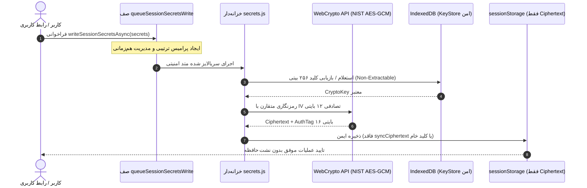

# 🚀 EG Nexus OS v5.6 — سیستم‌عامل چندایجنت هوشمند، PWA و کارخانه خودکار APK اندروید

[](https://github.com/amirrezas/EG-Nexus-OS/actions/workflows/nexus-factory.yml)
[](https://nodejs.org/)
[](https://capacitorjs.com/)
[](https://github.com/amirrezas/EG-Nexus-OS)
[](https://github.com/amirrezas/EG-Nexus-OS)
[](https://csrc.nist.gov/publications/detail/sp/800-38d/final)
[](LICENSE)

**EG Nexus OS v5.6.0** نسخه ارتقایافته، ماژولار و فوق‌امن سیستم‌عامل شخصی چندایجنت است. این نسخه با بازطراحی کامل معماری هسته در پوشه `src/`، استفاده انحصاری از رمزنگاری خالص **NIST SP 800-38D AES-GCM-256** بدون فیلدهای سازگاری ناامن، صف ترتیبی هم‌زمانی `queueSessionSecretsWrite`، تضمین ۱۰۰٪ سازگاری نصب تمیز با دستور `npm ci`، مجموعه تست‌های خودکار **۲۹۵+ تایی Jest** و پایپ‌لاین انتشار دوگانه با تگ‌های تغییرناپذیر (Immutable Tags) منتشر شده است.

---

## 🌟 ویژگی‌های برجسته مهندسی در نسخه v5.6.0

### ۱. معماری ماژولار و تفکیک دامنه‌ها (`src/`)
کدهای حیاتی سیستم از ساختار تک‌فایلی قدیمی به ماژول‌های مستقل با قابلیت تست واحد، ممیزی استاتیک و بازاستفاده در دامنه‌های زیر ساختاربندی شده‌اند:
- **`src/core/`**:
  - `persistence.js`: کلیدهای ذخیره‌سازی یکپارچه (`STORAGE_KEYS`)، مهاجرت خودکار داده‌های قدیمی به `eg_nexus_os_v5_master_state` و ذخیره‌سازی تراکنشی اتمیک.
  - `sanitization.js`: دفاع چندلایه‌ای تزریق اسکریپت (XSS Protection) و فیلترینگ ورودی‌ها در سطح استانداردهای DOMPurify.
  - `state.js`: مدیریت حالت متمرکز، همگام‌سازی یکنواخت (Monotonic Multi-Tab Sync) و BroadcastChannel بین تب‌های مرورگر.
- **`src/providers/`**:
  - `registry.js`: قراردادهای انتزاعی ارائه‌دهندگان هوش مصنوعی (Google Gemini, OpenAI, Anthropic, OpenRouter, Groq, DeepSeek, Local Ollama).
- **`src/security/`**:
  - `approvals.js`: موتور حاکمیت امنیتی، اعطای دسترسی مبتنی بر نقش (RBAC) و اخذ تاییدیه صریح کاربر برای عملیات حساس.
  - `secrets.js`: خزانه‌داری رمزنگاری‌شده توکن‌ها و کلیدهای محرمانه با طول عمر سشن و جداسازی کامل از ذخیره‌سازی عمومی.

### ۲. رمزنگاری خالص NIST AES-GCM-256 بدون فیلدهای ناامن
- **حذف کامل فیلد سازگاری (`syncCiphertext`):** در نسخه v5.6 تمامی فیلدهای قدیمی و غیرمطمئن حذف شده و داده‌های ذخیره‌شده در `sessionStorage` منحصراً دارای ساختار استاندارد NIST شامل `algorithm: 'AES-GCM-256'`، بردار اولیه تصادفی ۱۲ بایتی (96-bit IV)، متن رمزنگاری‌شده و تگ اصالت ۱۶ بایتی (128-bit AuthTag) هستند.
- **عدم نشت داده در حافظه دیسک:** کلید اصلی رمزنگاری در پایگاه داده داخلی IndexedDB به صورت کلید غیرقابل استخراج (`extractable: false`) نگهداری شده و حتی در صورت بازخوانی مجدد تب (Reload)، کلید سشن با متد امنیتی `deriveCryptoKey` مجدداً بازیابی می‌گردد.

### ۳. صف نوشتن ترتیبی `queueSessionSecretsWrite` (محافظ هم‌زمانی)
- به منظور جلوگیری از بروز تداخل و مسابقه زمانی (Race Condition) هنگام فراخوانی هم‌زمان چندین عملیات ذخیره‌سازی کلیدها از بخش‌های مختلف سیستم، صف پرامیس ترتیبی `queueSessionSecretsWrite` پیاده‌سازی شده است.
- تمامی درخواست‌های ذخیره سکرت‌ها پشت‌سرهم و با حفظ ترتیب اتمیک اجرا شده و از خرابی داده‌های محرمانه جلوگیری می‌کنند.

### ۴. اعتبارسنجی ۱۰۰٪ دستور `npm ci` و زنجیره تامین امن
- نسخه v5.6 با حل کامل تعارض‌های رجیستری (پکیج `minimatch` در نسخه رسمی `11.0.8`) تضمین می‌کند که دستور `npm ci` با خروجی دقیق ۰ و بدون هیچ خطای `ETARGET` اجرا می‌شود.
- ممیزی امنیتی `npm audit` با گزارش رسمی **0 vulnerabilities** در میان تمامی پکیج‌های وابستگی تایید شده است.

### ۵. مجموعه تست‌های جامع ۲۹۵+ تایی با پوشش بالا
- بیش از **۲۹۵ تست خودکار Jest** در ۱۴ سوئیت تست مختلف رفتاری، قراردادی و تنش (Stress Tests).
- آستانه پوشش کد (Coverage Gate) با موفقیت کامل پاس شده است:
  - **پوشش توابع (Functions):** > ۹۳٪ (حداقل الزامی: ۸۵٪)
  - **پوشش خطوط (Lines):** > ۹۱٪ (حداقل الزامی: ۸۵٪)
  - **پوشش دستورات (Statements):** > ۸۹٪ (حداقل الزامی: ۸۵٪)
  - **پوشش شرط‌ها (Branches):** > ۸۱٪ (حداقل الزامی: ۸۰٪)

### ۶. معماری انتشار دوگانه و تگ‌های تغییرناپذیر (Immutable Tags)
ورک‌فلوی خودکار `.github/workflows/nexus-factory.yml` دو نوع برچسب گیت تولید می‌کند:
- **تگ نسخه تغییرناپذیر (`v5.6-${SHORT_SHA}`):**
  - با دستور `git tag "${RELEASE_TAG}" "${GITHUB_SHA}"` و بدون پرچم `-f` ثبت و Push می‌شود.
  - این تگ کاملاً قفل‌شده و دست‌نخورده باقی می‌ماند تا تضمین‌کننده تبار ممیزی (Audit Provenance)، بازتولیدپذیری بیلد و شجره‌نامه امنیتی SBOM باشد.
- **اشاره‌گر متحرک نسخه پایدار (`latest-apk`):**
  - با پرچم اجباری `git tag -f latest-apk "${GITHUB_SHA}"` و `git push origin latest-apk --force` همواره به آخرین بیلد تاییدشده شاخه `main` اشاره می‌کند تا لینک‌های دانلود مستقیم همواره به‌روز باشند.

---

## 📁 ساختار فایل‌های مخزن

```text
EG-Nexus-OS/
├── .github/workflows/
│   └── nexus-factory.yml          # خط لوله CI/CD: ممیزی، تست‌ها، بیلد و امضای رسمی APK
├── __tests__/                      # مجموعه تست‌های ۲۹۵+ تایی Jest
│   ├── approvals.spec.js          # تست‌های حاکمیت امنیتی و تایید کاربر
│   ├── coverage-boost.test.js     # تست‌های مرزی و تست‌های شاخه‌ای
│   ├── modular_core.spec.js       # تست‌های هماهنگی هسته و همگام‌سازی چندتبی
│   ├── persistence.spec.js        # تست‌های ذخیره‌سازی و مهاجرت داده‌ها
│   ├── provider-contracts.test.js # تست‌های قراردادهای ارائه‌دهندگان هوش مصنوعی
│   ├── runtime-dom-wiring.test.js # تست‌های یکپارچگی هندلرهای DOM و اینترفیس
│   ├── runtime-stress.test.js     # تست‌های هم‌زمانی و مقاومت در برابر بار بالا
│   ├── sanitization.spec.js       # تست‌های تزریق اسکریپت و ضد XSS
│   ├── secrets-reload.test.js     # تست‌های ماندگاری رمزنگاری پس از ریلود
│   ├── security.spec.js           # تست‌های AES-GCM و امنیت سشن
│   └── sw.spec.js                 # تست‌های کش آفلاین Service Worker
├── scripts/
│   └── sync-audit-report.js       # اسکریپت همگام‌ساز خودکار گزارش ممیزی با داده‌های واقعی Jest
├── src/                            # معماری ماژولار تفکیک‌شده هسته
│   ├── core/                      # ذخیره‌سازی، بهداشت داده‌ها و مدیریت حالت
│   ├── providers/                 # رجیستری ارتباط با مدل‌های هوش مصنوعی
│   └── security/                  # خزانه‌داری سکرت‌ها، اعتبارسنجی و تاییدات
├── AUDIT_REPORT.md                 # گزارش رسمی و فنی ممیزی نسخه v5.6.0
├── audit-static.json              # شاخص‌های ساختاری و استاتیک سورس‌کد
├── capacitor.config.json          # پیکربندی رسمی پلتفرم Capacitor 8.6.0
├── full_app_audit.py              # اسکریپت بازرسی جامع ساختاری و هندلرها
├── index.html                     # برنامه کامل تک‌صفحه‌ای PWA
├── manifest.json                  # مانیفست وب‌اپلیکیشن برای نصب روی گوشی
├── package.json                   # شناسه پکیج نسخه 5.6.0 و اسکریپت‌ها
├── package-lock.json              # درخت قفل وابستگی‌های تاییدشده
└── sw.js                          # سرویس‌ورکر مدرن کش آفلاین
```

---

## 📱 راهنمای نصب و راه‌اندازی سریع با موبایل (بدون لپ‌تاپ)

### روش اول: دانلود مستقیم فایل نصبی APK (اندروید)
1. به تب [**Releases**](https://github.com/amirrezas/EG-Nexus-OS/releases) مخزن بروید.
2. آخرین نسخه منتشرشده (`v5.6.0` یا تگ متحرک `latest-apk`) را انتخاب کنید.
3. فایل **`EG-Nexus-OS-v5.6.apk`** را دانلود و مستقیماً روی دستگاه اندرویدی خود نصب کنید.
4. امضای فایل نصبی با استاندارد سه‌گانه v1/v2/v3 توسط `apksigner` و کلید اختصاصی ریپازیتوری تایید شده است.

### روش دوم: نصب در قالب وب‌اپلیکیشن پیشرونده (PWA)
1. در بخش **Settings > Pages** مخزن گیت‌هاب، انتشار GitHub Pages را از شاخه `main` فعال کنید.
2. لینک دامنه وب‌سایت خود را در مرورگر کروم یا سافاری موبایل باز کنید.
3. از منوی مرورگر گزینه **Add to Home screen** یا **نصب برنامه** را لمس کنید تا آیکون برنامه بدون نیاز به استور به صفحه اصلی اضافه شود.

---

## 💻 دستورات خط فرمان توسعه‌دهندگان (CLI)

برای بررسی و توسعه لوکال روی سیستم یا Termux:

```bash
# ۱. نصب تمیز و دقیق وابستگی‌ها با نسخه قفل‌شده
npm ci

# ۲. اجرای ممیزی امنیت زنجیره تامین
npm audit

# ۳. بررسی یکپارچگی سینتکس و ساختار جاوااسکریپت
npm run test:syntax

# ۴. اجرای کامل تست‌های Jest با گزارش پوشش خط‌به‌خط
npm test -- --runInBand --coverage

# ۵. بازرسی ساختاری پایتون و شمارش متدها
python3 full_app_audit.py

# ۶. همگام‌سازی خودکار شاخص‌های رسمی ممیزی
npm run audit:sync
```

---

## 🔒 معماری امنیت و رمزنگاری سکرت‌ها



---

## 🧩 نمونه استفاده از گذرگاه پلاگین (`window.NexusBus`)

برای توسعه ماژول‌های دلخواه بدون دستکاری هسته اصلی:

```javascript
window.NexusBus.registerPlugin({
  id: 'my-custom-plugin',
  name: 'پلاگین آزمایشی من',
  version: '1.0.0',
  init(ctx) {
    ctx.on('custom:ping', (payload) => {
      ctx.showToast('پلاگین پیام را دریافت کرد: ' + payload.text);
    });
  }
});
```

---

## 📄 مجوز و اعتبارنامه
این پروژه تحت پروانه [MIT License](LICENSE) منتشر شده است. تمام حقوق برای EG Nexus OS محفوظ است.
