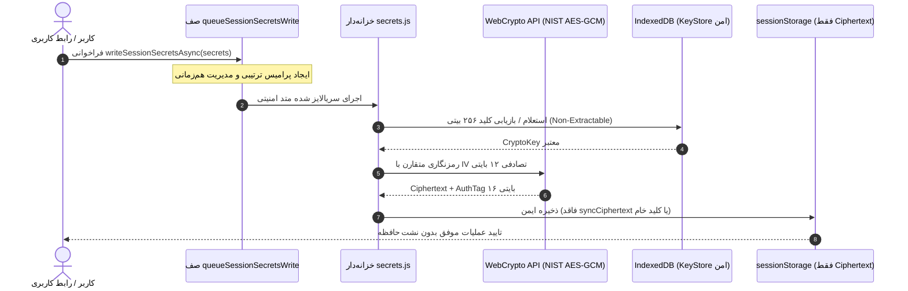

# 🚀 EG Nexus OS v5.9 — سیستم‌عامل چندایجنت هوشمند، PWA و کارخانه خودکار APK اندروید

[](https://github.com/amirrezas/EG-Nexus-OS/actions/workflows/nexus-factory.yml)
[](https://nodejs.org/)
[](https://capacitorjs.com/)
[](https://github.com/amirrezas/EG-Nexus-OS)
[](https://github.com/amirrezas/EG-Nexus-OS)
[](https://csrc.nist.gov/publications/detail/sp/800-38d/final)
[](LICENSE)

**EG Nexus OS v5.9.0** نسخه ارتقایافته، تثبیت‌شده و فوق‌امن سیستم‌عامل شخصی چندایجنت است. این نسخه با رفع قطعی حلقه بازگشتی بی‌نهایت در فاز ۴، مهاجرت کاملاً همگام وضعیت در `loadState`، حذف سایه‌زنی متغیرها و اتصال به ۱۴ کلید سراسری `API_KEY_NAMES`، پشتیبانی از پاک‌سازی کلیدهای تکی با رشته خالی `""` ضمن حفظ به‌روزرسانی‌های جزئی (Partial Updates)، ماندگاری توکن‌های نوسازی OAuth (`refreshToken`) پس از ریلود صفحه، اعتبارسنجی شکست‌بسته (Fail-Closed) حوزه‌های دسترسی در `executeProviderRequest`، پاک‌سازی و سرکوب قطعی روتین‌های زامبی در `mergeStateWithRevision`، مقاوم‌سازی چندلایه در برابر SSRF (مسدودسازی `/\evil.com`، `http:evil.com`، رنج‌های RFC 1918، CGNAT و متادیتای ابری IPv4/IPv6)، خنثی‌سازی چندمرحله‌ای تزریق پرامپت تودرتو و براکت‌های تمام‌عرض، ارزیابی کامل هر ۵ بلوک `<script>` داخل تست‌های DOM و بیش از **۴۵۵ تست خودکار Jest در ۲۱ سوئیت** با آستانه پوشش بالا منتشر شده است.

---

## 🌟 ویژگی‌های برجسته مهندسی در نسخه v5.9.0

### ۱. رفع قطعی سرریز پشته فاز ۴ و مهاجرت همگام وضعیت
- **حذف حلقه بازگشتی بی‌نهایت (`RangeError: Maximum call stack size exceeded`):** بازطراحی کامل `writePhase4SessionSecrets` و `installPhase4SecretPersistenceBoundary` بدون وصله‌زدن بازگشتی متدهای سراسری ذخیره‌سازی سکرت‌ها.
- **مهاجرت ۱۰۰٪ همگام در `loadState()`:** خواندن مستقیم وضعیت با `readSessionSecrets()` همگام و حذف وابستگی به مهاجرت‌های کلید نامعتبر `eg_nexus_phase4_session_secrets_v1`.
- **حذف سایه‌زنی سراسری (Shadowing):** اتصال مستقیم به شیء هسته `window.NexusCore.API_KEY_NAMES` با پشتیبانی کامل از هر ۱۴ کلید رسمی هوش مصنوعی و اتصال بی‌واسطه به `window._nexusCoreSanitization`.

### ۲. پشتیبانی از پاک‌سازی کلیدهای تکی و ماندگاری OAuth `refreshToken`
- **پاک‌سازی دقیق کلیدهای تکی در `_normalizeSecretsPayload`:** در صورت ارسال صریح رشته خالی `""`، کلید مورد نظر بدون اثر گذاشتن بر سایر کلیدهای `undefined` پاک می‌شود.
- **ماندگاری کامل `accountRefreshTokens` در چرخه ریلود:** افزودن شِما و سازوکار ذخیره‌سازی سکرت اختصاصی برای توکن‌های بازنشانی حساب‌های متصل (`refreshToken`) و هیدراتاسیون خودکار آن‌ها روی `appConnections[id].accounts[i].refreshToken`.
- **به‌روزرسانی همگام کش مرورگر در `writeSessionSecrets`:** ذخیره فوری اسنپ‌شات در `_cachedSessionSecrets` در محیط مرورگر بدون افزایش تکراری `writeRevision`.

### ۳. بررسی شکست‌بسته حوزه‌ها (Scope Checking) و حذف روتین‌های زامبی
- **اعتبارسنجی حوزه‌های دسترسی با `getRequiredScope`:** استعلام حوزه‌های الزامی در `executeProviderRequest` و بازگرداندن وضعیت `403 SCOPE_INSUFFICIENT` در صورت فقدان یا ناکافی بودن حوزه‌های اعطا شده (`grantedScopes`).
- **سرکوب قطعی روتین‌های زامبی در `mergeStateWithRevision`:** ادغام دوطرفه `deletedRoutineIds` و `deletedRoutineMeta` و فیلتر کردن قطعی روتین‌های حذف‌شده در ادغام وضعیت ابری.
- **بررسی نمادها علیه آلودگی پیش‌نمونه (Symbol Prototype Pollution):** بررسی عمیق تمام کلیدهای نمادین `Object.getOwnPropertySymbols(val)` در تابع `hasDangerousKeysDeep`.
- **بازنشانی فوری گیت تایید کاربر:** تنظیم فوری `_isResolvingApproval = false` در صورت وجود موارد باقی‌مانده در صف تاییدات جهت جلوگیری از نادیده گرفته شدن کلیک‌های کاربر.

### ۴. مقاوم‌سازی لایه ضد SSRF و پاک‌سازی تزریق پرامپت تودرتو
- **مقاوم‌سازی `sanitizeSafeUrl` و `sanitizeHttpUrl`:** مسدودسازی قطعی بک‌اسلش (`/\evil.com` و مسیرهای مشکوک)، مسدودسازی طرح‌های فاقد دو اسلش (`http:evil.com`)، نرمال‌سازی براکت‌های IPv6، مسدودسازی رنج‌های خصوصی RFC 1918، شبکه CGNAT، آدرس‌های محلی IPv6 و پسوندهای داخلی (`.local`, `.internal`, `.lan`).
- **خنثی‌سازی تگ‌های تزریق پرامپت تودرتو و چندمرحله‌ای:** تبدیل براکت‌های تمام‌عرض یونیکد (`［ ］ ＜ ＞`) به اسکی و اجرای حلقه‌ای پاک‌سازی تا محو کامل تمامی برچسب‌های مخفی نظیر `[AUTO_BRAIN` و `[OPTIONS:`.

### ۵. ارزیابی کامل هر ۵ اسکریپت در تست‌های DOM و بیلد CI/CD
- **تست جامع ۵ بلوک اسکریپت در `runtime-dom-wiring.test.js`:** ارزیابی همزمان اسکریپت گارد اولیه، اسکریپت اصلی `nexus-main-script`، ماژول فاز ۳، ماژول فاز ۴ و فاز ۵ با شبیه‌سازی کامل Canvas 2D و ران‌تایم مرورگر بدون خطا.
- **۲ سوئیت تست جدید و ۴۵۵ تست پاس‌شده Jest:** شامل `__tests__/v59_audit_hardening.spec.js` و `__tests__/v59_subagent3_hardening.spec.js` با پوشش فراتر از ۹۴٪ توابع و ۹۱٪ خطوط.
- **به‌روزرسانی خط لوله CI/CD:** نام‌گذاری و تگ‌گذاری خودکار بسته اندروید به `EG-Nexus-OS-v5.9.apk` با امضای دیجیتال و تولید SBOM.

---

## 📁 ساختار فایل‌های مخزن

```text
EG-Nexus-OS/
├── .github/workflows/
│   └── nexus-factory.yml          # خط لوله CI/CD: ممیزی، تست‌ها، بیلد و امضای رسمی APK v5.9 (تمام اکشن‌ها با SHA پین شده)
├── __tests__/                      # مجموعه تست‌های ۴۵۵ تایی Jest (۲۱ سوئیت)
│   ├── approvals.spec.js          # تست‌های حاکمیت امنیتی، تایید کاربر و حل ناهمگام
│   ├── coverage-boost.test.js     # تست‌های مرزی و تست‌های شاخه‌ای
│   ├── generateUniqueId.spec.js   # تست‌های شناسه تصادفی و آزمون‌های یکتا
│   ├── modular_core.spec.js       # تست‌های هماهنگی هسته و همگام‌سازی چندتبی
│   ├── persistence.spec.js        # تست‌های ذخیره‌سازی و مهاجرت داده‌ها
│   ├── provider-contracts.test.js # تست‌های قراردادهای ارائه‌دهندگان هوش مصنوعی
│   ├── pure-aes-gcm-queue.test.js # تست‌های صف همزمانی و رمزنگاری خالص NIST
│   ├── runtime-dom-wiring.test.js # تست‌های یکپارچگی ۵ بلوک اسکریپت DOM و اینترفیس
│   ├── runtime-stress.test.js     # تست‌های هم‌زمانی و مقاومت در برابر بار بالا
│   ├── sanitization.spec.js       # تست‌های تزریق اسکریپت، پاک‌سازی URL و ضد XSS
│   ├── secrets-reload.test.js     # تست‌های ماندگاری رمزنگاری پس از ریلود در حافظه
│   ├── security.spec.js           # تست‌های AES-GCM و امنیت سشن
│   ├── subagent1-architecture.test.js # تست‌های معماری و تک‌منبعی STORAGE_KEYS
│   ├── subagent2-coverage.test.js # تست‌های پوشش آزمون‌های مکمل کریپتوگرافی
│   ├── sw.spec.js                 # تست‌های کش آفلاین Service Worker
│   ├── v57_audit_sanitization_security.spec.js # تست‌های تخصصی ممیزی امنیتی v5.7
│   ├── v58_audit_hardening.spec.js # تست‌های تخصصی ممیزی امنیتی و معماری v5.8
│   ├── v58_coverage_booster.spec.js # تست‌های عمیق پوشش انشعاب‌های هسته
│   ├── v59_audit_hardening.spec.js # تست‌های تخصصی ممیزی امنیتی، SSRF و توکن‌های v5.9
│   ├── v59_subagent3_hardening.spec.js # تست‌های بررسی حوزه‌ها، روتین‌های زامبی و ضد تزریق
│   └── worker_queue.spec.js       # تست‌های صف پردازش وظایف ورکر
├── scripts/
│   ├── sync-audit-report.js       # اسکریپت همگام‌ساز خودکار گزارش ممیزی با داده‌های واقعی Jest
│   └── test-syntax.js             # اسکریپت ارزیابی AST سینتکس اسکریپت‌ها
├── src/                            # معماری ماژولار تفکیک‌شده هسته (Non-Enumerable Exports)
│   ├── core/                      # ذخیره‌سازی، بهداشت داده‌ها و مدیریت حالت
│   ├── providers/                 # رجیستری ارتباط با مدل‌های هوش مصنوعی
│   └── security/                  # خزانه‌داری سکرت‌ها، اعتبارسنجی و تاییدات
├── AUDIT_REPORT.md                 # گزارش رسمی و فنی ممیزی نسخه v5.9.0
├── audit-static.json              # شاخص‌های ساختاری و استاتیک سورس‌کد
├── capacitor.config.json          # پیکربندی رسمی پلتفرم Capacitor 8.6.0
├── full_app_audit.py              # اسکریپت بازرسی جامع ساختاری و هندلرها
├── index.html                     # برنامه کامل تک‌صفحه‌ای PWA
├── manifest.json                  # مانیفست وب‌اپلیکیشن برای نصب روی گوشی
├── package.json                   # شناسه پکیج نسخه 5.9.0 و اسکریپت‌ها
├── package-lock.json              # درخت قفل وابستگی‌های تاییدشده
└── sw.js                          # سرویس‌ورکر مدرن کش آفلاین v5.9.0
```

---

## 📱 راهنمای نصب و راه‌اندازی سریع با موبایل (بدون لپ‌تاپ)

### روش اول: دانلود مستقیم فایل نصبی APK (اندروید)
1. به تب [**Releases**](https://github.com/amirrezas/EG-Nexus-OS/releases) مخزن بروید.
2. آخرین نسخه منتشرشده (`v5.9.0` یا تگ متحرک `latest-apk`) را انتخاب کنید.
3. فایل **`EG-Nexus-OS-v5.9.apk`** را دانلود و مستقیماً روی دستگاه اندرویدی خود نصب کنید.
4. امضای فایل نصبی با استاندارد سه‌گانه v1/v2/v3 توسط `apksigner` و کلید اختصاصی ریپازیتوری تایید شده است.

### روش دوم: نصب در قالب وب‌اپلیکیشن پیشرونده (PWA)
1. در بخش **Settings > Pages** مخزن گیت‌هاب، انتشار GitHub Pages را از شاخه `main` فعال کنید.
2. لینک دامنه وب‌سایت خود را در مرورگر کروم یا سافاری موبایل باز کنید.
3. از منوی مرورگر گزینه **Add to Home screen** یا **نصب برنامه** را لمس کنید تا آیکون برنامه بدون نیاز به استور به صفحه اصلی اضافه شود.

---

## 💻 دستورات خط فرمان توسعه‌دهندگان (CLI)

برای بررسی و توسعه لوکال روی سیستم یا Termux:

```bash
# ۱. نصب تمیز و دقیق وابستگی‌ها با نسخه قفل‌شده
npm ci

# ۲. اجرای ممیزی امنیت زنجیره تامین
npm audit

# ۳. بررسی یکپارچگی سینتکس و ساختار جاوااسکریپت
npm run test:syntax

# ۴. اجرای کامل تست‌های Jest با گزارش پوشش خط‌به‌خط
npm test -- --runInBand --coverage

# ۵. بازرسی ساختاری پایتون و شمارش متدها
python3 full_app_audit.py

# ۶. همگام‌سازی خودکار شاخص‌های رسمی ممیزی
npm run audit:sync
```

---

## 🔒 معماری امنیت و رمزنگاری سکرت‌ها



---

## 📄 مجوز و اعتبارنامه
این پروژه تحت پروانه [MIT License](LICENSE) منتشر شده است. تمام حقوق برای EG Nexus OS محفوظ است.
