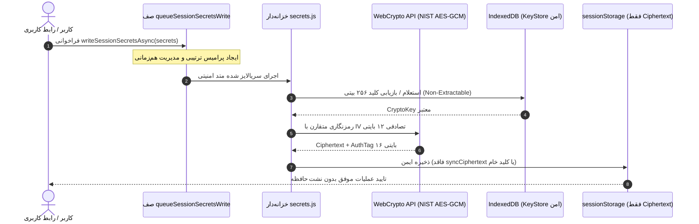

# 🚀 EG Nexus OS v5.8 — سیستم‌عامل چندایجنت هوشمند، PWA و کارخانه خودکار APK اندروید

[](https://github.com/amirrezas/EG-Nexus-OS/actions/workflows/nexus-factory.yml)
[](https://nodejs.org/)
[](https://capacitorjs.com/)
[](https://github.com/amirrezas/EG-Nexus-OS)
[](https://github.com/amirrezas/EG-Nexus-OS)
[](https://csrc.nist.gov/publications/detail/sp/800-38d/final)
[](LICENSE)

**EG Nexus OS v5.8.0** نسخه ارتقایافته، تثبیت‌شده و فوق‌امن سیستم‌عامل شخصی چندایجنت است. این نسخه با حل کامل ترتیب کش گریدل در CI، جلوگیری قطعی از قرنطینه‌سازی کلیدهای AES-GCM در هنگام بوت سینک مرورگر، یکپارچه‌سازی پروکسی وضعیت و سینگلتون‌های تایید، تقویت سازوکار ادغام نسخه‌ها (Revision Merge) و فهرست مجاز سخت‌گیرانه URL، ایزوله‌سازی پیشرفته کلیدهای سشن در حافظه بر پایه Symbol و IndexedDB بدون نشت بذر کلید در دیسک، حذف قطعی Math.random و جایگزینی با CSPRNG صلب شکست‌بسته (Fail-Closed)، ایمن‌سازی لایه پاک‌سازی ورودی‌ها علیه دور زدن کاراکترهای کنترلی و مسدودسازی SSRF متادیتای ابری، پین‌کردن ۴۰ کاراکتری تمام اکشن‌های خط لوله CI/CD با کش‌گذاری بهینه، حذف افشای پسورد و بیش از **۴۱۵ تست خودکار Jest در ۱۹ سوئیت** با آستانه پوشش بالا منتشر شده است.

---

## 🌟 ویژگی‌های برجسته مهندسی در نسخه v5.8.0

### ۱. تک‌منبعی شدن کلیدهای ذخیره‌سازی، یکپارچگی پروکسی وضعیت و حاکمیت تاییدات
- **تک‌منبعی سازی `STORAGE_KEYS`:** تمامی کلیدهای سراسری ذخیره‌سازی منحصراً در `src/core/state.js` به عنوان Single Source of Truth متمرکز شده و سایر ماژول‌ها (`persistence.js`، `sanitization.js`، `approvals.js`، `secrets.js`) آن را به صورت امن از شیء هسته یا فضای سراسری استعلام می‌کنند.
- **خنثی‌سازی بدون خطای آلودگی پیش‌نمونه (Neutralize without TypeError):** تله‌های `set` و `defineProperty` در پروکسی وضعیت، کلیدهای خطرناک نظیر `__proto__` و `constructor` را بدون پرتاب استثنا در حالت `'use strict'` خنثی کرده و مقدار `true` بازمی‌گردانند.
- **گارد تایم‌اوت در گیت تایید کاربر (`resolveApprovalGate`):** مجهز به گارد محدودیت زمانی ۳۰ ثانیه‌ای با `Promise.race` و بازنشانی تضمینی نشانگر قفل `_isResolvingApproval` در بلاک `finally`.

### ۲. حفاظت کریپتوگرافی صلب و کلیدهای درون‌حافظه‌ای مبتنی بر Symbol
- **رفع باگ قرنطینه در بوت مرورگر:** خواننده همگام `readSessionSecrets` در محیط مرورگر هرگز پی‌لودهای معتبر AES-GCM-256 را قرنطینه نکرده و با بازگرداندن `pendingAsyncHydration: true` زمینه هیدراتاسیون ناهمگام را فراهم می‌سازد.
- **رمزنگاری ۴ توکن حیاتی باقی‌مانده:** توکن‌های `workerSecret`, `supabaseKey`, `supabaseAuthToken`, `botToken` به اسکلت رمزنگاری‌شده پیوسته و از ذخیره در LocalStorage حذف شدند.
- **صفرسازی حافظه (`_zeroizeBuffer`):** صفرسازی ایمن بایت‌های کلید و داده‌های میانی در حافظه رم پس از اتمام عملیات کریپتوگرافی جهت مقابله با حملات Cold-boot.

### ۳. صف هم‌زمانی ترتیبی سکرت‌ها و اسنپ‌شات تغییرناپذیر
- **صف ترتیبی `queueSessionSecretsWrite` و `writeEpoch`:** ثبت اسنپ‌شات تغییرناپذیر عمیق در لحظه فراخوانی جهت جلوگیری قطعی از شرایط مسابقه (Race Condition)، اعتبارسنجی ۱۲ بایتی IV و داده‌های احراز هویت اضافی (AAD).
- **گزارش سلامت خزانه‌داری (`getSecretVaultHealth`):** گزارش دقیق وضعیت سخت‌افزاری و توانایی‌های کریپتوگرافی محیط اجرا (`idb-hardware-backed`، `session-memory-only`، یا `degraded`).

### ۴. ایمن‌سازی لایه پاک‌سازی ورودی‌ها و مسدودسازی SSRF متادیتای ابری
- **مقاوم‌سازی `sanitizeSafeUrl` و `sanitizeHttpUrl`:** مسدودسازی قطعی دسترسی به متادیتای ارائه‌دهندگان ابری (`169.254.169.254`, `metadata.google.internal`, `instance-data`) و پشتیبانی از فیلتر آدرس‌های loopback.
- **پالایش کاراکترهای مخفی با `INVISIBLE_FORMAT_CHARS_RE`:** حذف کامل کاراکترهای کنترلی مخفی یونیکد و فاصله‌های بدون عرض.
- **تزریق سیاست امنیتی محتوا (CSP):** درج خودکار متاتگ CSP در پیش‌نمایش‌های زنده `srcdoc` در استودیو.

### ۵. اصلاح ترتیب کش گریدل در CI/CD و انتشارات تغییرناپذیر (Immutable Tags)
- **اصلاح ترتیب کش Gradle (رفع شکست بیلد #130):** انتقال گام کش‌گذاری Gradle به پس از ایجاد پوشه اندروید توسط `npx cap sync android`.
- **پاک‌سازی و امحای امن کلید (Keystore Shredding Trap):** پاک‌سازی و خرد کردن فایل کلید امضا با `trap ... EXIT` حتی در صورت شکست پایپ‌لاین.
- **تولید سند اثبات اصالت بیلد (`dist/sbom-provenance.json`):** ثبت متادیتا و جزئیات امنیتی بسته بیلد شده.

### ۶. مجموعه تست‌های جامع ۴۱۵ تایی در ۱۹ سوئیت با پوشش بالا
- بیش از **۴۱۵ تست خودکار Jest** در ۱۹ سوئیت تست مجزا با ۱۰۰٪ قبولی و بدون هیچ شکستگی رفتاری.
- آستانه پوشش کد (Coverage Gate) در بالاترین سطح کیفی:
  - **پوشش توابع (Functions):** ۹۳.۷۲٪ (حداقل الزامی: ۸۵٪)
  - **پوشش خطوط (Lines):** ۹۰.۶۸٪ (حداقل الزامی: ۸۵٪)
  - **پوشش دستورات (Statements):** ۸۸.۹۲٪ (حداقل الزامی: ۸۵٪)
  - **پوشش شرط‌ها (Branches):** ۸۰.۷۱٪ (حداقل الزامی: ۸۰٪)

---

## 📁 ساختار فایل‌های مخزن

```text
EG-Nexus-OS/
├── .github/workflows/
│   └── nexus-factory.yml          # خط لوله CI/CD: ممیزی، تست‌ها، بیلد و امضای رسمی APK (تمام اکشن‌ها با SHA پین شده)
├── __tests__/                      # مجموعه تست‌های ۴۱۵ تایی Jest (۱۹ سوئیت)
│   ├── approvals.spec.js          # تست‌های حاکمیت امنیتی، تایید کاربر و حل ناهمگام
│   ├── coverage-boost.test.js     # تست‌های مرزی و تست‌های شاخه‌ای
│   ├── generateUniqueId.spec.js   # تست‌های شناسه تصادفی و آزمون‌های یکتا
│   ├── modular_core.spec.js       # تست‌های هماهنگی هسته و همگام‌سازی چندتبی
│   ├── persistence.spec.js        # تست‌های ذخیره‌سازی و مهاجرت داده‌ها
│   ├── provider-contracts.test.js # تست‌های قراردادهای ارائه‌دهندگان هوش مصنوعی
│   ├── pure-aes-gcm-queue.test.js # تست‌های صف همزمانی و رمزنگاری خالص NIST
│   ├── runtime-dom-wiring.test.js # تست‌های یکپارچگی هندلرهای DOM و اینترفیس
│   ├── runtime-stress.test.js     # تست‌های هم‌زمانی و مقاومت در برابر بار بالا
│   ├── sanitization.spec.js       # تست‌های تزریق اسکریپت، پاک‌سازی URL و ضد XSS
│   ├── secrets-reload.test.js     # تست‌های ماندگاری رمزنگاری پس از ریلود در حافظه
│   ├── security.spec.js           # تست‌های AES-GCM و امنیت سشن
│   ├── subagent1-architecture.test.js # تست‌های معماری و تک‌منبعی STORAGE_KEYS
│   ├── subagent2-coverage.test.js # تست‌های پوشش آزمون‌های مکمل کریپتوگرافی
│   ├── sw.spec.js                 # تست‌های کش آفلاین Service Worker
│   ├── v57_audit_sanitization_security.spec.js # تست‌های تخصصی ممیزی امنیتی v5.7
│   ├── v58_audit_hardening.spec.js # تست‌های تخصصی ممیزی امنیتی و معماری v5.8
│   ├── v58_coverage_booster.spec.js # تست‌های عمیق پوشش انشعاب‌های هسته
│   └── worker_queue.spec.js       # تست‌های صف پردازش وظایف ورکر
├── scripts/
│   ├── sync-audit-report.js       # اسکریپت همگام‌ساز خودکار گزارش ممیزی با داده‌های واقعی Jest
│   └── test-syntax.js             # اسکریپت ارزیابی AST سینتکس اسکریپت‌ها
├── src/                            # معماری ماژولار تفکیک‌شده هسته (Non-Enumerable Exports)
│   ├── core/                      # ذخیره‌سازی، بهداشت داده‌ها و مدیریت حالت
│   ├── providers/                 # رجیستری ارتباط با مدل‌های هوش مصنوعی
│   └── security/                  # خزانه‌داری سکرت‌ها، اعتبارسنجی و تاییدات
├── AUDIT_REPORT.md                 # گزارش رسمی و فنی ممیزی نسخه v5.8.0
├── audit-static.json              # شاخص‌های ساختاری و استاتیک سورس‌کد
├── capacitor.config.json          # پیکربندی رسمی پلتفرم Capacitor 8.6.0
├── full_app_audit.py              # اسکریپت بازرسی جامع ساختاری و هندلرها
├── index.html                     # برنامه کامل تک‌صفحه‌ای PWA
├── manifest.json                  # مانیفست وب‌اپلیکیشن برای نصب روی گوشی
├── package.json                   # شناسه پکیج نسخه 5.8.0 و اسکریپت‌ها
├── package-lock.json              # درخت قفل وابستگی‌های تاییدشده
└── sw.js                          # سرویس‌ورکر مدرن کش آفلاین
```

---

## 📱 راهنمای نصب و راه‌اندازی سریع با موبایل (بدون لپ‌تاپ)

### روش اول: دانلود مستقیم فایل نصبی APK (اندروید)
1. به تب [**Releases**](https://github.com/amirrezas/EG-Nexus-OS/releases) مخزن بروید.
2. آخرین نسخه منتشرشده (`v5.8.0` یا تگ متحرک `latest-apk`) را انتخاب کنید.
3. فایل **`EG-Nexus-OS-v5.8.apk`** را دانلود و مستقیماً روی دستگاه اندرویدی خود نصب کنید.
4. امضای فایل نصبی با استاندارد سه‌گانه v1/v2/v3 توسط `apksigner` و کلید اختصاصی ریپازیتوری تایید شده است.

### روش دوم: نصب در قالب وب‌اپلیکیشن پیشرونده (PWA)
1. در بخش **Settings > Pages** مخزن گیت‌هاب، انتشار GitHub Pages را از شاخه `main` فعال کنید.
2. لینک دامنه وب‌سایت خود را در مرورگر کروم یا سافاری موبایل باز کنید.
3. از منوی مرورگر گزینه **Add to Home screen** یا **نصب برنامه** را لمس کنید تا آیکون برنامه بدون نیاز به استور به صفحه اصلی اضافه شود.

---

## 💻 دستورات خط فرمان توسعه‌دهندگان (CLI)

برای بررسی و توسعه لوکال روی سیستم یا Termux:

```bash
# ۱. نصب تمیز و دقیق وابستگی‌ها با نسخه قفل‌شده
npm ci

# ۲. اجرای ممیزی امنیت زنجیره تامین
npm audit

# ۳. بررسی یکپارچگی سینتکس و ساختار جاوااسکریپت
npm run test:syntax

# ۴. اجرای کامل تست‌های Jest با گزارش پوشش خط‌به‌خط
npm test -- --runInBand --coverage

# ۵. بازرسی ساختاری پایتون و شمارش متدها
python3 full_app_audit.py

# ۶. همگام‌سازی خودکار شاخص‌های رسمی ممیزی
npm run audit:sync
```

# ۳. بررسی یکپارچگی سینتکس و ساختار جاوااسکریپت
npm run test:syntax

# ۴. اجرای کامل تست‌های Jest با گزارش پوشش خط‌به‌خط
npm test -- --runInBand --coverage

# ۵. بازرسی ساختاری پایتون و شمارش متدها
python3 full_app_audit.py

# ۶. همگام‌سازی خودکار شاخص‌های رسمی ممیزی
npm run audit:sync
```

---

## 🔒 معماری امنیت و رمزنگاری سکرت‌ها



---

## 🧩 نمونه استفاده از گذرگاه پلاگین (`window.NexusBus`)

برای توسعه ماژول‌های دلخواه بدون دستکاری هسته اصلی:

```javascript
window.NexusBus.registerPlugin({
  id: 'my-custom-plugin',
  name: 'پلاگین آزمایشی من',
  version: '1.0.0',
  init(ctx) {
    ctx.on('custom:ping', (payload) => {
      ctx.showToast('پلاگین پیام را دریافت کرد: ' + payload.text);
    });
  }
});
```

---

## 📄 مجوز و اعتبارنامه
این پروژه تحت پروانه [MIT License](LICENSE) منتشر شده است. تمام حقوق برای EG Nexus OS محفوظ است.
