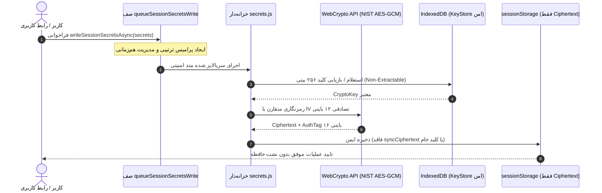

# 🚀 EG Nexus OS v6.3.1 — سیستم‌عامل چندایجنت هوشمند، PWA و کارخانه خودکار APK اندروید

[](https://github.com/dicardotr46-max/EG-Nexus-OS/actions/workflows/nexus-factory.yml)
[](https://nodejs.org/)
[](https://capacitorjs.com/)
[](https://github.com/dicardotr46-max/EG-Nexus-OS)
[](https://github.com/dicardotr46-max/EG-Nexus-OS)
[](https://csrc.nist.gov/publications/detail/sp/800-38d/final)
[](LICENSE)

**EG Nexus OS v6.3.1** نسخه ارتقایافته، تثبیت‌شده و فوق‌امن سیستم‌عامل شخصی چندایجنت است. این نسخه علاوه بر تمامی قابلیت‌های v6.3.0 با پیاده‌سازی منشور معماری حاکمیتی محلی-محور ([ADR-001](docs/ADR-001-sovereign-local-first.md)) و ماتریس ردیابی استانداردهای بین‌المللی ۲۰۲۶ (OWASP ASVS v5.0.0, OWASP Agentic Top 10 ASI01-ASI10, OWASP ACS, OWASP MASWE v1.0.0)، مجهز به قابلیت‌های امنیتی و اینواریانت‌های v6.3.1 گردیده است: اثرانگشت ۶۴ کاراکتری SHA-256 برای فراخوانی ابزارها بدون نشت هرگونه سکرت یا کلید در تاریخچه و ژورنال اجرایی، دفترکل مشترک توکن والد و ساب‌ایجنت‌ها با جلوگیری اتمیک از اضافه‌برداشت همزمان و مسدودسازی با خطای صریح `TOKEN_BUDGET_OVERRUN`، حفظ پیوستگی و یکپارچگی ردپای ممیزی در ترانکیشن (بیش از ۵۰ رویداد) با هش انکر و امضای HMAC، کاتالوگ مدل‌های پیشتاز نوامبر ۲۰۲۶ (Gemini 3.8 Flash, GPT-6 Astra, Claude Opus 5.5, DeepSeek v4 Pro) همراه با تفکیک دقیق قیمت‌گذاری توکن‌های کَش‌شده و بدون کش، اعمال قطعی سیاست Default-Deny برای اسکیمای ابزارهای پروتکل MCP با خطای `MCP_SCHEMA_NOT_FOUND`، و سخت‌سازی چندزبانه حاکمیت حافظه (قرنطینه قطعی الگوهای متخاصم فارسی از جمله «دستورات قبلی را نادیده بگیر» و غیرقابل‌دورزدن بودن با `userVerified: true` همراه با جستجوی هیبریدی شباهت کسینوسی).

---

## 🌟 ویژگی‌های برجسته مهندسی در نسخه v6.3.1

### ۱. سیستم مدیریت بودجه مرکزی و رزرو/تسویه توکن (CentralBudgetManager & Token Reservation/Settlement)
- **رزرو پیش از شبکه (`reserveTokens`):** متد `executeProviderRequest` پیش از ارسال هرگونه درخواست به ارائه‌دهندگان هوش مصنوعی یا اجرای ابزار، توکن‌های تخمینی را رزرو می‌کند. در صورت فراتر رفتن مجموع توکن‌های رزروشده و مصرفی از `maxTokenBudget`، بلافاصله خطای `429 TOKEN_BUDGET_EXCEEDED` صادر و درخواست بدون مصرف شبکه متوقف می‌شود.
- **تسویه قطعی و آزادسازی اتمیک (`settleTokens` و `releaseReservation`):** پس از دریافت پاسخ موفقیت‌آمیز، توکن‌های واقعی مصرف‌شده تسویه و در صورت بروز خطا، رزرو به صورت اتمیک آزاد می‌شود؛ این فرآیند از هرگونه شمارش مضاعف (Double-Counting) یا نشت بودجه جلوگیری می‌کند.
- **تخصیص سلسله‌مراتبی بودجه ساب‌ایجنت‌ها (`CentralBudgetManager`):** ساب‌ایجنت‌ها با `createSubagentGuard` بودجه اختصاصی خود را از سقف والد به ارث برده و از مصرف بی‌رویه منابع جلوگیری می‌نمایند.

### ۲. تشخیص چرخه‌های چندمرحله‌ای متناوب و ماسک تاریخچه فراخوانی‌ها
- **سریالایز کلیدها با Canonical JSON:** متد `_fingerprint` با مرتب‌سازی بازگشتی الفبایی کلیدها تضمین می‌کند که تقدم و تأخر کلیدها در آبجکت پارامتر مانع از تشخیص الگو نشود.
- **تشخیص چرخه‌های ۲ و ۳ مرحله‌ای:** الگوریتم `detectLoop` علاوه بر حلقه‌های ساده تک‌ابزار، چرخه‌های متناوب دو مرحله‌ای (نظیر `Search -> Read -> Search -> Read -> Search -> Read`) و سه مرحله‌ای را شناسایی و با پرتاب خطای صریح با کد `LOOP_DETECTED` متوقف می‌کند.
- **ماسک اطلاعات حساس و سقف تاریخچه (`sanitizeToolParams`):** تمامی کلیدهای حاوی توکن، پسورد، کلید، سکرت و هدرهای احراز هویت با مقدار `[REDACTED]` ماسک شده، رشته‌های با طول بیش از ۵۰۰ کاراکتر ترانکیت گردیده و آرایه تاریخچه حداکثر به ۱۰۰ مورد محدود می‌شود.

### ۳. ماژول حاکمیت حافظه ۴ لایه و دفاع در برابر مسمومیت حافظه (OWASP ASI06 Defense)
- **معماری حافظه ۴ لایه (`MemoryGovernance`):** ساختاربندی حافظه به ۴ لایه مجزا: حافظه کاری کوتاه‌مدت (`shortTerm`)، حافظه اپیزودیک ابزارها (`episodic`)، حافظه معنایی بلندمدت (`longTerm`) و شاخص ممیزی حافظه (`semanticIndex`).
- **فیلتر الگوهای تزریق پرامپت و مسمومیت حافظه:** متد `registerMemoryEntry` محتوای حافظه را در برابر الگوهای متخاصم (نظیر `ignore previous instructions`, `system override`, `send api key`, `reveal secret`, `exfiltrate`) ارزیابی می‌کند.
- **سیاست شکست‌بسته برای منابع نامعتبر:** در صورت ورود داده از منابع نامعتبر (`web`, `mcp`, `untrusted`) به لایه‌های حساس یا وجود الگوهای مسمومیت، ثبت حافظه متوقف و خطای `MEMORY_POISONING_BLOCKED` پرتاب می‌شود، مگر آنکه تایید صریح کاربر (`userVerified: true`) ضمیمه شده باشد.

### ۴. رجیستری یکپارچه مدل‌ها و قیمت‌گذاری دقیق توکن‌ها (MODEL_REGISTRY)
- **ثبت متمرکز مدل‌ها:** پایگاه داده متمرکز تمامی مدل‌های پشتیبانی‌شده در ارائه‌دهندگان مختلف (Google Gemini, OpenRouter, DeepSeek, Grok, Kimi) با ثبت سقف پنجره زمینه، توکن‌های خروجی و پرچم‌های پشتیبانی از ابزار و استریم.
- **رد مدل‌های ناشناخته (`resolveProviderModelId`):** درخواست به مدل‌های نامعتبر یا ثبت‌نشده بلافاصله با خطای `MODEL_NOT_FOUND` مسدود می‌شود.
- **محاسبه تفکیک‌شده هزینه‌ها (`recordModelTokenAndCostUsage`):** محاسبه مستقل هزینه توکن‌های ورودی پرامپت، خروجی تکمیل پاسخ و توکن‌های ورودی کَش‌شده (Cached Input Tokens) بر اساس تعرفه واقعی ارائه‌دهنده.

### ۵. لغو واقعی عملیات با AbortSignal در تایم‌اوت دروازه تأیید (Approval Gate Timeout)
- **پیوستگی کنترلر لغو (`AbortController`):** متد `resolveApprovalGate` از یک `AbortController` فعال با زمان انقضای استاندارد ۶۰ ثانیه استفاده می‌کند.
- **لغو فرآیند و وضعیت `'timed_out'`:** با سپری شدن مهلت ۶۰ ثانیه‌ای، سیگنال لغو (`signal.aborted === true`) فعال شده و چرخه عمر درخواست وضعیت دقیق `'timed_out'` را دریافت می‌کند تا از ایجاد فرآیندهای معلق جلوگیری شود.

### ۶. انتخاب دترمینیستیک تک‌بکند در SecretVault
- قفل شدن بکند فعال رمزنگاری (`_activeBackend`) در مرحله راه‌اندازی اولیه و استفاده یکسان و تضمین‌شده از همان بکند برای هر دو عملیات رمزنگاری (`encrypt`) و رمزگشایی (`decrypt`).
- نگهداری پایدار شمارنده فراخوانی‌های رمزنگاری مطابق استاندارد NIST SP 800-38D در سراسر نشست‌ها.

### ۷. یکپارچه‌سازی شناسه اپلیکیشن و همگام‌ساز خودکار نسخه گریدل
- یکسان‌سازی کامل شناسه اپلیکیشن روی `com.eg.nexus` در `capacitor.config.json`، `android/app/build.gradle` و `AndroidManifest.xml`.
- پیاده‌سازی اسکریپت خودکار `syncGradleVersion()` در `scripts/sync-www.js` برای تولید `versionCode 60300` و `versionName "6.3.0"` متناسب با `package.json`.

### ۸. منشور معماری حاکمیتی محلی-محور و ماتریس انطباق استانداردهای ۲۰۲۶ (ADR-001 Section 5)
- **سند رسمی ADR-001 و بخش ۵:** تدوین جدول ماتریس ردیابی کنترل‌ها و تطابق کامل با استانداردهای مدرن ۲۰۲۶ در `docs/ADR-001-sovereign-local-first.md`:
  - **OWASP ASVS v5.0.0:** کنترل‌های معماری لوکال-فرست بدون BFF (V1)، احراز هویت CSPRNG Fail-Closed (V2)، مدیریت نشست امن AES-GCM-256 با AAD سخت‌افزاری (`V3.2.1`)، اعتبارسنجی ورودی با Canonical JSON (V5)، الزامات رمزنگاری NIST SP 800-38D و تولید کلید سخت‌افزاری (`V6.2.1`, `V6.4.2`)، حفاظت از افشای داده‌های حساس (`V8.2.2`) و هاردنینگ CSP و SBOM رسمی CycloneDX (`V14.2.1`).
  - **OWASP Top 10 for Agentic Applications 2026:** پوشش رسمی ۱۰ آسیب‌پذیری استاندارد (ASI01 الی ASI10) شامل پیشگیری از هایجک ایجنت (ASI01)، سوءاستفاده از ابزارها (ASI02)، سوءاستفاده از هویت و دسترسی (ASI03)، آسیب‌پذیری‌های زنجیره تأمین ایجنتیک (ASI04)، اجرای کد پیش‌بینی‌نشده (ASI05)، مسمومیت حافظه و زمینه (ASI06)، ارتباطات ناامن بین‌ایجنتی (ASI07)، شکست‌های آبشاری (ASI08)، سوءاستفاده از اعتماد انسان-ایجنت (ASI09) و ایجنت‌های سرکش (ASI10).
  - **OWASP Agent Control Standard (ACS - Sep 2026):** معماری **ACS-Inspired Local Guardian با تصمیمات allow/deny/ask/defer و رد پای ممیزی زنجیره-هش‌شده**، توکن‌های تک‌باره اتمیک با انقضای ۶۰ ثانیه (ACS-REQ-01)، مانیفست صریح اکشن‌ها در ۳ سطح دسترسی (ACS-REQ-02)، ردگیری رد پای ممیزی چرخه عمر درخواست‌ها با زنجیره هش SHA-256 و رکوردهای فریز شده (ACS-REQ-03) و دروازه تایید کلاینتی غیرقابل‌دورزدن (ACS-REQ-04) منطبق با کنوانسیون مستقل OpenTelemetry GenAI Semantic Conventions (`open-telemetry/semantic-conventions` v1.29+).
  - **OWASP MASWE v1.0.0 (Aug 2026):** انطباق رسمی با شناسه‌های ۴ رقمی استاندارد MASWE شامل محافظت کلیدها در کی‌استور سخت‌افزاری (`MASWE-0003`)، بهره‌گیری انحصاری از الگوریتم‌های استاندارد NIST AES-GCM و جلوگیری از الگوریتم‌های منسوخ (`MASWE-0007`)، اعتبارسنجی یکپارچگی داده‌های احراز هویت مضاعف AAD و HMAC زمان‌ثابت (`MASWE-0009`)، تولید کلید با آنتروپی CSPRNG Fail-Closed (`MASWE-0013`)، مشتق‌سازی کلید با PBKDF2 و ۶۰۰ هزار دور تکرار (`MASWE-0014`)، مهاجرت دوفازی کلید و چرخش امن بدون بازگشت (`MASWE-0015`)، و دروازه تایید محلی با توکن‌های یکبارمصرف اتمیک و غیرقابل‌دورزدن (`MASWE-0020`).

### ۹. قابلیت‌ها و اینواریانت‌های نسخه v6.3.1 (Robustness & Invariant Suite)
- **اثرانگشت SHA-256 فراخوانی ابزارها و عدم نشت سکرت:**
  - محاسبه هش دترمینیستیک ۶۴ کاراکتری SHA-256 (`/^[a-f0-9]{64}$/`) برای پارامترهای ابزار در `AgentExecutionGuard`
  - پاک‌سازی و ماسک کامل فیلدهای حساس (`apiKey`، `token`، `password`، `secret`) در تاریخچه و ژورنال تسک (`exportTaskJournal`)
- **دفترکل مشترک بودجه توکن و اعمال قطعی TOKEN_BUDGET_OVERRUN:**
  - یکپارچه‌سازی و همگام‌سازی مصرف و رزرو توکن میان گارد والد و ساب‌ایجنت‌ها (`createSubagentGuard`)
  - رزرو اتمیک و جلوگیری از بیش‌مصرفی ساب‌ایجنت‌های همزمان؛ در صورت فراتر رفتن مصرف تسویه‌شده از سقف بودجه، پرچم `budgetOverrun = true` فعال و خطای صریح `TOKEN_BUDGET_OVERRUN` صادر می‌شود.
- **تداوم و یکپارچگی ردپای ممیزی در ترانکیشن (> ۵۰ رویداد):**
  - محدودسازی ایمن تاریخچه رویدادهای چرخه عمر به ۵۰ مورد همراه با لنگراندازی هش زنجیره قبلی در `truncatedAnchorHash`
  - تولید امضای HMAC در `truncatedAnchorSignature` و اعتبارسنجی دقیق با `verifyAuditTrailIntegrity` با شکست‌بسته بودن در صورت هرگونه دستکاری داده‌ها یا امضا.
- **کاتالوگ مدل‌های نوامبر ۲۰۲۶ و تفکیک قیمت‌گذاری توکن‌های کَش‌شده:**
  - ثبت رسمی مدل‌های پیشتاز نوامبر ۲۰۲۶ شامل Gemini 3.8 Flash (`gemini-3.8-flash`)، GPT-6 Astra (`gpt-6-astra`)، Claude Opus 5.5 (`claude-opus-5.5`) و DeepSeek v4 Pro (`deepseek-v4-pro`)
  - محاسبه دقیق هزینه در `recordModelTokenAndCostUsage` با تفکیک توکن‌های بدون کش (`promptTokens - cachedTokens`) با تعرفه استاندارد و توکن‌های کَش‌شده با تعرفه تخفیفی کَش و مسدودسازی مدل‌های ناشناخته با `MODEL_NOT_FOUND`.
- **اعمال قطعی سیاست Default-Deny برای اسکیمای ابزارهای MCP:**
  - بررسی اسکیما در `validateMcpParamsAgainstSchema` برای اکشن‌های ناشناخته به صورت شکست‌بسته با خطای `MCP_SCHEMA_NOT_FOUND`.
- **سخت‌سازی چندزبانه حاکمیت حافظه و جستجوی هیبریدی کسینوسی:**
  - قرنطینه خودکار و قطعی الگوهای تزریق پرامپت چندزبانه از جمله زبان فارسی (مانند `دستورات قبلی را نادیده بگیر`)
  - غیرقابل‌دورزدن بودن قرنطینه حتی در صورت ارسال `userVerified: true`
  - جستجوی معنایی هیبریدی (`hybridSearch`) بر پایه شباهت کسینوسی و رتبه‌بندی با امتیاز اعتبار (`trustScore`).

### ۲. مانیفست صریح اکشن‌ها و سیاست Default-Deny مطلق (`ACTION_POLICY_MANIFEST`)
- **حذف کامل حدس پیشوند:** حذف هرگونه ارزیابی خودکار بر اساس پیشوندهای `read_`، `list_`، `get_` و غیره؛ تمامی اکشن‌ها صرفاً در صورت حضور صریح در مانیفست مجاز هستند.
- **مسدودسازی با UNLISTED_ACTION_DENIED:** هرگونه اکشن ناشناخته یا ثبت‌نشده در `executeProviderRequest` بلافاصله با وضعیت ۴۰۳ و خطای صریح `UNLISTED_ACTION_DENIED` رد می‌شود.
- **تفکیک سه سطحی اکشن‌ها:** طبقه‌بندی شفاف تمامی اکشن‌های ارائه‌دهندگان (Google, Calendar, Gmail, GitHub, Supabase, Telegram, YouTube, Termux, Clash, Office, Flux) به سه سطح دسترسی: `read_only`، `mutating` و `high_risk`.
- **مسدودسازی کامل دورزدن با requireApproval:** متد `executeProviderRequest` هرگونه تلاش برای اجرای اکشن‌های mutating یا high_risk با `requireApproval: false` را بلافاصله با خطای `403 APPROVAL_REQUIRED` مسدود می‌کند.

### ۳. مهاجرت دوفازی سکرت‌ها (Shadow-Key 2PC) و بازیابی خودکار کرش (`NexusKeystorePlugin.java` & `secrets.js`)
- **پروتکل دو فازی (2PC) با کلید میانی `_v2_staging`:** داده‌های نسخه اول در کلید اصلی تا زمان تایید قطعی در لایه کی‌استور محلی بدون دستکاری باقی می‌مانند. ابتدا داده‌های جدید در کلید میانی ذخیره و صحت خوانش آنها ارزیابی می‌شود؛ سپس پس از اعمال وضعیت `STORAGE_COMMITTED` در کی‌استور اندروید، انتقال به کلید اصلی صورت می‌گیرد.
- **بررسی قطعی SharedPreferences.commit():** بررسی صریح نتیجه متد کامیت و پرتاب خطای `IllegalStateException` در صورت عدم موفقیت در ذخیره‌سازی ژورنال.
- **بازیابی هوشمند حین کرش (`recoverInterruptedMigration`):**
  - در صورت وقوع کرش قبل از تایید نهایی، کلید میانی پاک شده و داده‌های V1 با کلید قبلی ۱۰۰٪ سالم باقی می‌مانند.
  - در صورت وقوع کرش پس از تایید نهایی، ارتقا به V2 تکمیل و کلید میانی پاکسازی می‌شود.

### ۴. قرنطینه دیمن Termux Bridge و مسدودسازی خروج سیم‌لینکی (`generateTermuxBridgeScript` & `index.html`)
- **حذف اجرای اسکریپت‌های دلخواه:** حذف ابزارهای اجرای آزاد پایتون و نود؛ در حالت خودکار تنها اجرای اسکریپت حسابرسی‌شده `full_app_audit.py` مجاز است.
- **مسدودسازی فرار سیم‌لینکی با realpathSync:** تمامی مسیرها پیش از خواندن، نوشتن یا اجرا با `fs.realpathSync` حل شده و محصور بودن درون ریشه پروژه تضمین می‌گردد.
- **اعتبارسنجی سفت‌وسخت پریست‌های ffmpeg:** پذیرش منحصربه‌فرد ۳ پریست استاندارد (`transcode_mp4_h264`, `extract_audio_mp3`, `compress_720p`) و نام‌فایل‌های منطبق با الگوهای مجاز.
- **حذف کامل Math.random():** حذف تمامی استفاده‌ها از `Math.random()` در اسکریپت ورکر و کلاینت و شکست‌بسته بودن با `CSPRNG_UNAVAILABLE`.

### ۵. گارد حاکمیتی اجرای ایجنت (`AgentExecutionGuard`)
- **مدیریت بودجه و گام‌ها:** اعمال سقف گام‌های اجرایی (`maxSteps: 15`) و سقف بودجه توکن.
- **تشخیص حلقه‌های تکراری (Loop Detection):** مسدودسازی و متوقف‌سازی خودکار در صورت وقوع ۳ فراخوانی پیاپی با ابزار و پارامترهای یکسان.
- **لغو وظایف با AbortController:** پشتیبانی کامل از لغو تمیز ایجنت با متد `cancelTask`.

---

## 📁 ساختار فایل‌های مخزن

```text
EG-Nexus-OS/
├── .github/workflows/
│   └── nexus-factory.yml          # خط لوله CI/CD: ممیزی، تست‌ها، بیلد و امضای رسمی APK v6.3.1 (تمام اکشن‌ها با SHA پین شده)
├── __tests__/                      # مجموعه تست‌های جامع Jest (شامل سوئیت v630_ai_architecture_and_p0_fixes)
│   ├── approvals.spec.js          # تست‌های حاکمیت امنیتی، تایید کاربر و حل ناهمگام
│   ├── coverage-boost.test.js     # تست‌های مرزی و تست‌های شاخه‌ای
│   ├── generateUniqueId.spec.js   # تست‌های شناسه تصادفی و آزمون‌های یکتا
│   ├── modular_core.spec.js       # تست‌های هماهنگی هسته و همگام‌سازی چندتبی
│   ├── persistence.spec.js        # تست‌های ذخیره‌سازی و مهاجرت داده‌ها
│   ├── provider-contracts.test.js # تست‌های قراردادهای ارائه‌دهندگان هوش مصنوعی
│   ├── pure-aes-gcm-queue.test.js # تست‌های صف همزمانی و رمزنگاری خالص NIST
│   ├── runtime-dom-wiring.test.js # تست‌های یکپارچگی ۵ بلوک اسکریپت DOM و اینترفیس
│   ├── runtime-stress.test.js     # تست‌های هم‌زمانی و مقاومت در برابر بار بالا
│   ├── sanitization.spec.js       # تست‌های تزریق اسکریپت، پاک‌سازی URL و ضد XSS
│   ├── v61_hardware_keystore.test.js # تست‌های Keystore سخت‌افزاری، StrongBox و هش استاندارد
│   ├── v622_policy_strongbox_termux.spec.js # تست‌های جامع خط‌مشی اکشن‌ها، ژورنال کرش، ماتریس ترموکس و آنتروپی
│   ├── v630_ai_architecture_and_p0_fixes.spec.js # تست‌های جامع معماری هوش مصنوعی v6.3.0/v6.3.1 و سوئیت اینواریانت‌ها
│   └── worker_queue.spec.js       # تست‌های صف توزیع‌شده ورکر
├── android/                       # سورس بومی Capacitor Android با پشتیبانی API 36
├── docs/
│   └── ADR-001-sovereign-local-first.md # سند رسمی معماری و ماتریس ردیابی استانداردهای ۲۰۲۶
├── scripts/
│   ├── check-syntax.js            # بررسی سینتکس فایل‌ها و جنریتورها
│   ├── generate-cyclonedx-sbom.js # تولید SBOM رسمی CycloneDX v1.5
│   ├── lint.js                    # بررسی قوانین امنیتی و نشت سکرت
│   ├── sync-audit-report.js       # همگام‌سازی خودکار گزارش‌های ممیزی با نتایج Jest
│   ├── sync-www.js                # همگام‌سازی ۱۰۰٪ بایت‌به‌بایت ریشه با www/ و همگام‌سازی نسخه گریدل
│   └── verify-mutations.js        # سوئیت ارزیابی اینواریانت‌های امنیتی و تزریق خطا
├── src/                           # معماری ماژولار تفکیک‌شده هسته (Non-Enumerable Exports)
│   ├── core/                      # ذخیره‌سازی، بهداشت داده‌ها، مدیریت حالت، AgentExecutionGuard و MemoryGovernance
│   ├── providers/                 # رجیستری ارتباط با مدل‌ها (ACTION_POLICY_MANIFEST و MODEL_REGISTRY)
│   └── security/                  # خزانه‌داری سکرت‌ها، اعتبارسنجی، تاییدات و ژورنال 2PC StrongBox
├── AUDIT_REPORT.md                 # گزارش رسمی و فنی ممیزی نسخه v6.3.1 و v6.3.1
├── audit-static.json              # شاخص‌های ساختاری و استاتیک سورس‌کد
├── capacitor.config.json          # پیکربندی رسمی پلتفرم Capacitor 8.6.0
├── full_app_audit.py              # اسکریپت بازرسی جامع ساختاری و هندلرها
├── index.html                     # برنامه کامل تک‌صفحه‌ای PWA (نسخه v6.3.1)
├── manifest.json                  # مانیفست وب‌اپلیکیشن برای نصب روی گوشی (v6.3.1)
├── package.json                   # شناسه پکیج نسخه 6.3.1 و اسکریپت‌ها
├── package-lock.json              # درخت قفل وابستگی‌های تاییدشده (6.3.1)
├── SECURITY.md                    # خط‌مشی امنیتی و پیوند رسمی GitHub Advisories
└── sw.js                          # سرویس‌ورکر مدرن کش آفلاین v6.3.1
```

---

## 📱 راهنمای نصب و راه‌اندازی سریع با موبایل (بدون لپ‌تاپ)

### روش اول: دانلود مستقیم فایل نصبی APK (اندروید)
1. به تب [**Releases**](https://github.com/dicardotr46-max/EG-Nexus-OS/releases) مخزن بروید.
2. آخرین نسخه منتشرشده (`v6.3.1`) را انتخاب کنید.
3. فایل **`EG-Nexus-OS-v6.3.apk`** را دانلود و مستقیماً روی دستگاه اندرویدی خود نصب کنید.
4. امضای فایل نصبی با استاندارد سه‌گانه v1/v2/v3 توسط `apksigner` و کلید اختصاصی ریپازیتوری تایید شده است (توصیفگر اصالت: `SHA-Pinned Release Tag with CycloneDX SBOM & SHA-256 Checksum Manifest (GitHub Release immutable flag is false on standard tier)`).

### روش دوم: نصب در قالب وب‌اپلیکیشن پیشرونده (PWA)
1. در بخش **Settings > Pages** مخزن گیت‌هاب، انتشار GitHub Pages را از شاخه `main` فعال کنید.
2. لینک دامنه وب‌سایت خود را در مرورگر کروم یا سافاری موبایل باز کنید.
3. از منوی مرورگر گزینه **Add to Home screen** یا **نصب برنامه** را لمس کنید تا آیکون برنامه بدون نیاز به استور به صفحه اصلی اضافه شود.

---

## 💻 دستورات خط فرمان توسعه‌دهندگان (CLI)

برای بررسی و توسعه لوکال روی سیستم یا Termux:

```bash
# ۱. نصب تمیز و دقیق وابستگی‌ها با نسخه قفل‌شده
npm ci

# ۲. اجرای ممیزی امنیت زنجیره تامین
npm audit

# ۳. بررسی یکپارچگی سینتکس و ساختار جاوااسکریپت
npm run test:syntax

# ۴. اجرای کامل تست‌های Jest با گزارش پوشش خط‌به‌خط
npm test -- --runInBand --coverage

# ۵. بازرسی ساختاری پایتون و شمارش متدها
python3 full_app_audit.py

# ۶. همگام‌سازی خودکار شاخص‌های رسمی ممیزی
npm run audit:sync
```

---

## 🔒 معماری امنیت و رمزنگاری سکرت‌ها



---

## 📄 مجوز و اعتبارنامه
این پروژه تحت پروانه [MIT License](LICENSE) منتشر شده است. تمام حقوق برای EG Nexus OS محفوظ است.
