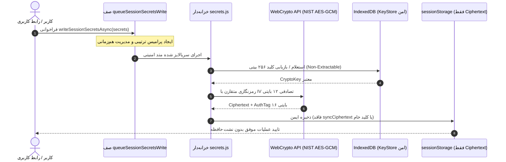

# 🚀 EG Nexus OS v6.1.1 — سیستم‌عامل چندایجنت هوشمند، PWA و کارخانه خودکار APK اندروید

[](https://github.com/dicardotr46-max/EG-Nexus-OS/actions/workflows/nexus-factory.yml)
[](https://nodejs.org/)
[](https://capacitorjs.com/)
[](https://github.com/dicardotr46-max/EG-Nexus-OS)
[](https://github.com/dicardotr46-max/EG-Nexus-OS)
[](https://csrc.nist.gov/publications/detail/sp/800-38d/final)
[](LICENSE)

**EG Nexus OS v6.1.1** نسخه ارتقایافته، تثبیت‌شده و فوق‌امن سیستم‌عامل شخصی چندایجنت است. این نسخه با محافظت از کلیدها در سطح سخت‌افزار واقعی TEE/StrongBox به همراه AAD در اندروید (`NexusKeystorePlugin`)، موتور خط‌مشی محلی و توکن‌های تایید یکبارمصرف ضد Replay (`One-Time Capability Approval Token`)، سیاست Default-Deny مطلق برای ارائه‌دهندگان، لیست سفید ساختاریافته دستورات Termux Bridge (`TERMUX_ALLOWED_COMMANDS`) با آرگومان‌های مجزا (`spawn(cmd, args, { shell: false })`)، پین کردن کامل اکشن‌های GitHub با SHA-40، انتشار خودکار ریلیز و فایل APK امضاشده توسط پایپلاین CI/CD و بیش از **۵۷۰ تست خودکار Jest در ۲۶ سوئیت** و پوشش بالای ۸۰٪ شاخه‌ها منتشر شده است.

---

## 🌟 ویژگی‌های برجسته مهندسی در نسخه v6.1.1

### ۱. پشتیبانی کامل از StrongBox/TEE و اعتبارسنجی AAD در سخت‌افزار اندروید
- **تشخیص بومی سطح امنیت سخت‌افزاری:** در پلاگین `NexusKeystorePlugin.java`، ساخت کلید در اندروید P به بالا ابتدا با `setIsStrongBoxBacked(true)` انجام شده و در صورت عدم پشتیبانی سخت‌افزار به صورت خودکار به TEE عقب‌نشینی می‌کند.
- **گزارش دقیق `securityLevel`:** استعلام مشخصات کلید با `SecretKeyFactory` و `KeyInfo` در API 31+ مقادیر واقعی `strongbox`، `tee` یا `software` را استخراج کرده و مقدار `hardwareBacked` را منحصراً در صورت حضور واقعی در سخت‌افزار امن برمی‌گرداند.
- **تطابق کامل AAD (داده‌های احراز هویت اضافی):** در متدهای `encrypt` و `decrypt`، پارامتر اختیاری `aad` به موتور بومی منتقل شده و با `cipher.updateAAD` اعمال می‌شود؛ به طوری که در صورت هرگونه تغییر در `aad`، فرآیند رمزگشایی بلافاصله Fail-Closed می‌شود.

### ۲. موتور خط‌مشی محلی و توکن تایید یکبارمصرف (One-Time Capability Token)
- **سیاست Default-Deny مطلق در ارائه‌دهندگان:** در `validateProviderScope`، پذیرش هرگونه وایلدکارد عمومی (`*`, `all`, `admin`) به طور کامل حذف شد. در صورت فقدان تعریف صریح اسکوپ یا عدم تطابق دقیق، دسترسی رد می‌شود.
- **توکن تایید صلاحیت یکبارمصرف:** هنگام تایید عملیات توسط کاربر در `resolveApprovalGate(true)`، یک توکن یکبارمصرف زمان‌دار (TTL: 60s) مقید به `{ providerId, action, paramsHash, nonce }` صادر می‌شود. مصرف این توکن در `executeProviderRequest` به صورت اتمیک انجام شده و بلافاصله پس از اولین مصرف حذف می‌شود تا از حملات Replay و Prompt Injection جلوگیری شود.

### ۳. محدودسازی ساختاریافته دستورات Termux Bridge
- **لیست سفید سخت‌گیرانه `TERMUX_ALLOWED_COMMANDS`:** دستورات خودکار ایجنت‌ها به ابزارهای استاندارد (`git`, `ls`, `node`, `npm`, `python3`, `ffmpeg` و ...) محدود شده است.
- **اجرای مستقیم با `shell: false`:** اجرای دستورات با تفکیک ساختاریافته آرگومان‌ها انجام شده و کاراکترهای زنجیره‌سازی شل (`;`, `&&`, `||`, `|`, `` ` ``, `$()`) در فراخوانی‌های خودکار ایجنت مسدود می‌گردند.

### ۴. خط لوله ممیزی خودکار CI/CD و آزمون‌های جهش (Mutation Testing)
- **اتصال رسمی Linter و آزمون جهش هسته:** در گردش‌کار GitHub Actions، مراحل رسمی `npm run lint` و آزمون سریع جهش ماژول‌های امنیتی اضافه شده است تا از کشته شدن ۱۰۰٪ جهش‌های امنیتی اطمینان حاصل شود.
- **انتشار پایدار ریلیز و تگ اتمیک:** ایجاد ریلیز و آپلود APK امضاشده توسط `softprops/action-gh-release` به همراه تولید خودکار SBOM استاندارد CycloneDX v1.5 انجام می‌شود.

---

## 📁 ساختار فایل‌های مخزن

```text
EG-Nexus-OS/
├── .github/workflows/
│   └── nexus-factory.yml          # خط لوله CI/CD: ممیزی، تست‌ها، بیلد و امضای رسمی APK v6.1.1 (تمام اکشن‌ها با SHA پین شده)
├── __tests__/                      # مجموعه تست‌های ۵۷۰+ تایی Jest (۲۶ سوئیت)
│   ├── approvals.spec.js          # تست‌های حاکمیت امنیتی، تایید کاربر و حل ناهمگام
│   ├── coverage-boost.test.js     # تست‌های مرزی و تست‌های شاخه‌ای
│   ├── generateUniqueId.spec.js   # تست‌های شناسه تصادفی و آزمون‌های یکتا
│   ├── modular_core.spec.js       # تست‌های هماهنگی هسته و همگام‌سازی چندتبی
│   ├── persistence.spec.js        # تست‌های ذخیره‌سازی و مهاجرت داده‌ها
│   ├── provider-contracts.test.js # تست‌های قراردادهای ارائه‌دهندگان هوش مصنوعی
│   ├── pure-aes-gcm-queue.test.js # تست‌های صف همزمانی و رمزنگاری خالص NIST
│   ├── runtime-dom-wiring.test.js # تست‌های یکپارچگی ۵ بلوک اسکریپت DOM و اینترفیس
│   ├── runtime-stress.test.js     # تست‌های هم‌زمانی و مقاومت در برابر بار بالا
│   ├── sanitization.spec.js       # تست‌های تزریق اسکریپت، پاک‌سازی URL و ضد XSS
│   ├── v61_hardware_keystore.test.js # تست‌های Keystore سخت‌افزاری و پل‌های بشکه‌ای
├── android/                       # سورس بومی Capacitor Android با پشتیبانی API 36
├── scripts/
│   ├── check-syntax.js            # بررسی سینتکس فایل‌ها و جنریتورها
│   ├── generate-cyclonedx-sbom.js # تولید SBOM رسمی CycloneDX v1.5
│   ├── lint.js                    # بررسی قوانین امنیتی و نشت سکرت
│   ├── sync-www.js                # همگام‌سازی ۱۰۰٪ بایت‌به‌بایت ریشه با www/
│   └── verify-mutations.js        # آزمون جهش سریع ماژول‌های هسته امنیتی
├── src/                           # معماری ماژولار تفکیک‌شده هسته (Non-Enumerable Exports)
│   ├── core/                      # ذخیره‌سازی، بهداشت داده‌ها و مدیریت حالت
│   ├── providers/                 # رجیستری ارتباط با مدل‌های هوش مصنوعی
│   └── security/                  # خزانه‌داری سکرت‌ها، اعتبارسنجی و تاییدات
├── AUDIT_REPORT.md                 # گزارش رسمی و فنی ممیزی نسخه v6.1.1
├── audit-static.json              # شاخص‌های ساختاری و استاتیک سورس‌کد
├── capacitor.config.json          # پیکربندی رسمی پلتفرم Capacitor 8.6.0
├── full_app_audit.py              # اسکریپت بازرسی جامع ساختاری و هندلرها
├── index.html                     # برنامه کامل تک‌صفحه‌ای PWA
├── manifest.json                  # مانیفست وب‌اپلیکیشن برای نصب روی گوشی
├── package.json                   # شناسه پکیج نسخه 6.1.1 و اسکریپت‌ها
├── package-lock.json              # درخت قفل وابستگی‌های تاییدشده
└── sw.js                          # سرویس‌ورکر مدرن کش آفلاین v6.1.1
```

---

## 📱 راهنمای نصب و راه‌اندازی سریع با موبایل (بدون لپ‌تاپ)

### روش اول: دانلود مستقیم فایل نصبی APK (اندروید)
1. به تب [**Releases**](https://github.com/dicardotr46-max/EG-Nexus-OS/releases) مخزن بروید.
2. آخرین نسخه منتشرشده (`v6.1.1`) را انتخاب کنید.
3. فایل **`EG-Nexus-OS-v6.1.apk`** را دانلود و مستقیماً روی دستگاه اندرویدی خود نصب کنید.
4. امضای فایل نصبی با استاندارد سه‌گانه v1/v2/v3 توسط `apksigner` و کلید اختصاصی ریپازیتوری تایید شده است.

### روش دوم: نصب در قالب وب‌اپلیکیشن پیشرونده (PWA)
1. در بخش **Settings > Pages** مخزن گیت‌هاب، انتشار GitHub Pages را از شاخه `main` فعال کنید.
2. لینک دامنه وب‌سایت خود را در مرورگر کروم یا سافاری موبایل باز کنید.
3. از منوی مرورگر گزینه **Add to Home screen** یا **نصب برنامه** را لمس کنید تا آیکون برنامه بدون نیاز به استور به صفحه اصلی اضافه شود.

---

## 💻 دستورات خط فرمان توسعه‌دهندگان (CLI)

برای بررسی و توسعه لوکال روی سیستم یا Termux:

```bash
# ۱. نصب تمیز و دقیق وابستگی‌ها با نسخه قفل‌شده
npm ci

# ۲. اجرای ممیزی امنیت زنجیره تامین
npm audit

# ۳. بررسی یکپارچگی سینتکس و ساختار جاوااسکریپت
npm run test:syntax

# ۴. اجرای کامل تست‌های Jest با گزارش پوشش خط‌به‌خط
npm test -- --runInBand --coverage

# ۵. بازرسی ساختاری پایتون و شمارش متدها
python3 full_app_audit.py

# ۶. همگام‌سازی خودکار شاخص‌های رسمی ممیزی
npm run audit:sync
```

---

## 🔒 معماری امنیت و رمزنگاری سکرت‌ها



---

## 📄 مجوز و اعتبارنامه
این پروژه تحت پروانه [MIT License](LICENSE) منتشر شده است. تمام حقوق برای EG Nexus OS محفوظ است.
