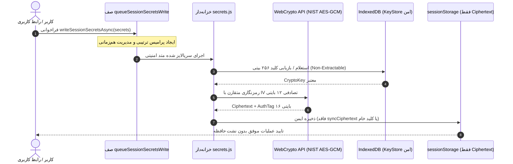

# 🚀 EG Nexus OS v6.2.1 — سیستم‌عامل چندایجنت هوشمند، PWA و کارخانه خودکار APK اندروید

[](https://github.com/dicardotr46-max/EG-Nexus-OS/actions/workflows/nexus-factory.yml)
[](https://nodejs.org/)
[](https://capacitorjs.com/)
[](https://github.com/dicardotr46-max/EG-Nexus-OS)
[](https://github.com/dicardotr46-max/EG-Nexus-OS)
[](https://csrc.nist.gov/publications/detail/sp/800-38d/final)
[](LICENSE)

**EG Nexus OS v6.2.1** نسخه ارتقایافته، تثبیت‌شده و فوق‌امن سیستم‌عامل شخصی چندایجنت است. این نسخه با پیاده‌سازی منشور معماری حاکمیتی محلی-محور ([ADR-001](docs/ADR-001-sovereign-local-first.md))، بستن قطعی راه فرار requireApproval: false در Policy Engine، قفل سروری سرور دیمن Termux Bridge، مهاجرت تراکنشی، بدون خطر از دست رفتن داده (Zero Data-Loss) به StrongBox سخت‌افزاری با قابلیت Rollback و Commit امن، ارتقای آنتروپی و پیچیدگی اسرار به ۱۲۸ بیت، حذف 'unsafe-eval' از CSP، آزمون‌های جهش جامع هسته امنیتی، انتشار خودکار ریلیز و فایل APK امضاشده توسط پایپلاین CI/CD و تست‌های خودکار Jest در ۲۶ سوئیت و پوشش بالای ۸۰٪ شاخه‌ها منتشر شده است.

---

## 🌟 ویژگی‌های برجسته مهندسی در نسخه v6.2.1

### ۱. منشور معماری حاکمیتی محلی-محور (Sovereign Local-First Architecture - ADR-001)
- **سند رسمی ADR-001:** تدوین سند رسمی تصمیم‌گیری معماری در `docs/ADR-001-sovereign-local-first.md` شامل مرزهای آفلاین، مدل تهدید، اولویت پردازش لوکال و استقلال کامل داده‌ها.
- **کانال‌های رسمی گزارش امنیتی:** جایگزینی ایمیل ساختگی با پیوند رسمی GitHub Security Advisories در `SECURITY.md`.

### ۲. قفل کامل موتور خط‌مشی محلی (Local Policy Engine Lock-down)
- **تولید قطعی Nonce با CSPRNG شکست‌بسته (Fail-Closed):** حذف کامل `Math.random()` در `_generateTokenNonce()` در هر دو ماژول `approvals.js` و `registry.js`. در صورت در دسترس نبودن `crypto.getRandomValues` یا `nodeCrypto.randomBytes`، برنامه خطای صریح `CSPRNG_UNAVAILABLE` صادر می‌کند.
- **هش قطعی پارامترها با Canonical JSON و SHA-256 واقعی:** مرتب‌سازی بازگشتی کلیدها با `canonicalizeJson` و تولید هش استاندارد ۶۴ کاراکتری هگزادسیمال SHA-256 در `_hashParams` برای تضمین بی‌کم‌وکاست یکپارچگی درخواست‌ها.
- **حذف کامل روزنه تایید مستقیم (`approved: true`):** در متد `executeProviderRequest`، ارسال `approved: true` بلافاصله رد می‌شود؛ اجرای عملیات حساس صرفاً با مصرف اتمیک و یکبارمصرف `approvalToken` معتبر مجاز خواهد بود.
- **سیاست Default-Deny فراگیر بر اسکوپ‌ها:** اعمال بدون قیدوشرط Default-Deny برای تمام سرویس‌های دارای اسکوپ مگر سرویس‌های با `authType: none`.

### ۳. ابزارهای ساختاریافته Termux Bridge و تقویت سکرت ورکر
- **لیست سفید ابزارهای ساختاریافته (`TERMUX_STRUCTURED_TOOLS`):** تفکیک سخت‌گیرانه دستورات شل در کلاینت و سرور دیمن Termux برای ابزارهایی مانند `git_status`، `git_diff`، `npm_test`، `npm_audit`، `python_audit` و `read_workspace_file`.
- **مسدودسازی آرگومان‌های خطرناک:** رد درخواست‌های حاوی پرچم‌های دستکاری مانند `-c`, `-e`, `--eval`, `--prefix`, `push`, `run` با کد خطای `403 ARGUMENT_POLICY_VIOLATION`.
- **افزایش طول سکرت ورکر به ۲۵۶ بیت:** الزام بر حداقل طول ۳۲ کاراکتر در `verifyWorkerSecretTimingSafe` و مقایسه در زمان ثابت (Timing-Safe Constant-Time).

### ۴. مهاجرت کلید به StrongBox سخت‌افزاری و گزارش همگام سلامت
- **متد بومی `migrateKeyToStrongBox`:** پیاده‌سازی متد بومی در `NexusKeystorePlugin.java` و لایه جاوااسکریپت `secrets.js` جهت ارتقای اتمیک کلیدهای رمزشده به چیپ امن اختصاصی StrongBox.
- **همگام‌سازی شاخص سلامت خزانه‌دار (`getSecretVaultHealth`):** مقدار `hardwareBacked` منحصراً زمانی `true` گزارش می‌شود که سطح امنیت سخت‌افزاری دقیقاً برابر با `strongbox` یا `tee` باشد.

### ۵. آزمون‌های جامع جهش امنیتی (Security Mutation Testing)
- **بازنویسی اسکریپت آزمون جهش (`scripts/verify-mutations.js`):** تبدیل هارنس به `Security Mutation & Regression Verification` و آزمون مستقیم روی متدهای واقعی پروژه (`SecretVault`, `validateProviderScope`, `consumeApprovalToken`, `canonicalizeJson` + SHA-256) با نرخ نابودی ۱۰۰٪ جهش‌ها (۶ جهش از ۶).

---

## 📁 ساختار فایل‌های مخزن

```text
EG-Nexus-OS/
├── .github/workflows/
│   └── nexus-factory.yml          # خط لوله CI/CD: ممیزی، تست‌ها، بیلد و امضای رسمی APK v6.2.1 (تمام اکشن‌ها با SHA پین شده)
├── __tests__/                      # مجموعه تست‌های جامع Jest (۲۶ سوئیت)
│   ├── approvals.spec.js          # تست‌های حاکمیت امنیتی، تایید کاربر و حل ناهمگام
│   ├── coverage-boost.test.js     # تست‌های مرزی و تست‌های شاخه‌ای
│   ├── generateUniqueId.spec.js   # تست‌های شناسه تصادفی و آزمون‌های یکتا
│   ├── modular_core.spec.js       # تست‌های هماهنگی هسته و همگام‌سازی چندتبی
│   ├── persistence.spec.js        # تست‌های ذخیره‌سازی و مهاجرت داده‌ها
│   ├── provider-contracts.test.js # تست‌های قراردادهای ارائه‌دهندگان هوش مصنوعی
│   ├── pure-aes-gcm-queue.test.js # تست‌های صف همزمانی و رمزنگاری خالص NIST
│   ├── runtime-dom-wiring.test.js # تست‌های یکپارچگی ۵ بلوک اسکریپت DOM و اینترفیس
│   ├── runtime-stress.test.js     # تست‌های هم‌زمانی و مقاومت در برابر بار بالا
│   ├── sanitization.spec.js       # تست‌های تزریق اسکریپت، پاک‌سازی URL و ضد XSS
│   ├── v61_hardware_keystore.test.js # تست‌های Keystore سخت‌افزاری، StrongBox و هش استاندارد
│   └── worker_queue.spec.js       # تست‌های صف توزیع‌شده ورکر
├── android/                       # سورس بومی Capacitor Android با پشتیبانی API 36
├── docs/
│   └── ADR-001-sovereign-local-first.md # سند رسمی تصمیم‌گیری معماری حاکمیتی محلی-محور
├── scripts/
│   ├── check-syntax.js            # بررسی سینتکس فایل‌ها و جنریتورها
│   ├── generate-cyclonedx-sbom.js # تولید SBOM رسمی CycloneDX v1.5
│   ├── lint.js                    # بررسی قوانین امنیتی و نشت سکرت
│   ├── sync-audit-report.js       # همگام‌سازی خودکار گزارش‌های ممیزی با نتایج Jest
│   ├── sync-www.js                # همگام‌سازی ۱۰۰٪ بایت‌به‌بایت ریشه با www/
│   └── verify-mutations.js        # هارنس ارزیابی جهش امنیتی و رگرسیون
├── src/                           # معماری ماژولار تفکیک‌شده هسته (Non-Enumerable Exports)
│   ├── core/                      # ذخیره‌سازی، بهداشت داده‌ها و مدیریت حالت
│   ├── providers/                 # رجیستری ارتباط با مدل‌های هوش مصنوعی
│   └── security/                  # خزانه‌داری سکرت‌ها، اعتبارسنجی و تاییدات
├── AUDIT_REPORT.md                 # گزارش رسمی و فنی ممیزی نسخه v6.2.1
├── audit-static.json              # شاخص‌های ساختاری و استاتیک سورس‌کد
├── capacitor.config.json          # پیکربندی رسمی پلتفرم Capacitor 8.6.0
├── full_app_audit.py              # اسکریپت بازرسی جامع ساختاری و هندلرها
├── index.html                     # برنامه کامل تک‌صفحه‌ای PWA (نسخه v6.2.1)
├── manifest.json                  # مانیفست وب‌اپلیکیشن برای نصب روی گوشی (v6.2.1)
├── package.json                   # شناسه پکیج نسخه 6.2.1 و اسکریپت‌ها
├── package-lock.json              # درخت قفل وابستگی‌های تاییدشده (6.2.1)
├── SECURITY.md                    # خط‌مشی امنیتی و پیوند رسمی GitHub Advisories
└── sw.js                          # سرویس‌ورکر مدرن کش آفلاین v6.2.1
```

---

## 📱 راهنمای نصب و راه‌اندازی سریع با موبایل (بدون لپ‌تاپ)

### روش اول: دانلود مستقیم فایل نصبی APK (اندروید)
1. به تب [**Releases**](https://github.com/dicardotr46-max/EG-Nexus-OS/releases) مخزن بروید.
2. آخرین نسخه منتشرشده (`v6.2.1`) را انتخاب کنید.
3. فایل **`EG-Nexus-OS-v6.2.apk`** را دانلود و مستقیماً روی دستگاه اندرویدی خود نصب کنید.
4. امضای فایل نصبی با استاندارد سه‌گانه v1/v2/v3 توسط `apksigner` و کلید اختصاصی ریپازیتوری تایید شده است.

### روش دوم: نصب در قالب وب‌اپلیکیشن پیشرونده (PWA)
1. در بخش **Settings > Pages** مخزن گیت‌هاب، انتشار GitHub Pages را از شاخه `main` فعال کنید.
2. لینک دامنه وب‌سایت خود را در مرورگر کروم یا سافاری موبایل باز کنید.
3. از منوی مرورگر گزینه **Add to Home screen** یا **نصب برنامه** را لمس کنید تا آیکون برنامه بدون نیاز به استور به صفحه اصلی اضافه شود.

---

## 💻 دستورات خط فرمان توسعه‌دهندگان (CLI)

برای بررسی و توسعه لوکال روی سیستم یا Termux:

```bash
# ۱. نصب تمیز و دقیق وابستگی‌ها با نسخه قفل‌شده
npm ci

# ۲. اجرای ممیزی امنیت زنجیره تامین
npm audit

# ۳. بررسی یکپارچگی سینتکس و ساختار جاوااسکریپت
npm run test:syntax

# ۴. اجرای کامل تست‌های Jest با گزارش پوشش خط‌به‌خط
npm test -- --runInBand --coverage

# ۵. بازرسی ساختاری پایتون و شمارش متدها
python3 full_app_audit.py

# ۶. همگام‌سازی خودکار شاخص‌های رسمی ممیزی
npm run audit:sync
```

---

## 🔒 معماری امنیت و رمزنگاری سکرت‌ها



---

## 📄 مجوز و اعتبارنامه
این پروژه تحت پروانه [MIT License](LICENSE) منتشر شده است. تمام حقوق برای EG Nexus OS محفوظ است.
