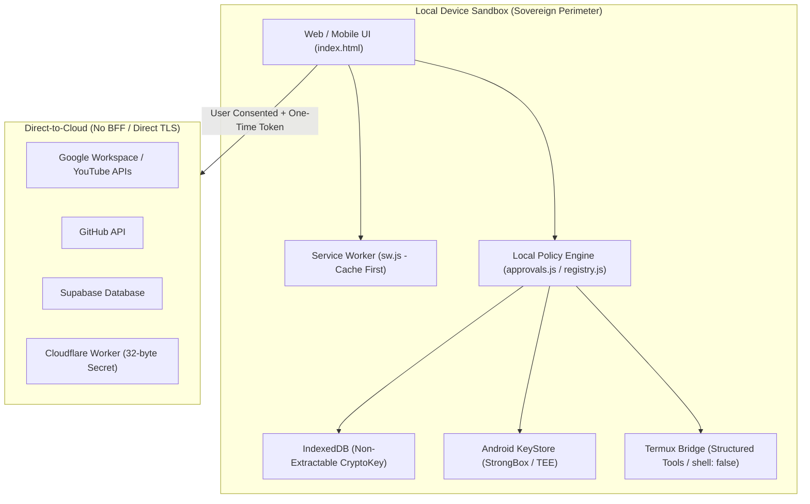

# Architecture Decision Record (ADR) 001: Sovereign Local-First Architecture Charter

- **Status:** Accepted
- **Deciders:** EG Nexus OS Architecture & Security Steering Team
- **Date:** 2026-11-13
- **Scope:** Runtime Security, Data Sovereignty, Local-First Boundaries, CI/CD Integrity

---

## 1. Context & Architectural Charter

EG Nexus OS is an autonomous, privacy-preserving AI operating workspace designed for mobile and web environments. Unlike conventional cloud-based or SaaS AI applications that funnel user data and credentials through a central proxy or Backend-for-Frontend (BFF), EG Nexus OS enforces a **Sovereign Local-First** architectural paradigm:

1. **Local Data Sovereignty:**  
   دستگاه محلی کاربر مرجع اصلی و حقیقت پایه (Primary Authoritative Source of Truth) برای تمامی داده‌ها و اسرار است و همگام‌سازی ابری (از طریق Cloudflare Worker یا Supabase) کاملاً اختیاری، رمزنگاری‌شده و منحصراً با فعال‌سازی و رضایت صریح کاربر (Opt-In) انجام می‌گیرد.  
   All user state, chat history, custom models, and sensitive API secrets reside exclusively on the user's physical device. Keys are managed using hardware-backed security modules (Android KeyStore with StrongBox / TEE) or non-extractable CryptoKey primitives inside browser IndexedDB. Cloud synchronization (via Cloudflare Worker or Supabase) is strictly opt-in, client-side encrypted, and never authoritative over local storage.
2. **Zero Central Intermediary (No BFF):**  
   EG Nexus OS eliminates central application servers, telemetry aggregators, and proxy middlewares. Outbound requests to third-party providers (Google OAuth, GitHub API, Cloudflare Workers, Supabase) occur directly from the user's runtime sandbox over TLS, ensuring credentials and prompt data are never exposed to intermediate infrastructure.
3. **Fail-Closed Offline Capability:**  
   The system relies on a high-resilience Service Worker (`sw.js`) caching core application assets with strict cryptographic integrity (SHA-256 parity). The application remains fully functional offline for local execution, termux scripting, and prompt drafting without reliance on external servers.

---

## 2. Threat Model & Security Mitigations

### 2.1 Threat Vector: Indirect Prompt Injection (IPI) & Capability Hijacking
- **Attack Scenario:** An untrusted LLM prompt or malicious web content attempts to trick the agent into executing sensitive mutating actions (e.g., repository deletion, unsolicited emails, unapproved file modifications).
- **Defense-in-Depth Mitigation:**
  - **Local Policy Engine & Default-Deny:** `validateProviderScope` rejects unmapped actions, unknown scopes, and wildcard operators (`*`, `all`, `admin`).
  - **One-Time Capability Approval Tokens (`approvalToken`):** For all mutating or sensitive operations (`isSensitiveProviderAction`), the system requires explicit user confirmation via the Approval Gate.
  - **Canonical JSON + SHA-256 Binding:** Approval tokens are bound to a 256-bit SHA-256 hash computed over recursively sorted canonical parameters (`canonicalizeJson(params)`). Any parameter alteration immediately invalidates the token.
  - **Single-Use Atomic Consumption:** Tokens are invalidated and deleted from memory immediately upon first use (`consumeApprovalToken`), preventing replay attacks and token harvesting.

### 2.2 Threat Vector: Arbitrary Command & Shell Injection via Termux Bridge
- **Attack Scenario:** Automated agents attempting to chain dangerous shell utilities or escape the workspace boundary using terminal commands.
- **Defense-in-Depth Mitigation:**
  - **Structured Tools Specification (`TERMUX_STRUCTURED_TOOLS`):** Automated invocations are confined to explicitly structured tasks (`git_status`, `git_diff`, `npm_test`, `npm_audit`, `python_audit`, `read_workspace_file`).
  - **Zero Shell Metacharacters:** Commands containing shell chaining characters (`;`, `&&`, `||`, `|`, `` ` ``, `$()`) are blocked outright in automated mode.
  - **Dangerous Flag Prohibition:** Flags like `-c`, `-e`, `--eval`, `--prefix`, `push`, `run` trigger immediate `403 ARGUMENT_POLICY_VIOLATION`.
  - **Execution Isolation:** Commands are executed strictly using Node.js `child_process.spawn` with `shell: false`, preventing shell interpretation or environment variable injection.

### 2.3 Threat Vector: Master Secret Compromise in Memory & Storage
- **Defense-in-Depth Mitigation:**
  - **Hardware Key Hierarchy:** On Android, AES-256-GCM master keys are generated within dedicated StrongBox or TEE hardware (`NexusKeystorePlugin.java`), with strict Additional Authenticated Data (`AAD`) verification.
  - **Non-Extractable WebCrypto Keys:** In browser environments, master session keys are generated with `extractable: false` in IndexedDB, preventing JavaScript scraping via memory dumps or XSS.
  - **Constant-Time HMAC & Worker Secret Verification:** Worker secrets enforce a minimum entropy of 32 characters (256 bits) and are verified using `crypto.timingSafeEqual` to eliminate side-channel timing attacks.

---

## 3. Boundaries: Offline Core vs. Online Direct Connect

---

## 4. Consequences & Verifications

- **Positive:** Maximum privacy, zero subscription-based backend hosting costs, immunity to central server breaches, strict auditability.
- **Negative / Constraints:** Mobile hardware limitations require careful memory management; cryptographic key rotation must be handled on-device with zero data loss.
- **Verification:** All security guarantees are verified automatically via `npm run test:mutation` (`verify-mutations.js`), AST syntax checks (`check-syntax.js`), and full regression test suites.

---

## 5. Standards & Controls Traceability Matrix (2026)

This matrix establishes formal traceability between international security standards (OWASP ASVS v5.0.0, OWASP Agentic Top 10 2026, OWASP ACS Sep 2026, and OWASP MASWE v1.0.0 Aug 2026) and the concrete implementation modules and automated verification test suites of EG Nexus OS.

### 5.1 OWASP ASVS v5.0.0 (Application Security Verification Standard)

| Standard & Section | Control Specification | Architectural Implementation & Codebase Mapping | Verification Test Suite |
|---|---|---|---|
| **V1 Architecture** | Local-First Sovereign Perimeter, Zero Backend-for-Frontend (BFF), client-direct TLS with zero intermediary telemetry or reverse proxies. | `docs/ADR-001-sovereign-local-first.md` `src/core/state.js` `src/providers/registry.js` | `__tests__/modular_core.spec.js` `__tests__/provider-contracts.test.js` `__tests__/v622_policy_strongbox_termux.spec.js` |
| **V2 Authentication** | Fail-Closed CSPRNG Nonce generation (`CSPRNG_UNAVAILABLE` on fallback failure), constant-time HMAC / Worker Secret verification (`timingSafeEqual`). | `src/security/approvals.js` `src/security/secrets.js` `index.html` | `__tests__/approvals.spec.js` `__tests__/security.spec.js` `__tests__/v622_policy_strongbox_termux.spec.js` |
| **V3 Session Management** | Authenticated AES-GCM-256 session vault with AAD integrity, non-extractable IndexedDB CryptoKey, and hardware StrongBox TEE backing. | `src/security/secrets.js` `android/app/src/main/java/com/eg/nexus/NexusKeystorePlugin.java` | `__tests__/v61_hardware_keystore.test.js` `__tests__/secrets-reload.test.js` `__tests__/pure-aes-gcm-queue.test.js` `__tests__/v622_policy_strongbox_termux.spec.js` |
| **V5 Input Validation** | Canonical JSON parameter hashing (`canonicalizeJson` + SHA-256), strict HTML entity escaping (`escapeHtml`), and protocol/URL sanitization (`sanitizeUrl`). | `src/core/sanitization.js` `src/security/approvals.js` | `__tests__/sanitization.spec.js` `__tests__/approvals.spec.js` `scripts/verify-mutations.js` `__tests__/v622_policy_strongbox_termux.spec.js` |
| **V6 Cryptography** | NIST SP 800-38D AES-GCM compliance: 1M encryption invocation limit, 96/128-bit unique IVs, 256-bit CSPRNG entropy requirement. | `src/security/secrets.js` `index.html` | `__tests__/pure-aes-gcm-queue.test.js` `__tests__/security.spec.js` `scripts/verify-mutations.js` `__tests__/v622_policy_strongbox_termux.spec.js` |
| **V14 Configuration** | Hardened CSP without `'unsafe-eval'` or `blob:` script sources, strictly pinned package dependencies, CycloneDX v1.5 SBOM generation. | `index.html` `.github/workflows/nexus-factory.yml` `scripts/generate-cyclonedx-sbom.js` | `scripts/check-syntax.js` `scripts/lint.js` `test_full_app_audit.py` |

---

### 5.2 OWASP Top 10 for Agentic Applications 2026

| Control ID & Title | Threat Mitigation & Policy Specification | Architectural Implementation & Codebase Mapping | Verification Test Suite |
|---|---|---|---|
| **ASI-01 Agent Execution Hijacking** | Action Policy Manifest enforcing strict Default-Deny for all unmapped actions and unknown provider services; automatic promotion to sensitive tier. | `src/providers/registry.js` (`ACTION_POLICY_MANIFEST`, `isSensitiveProviderAction`) | `__tests__/v622_policy_strongbox_termux.spec.js` `scripts/verify-mutations.js` `__tests__/provider-contracts.test.js` |
| **ASI-02 Insecure Tool Calling** | Structured Tools Allowlist and `TERMUX_CAPABILITY_MATRIX`; total rejection of shell metacharacters, chained commands, and dangerous argument flags (`-exec`, `-delete`, `-c`, `--eval`, `push`, `run`). | `index.html` (`validateStructuredTermuxCommand`, `_nexusTermuxDaemonValidator`) | `__tests__/v622_policy_strongbox_termux.spec.js` `__tests__/runtime-dom-wiring.test.js` |
| **ASI-03 Capability Tampering** | Single-use atomic approval tokens with Canonical SHA-256 parameter binding; immediate memory deletion upon consumption prevents replay attacks. | `src/security/approvals.js` `src/providers/registry.js` | `__tests__/approvals.spec.js` `scripts/verify-mutations.js` `__tests__/v622_policy_strongbox_termux.spec.js` |
| **ASI-04 Unbounded Concurrency** | Serialized session write queue (`queueSessionSecretsWrite`) with monotonic revision locking and LWW conflict resolution across multi-tab environments. | `src/security/secrets.js` `src/core/persistence.js` | `__tests__/pure-aes-gcm-queue.test.js` `__tests__/persistence.spec.js` `__tests__/runtime-stress.test.js` |
| **ASI-05 Credential Exfiltration** | Zero plaintext secrets in `localStorage` or `buildPersistedState()`; on-device hardware KeyStore isolation (StrongBox / TEE) and non-extractable session keys. | `src/security/secrets.js` `src/core/persistence.js` `NexusKeystorePlugin.java` | `__tests__/v61_hardware_keystore.test.js` `__tests__/persistence.spec.js` `scripts/lint.js` |

---

### 5.3 OWASP Agent Control Standard (ACS - Sep 2026)

| Requirement ID | Standard Requirement | Architectural Implementation & Codebase Mapping | Verification Test Suite |
|---|---|---|---|
| **ACS-REQ-01 Single-Use Capability Tokens** | High-entropy capability tokens consumed atomically on first use with zero replay allowance and strict 5-minute time-to-live (TTL). | `src/security/approvals.js` (`consumeApprovalToken`, `issueApprovalToken`) | `__tests__/approvals.spec.js` `scripts/verify-mutations.js` `__tests__/v622_policy_strongbox_termux.spec.js` |
| **ACS-REQ-02 Explicit Action Policy Manifest** | Comprehensive 3-tier action classification (`read_only`, `mutating`, `high_risk`) across all third-party providers with fail-closed default-deny. | `src/providers/registry.js` (`ACTION_POLICY_MANIFEST`, `isSensitiveProviderAction`) | `__tests__/provider-contracts.test.js` `__tests__/v622_policy_strongbox_termux.spec.js` |
| **ACS-REQ-03 Audit Lifecycle Tracking** | Deterministic request lifecycle event tracking (`queued` → `awaiting_approval` → `approved` → `executed` / `rejected`) stored in bounded audit trail. | `src/security/approvals.js` (`recordLifecycleEvent`, `getRequestLifecycle`) | `__tests__/v622_policy_strongbox_termux.spec.js` |
| **ACS-REQ-04 Local Approval Boundary** | User confirmation gate enforced directly in local client UI runtime; backend or caller cannot bypass (`requireApproval: false` overrides prohibited). | `index.html` `src/security/approvals.js` `src/providers/registry.js` | `__tests__/subagent1-architecture.test.js` `__tests__/provider-contracts.test.js` `__tests__/v622_policy_strongbox_termux.spec.js` |

---

### 5.4 OWASP Mobile Application Security Verification Standard (MASWE v1.0.0 - Aug 2026)

| Control ID & Title | Mobile Security Specification | Architectural Implementation & Codebase Mapping | Verification Test Suite |
|---|---|---|---|
| **MASWE-KEY-01 Hardware Key Hierarchy** | AndroidKeyStore StrongBox backed key generation (`FEATURE_STRONGBOX_KEYSTORE`) with automatic TEE fallback and explicit security level reporting. | `android/app/src/main/java/com/eg/nexus/NexusKeystorePlugin.java` `src/security/secrets.js` | `__tests__/v61_hardware_keystore.test.js` `__tests__/v622_policy_strongbox_termux.spec.js` |
| **MASWE-RES-02 Crash-Safe Key Migration** | Transactional migration state machine (`MIGRATION_PREPARED` → `V2_KEY_CREATED` → `V2_DATA_VERIFIED` → `STORAGE_COMMITTED` → `ACTIVE_V2`) with automatic crash recovery. | `android/app/src/main/java/com/eg/nexus/NexusKeystorePlugin.java` `src/security/secrets.js` | `__tests__/v61_hardware_keystore.test.js` `__tests__/v622_policy_strongbox_termux.spec.js` |
| **MASWE-CRYPTO-03 Non-Extractable Session Keys** | WebCrypto API master keys created with `extractable: false` stored in private IndexedDB database (`_eg_nexus_keystore`), shielded from DOM and memory scraping. | `src/security/secrets.js` | `__tests__/pure-aes-gcm-queue.test.js` `__tests__/secrets-reload.test.js` `__tests__/v61_hardware_keystore.test.js` |
