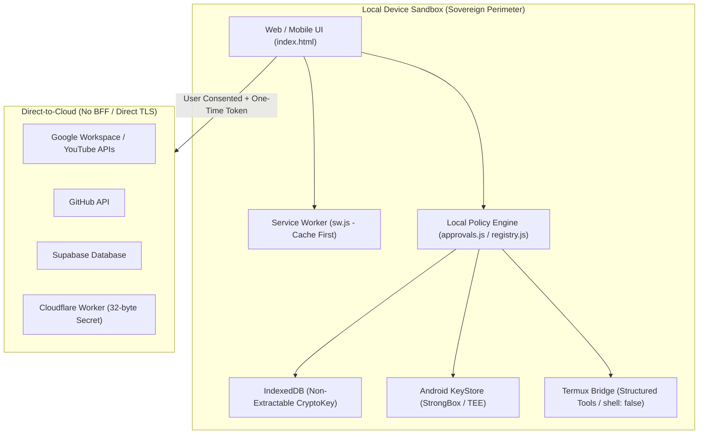

# Architecture Decision Record (ADR) 001: Sovereign Local-First Architecture Charter

- **Status:** Accepted
- **Deciders:** EG Nexus OS Architecture & Security Steering Team
- **Date:** 2026-11-13
- **Scope:** Runtime Security, Data Sovereignty, Local-First Boundaries, CI/CD Integrity

---

## 1. Context & Architectural Charter

EG Nexus OS is an autonomous, privacy-preserving personal AI operating system engineered for Android (Capacitor APK) and web (offline-capable PWA). Unlike conventional cloud-based or SaaS AI applications that funnel user data and credentials through a central proxy or Backend-for-Frontend (BFF), EG Nexus OS enforces a **Sovereign Local-First** architectural paradigm:

### 1.1 System Paradigm
- **Definition:** `Sovereign, Local-First, Single-User Personal AI Operating System (Android APK + Offline-Capable PWA)`.
- **Single-User Ownership:** The end-user is the sovereign administrator and sole owner of the physical device and execution runtime. There are no corporate accounts, centralized tracking databases, or intermediate proxy servers.
- **Zero Server Costs:** The system operates at zero hosting cost for the user by running client-side, talking directly to AI providers via user-supplied API keys without third-party surveillance.

### 1.2 Hybrid Architecture Rationale
EG Nexus OS deliberately adopts a **Modular Security Core (`src/`) + Zero-Build Portable Single-Shell (`index.html`)** hybrid architecture:
1. **Decoupled Security Core (`src/`):** The six mission-critical engines—`state.js`, `persistence.js`, `sanitization.js`, `secrets.js`, `approvals.js`, and `registry.js`—are completely decoupled, standalone, and strictly verified with 750+ automated Jest unit tests achieving $\ge 80\%$ branch coverage and $\ge 89\%$ line coverage.
2. **Zero-Build Portable Shell (`index.html`):** The complete presentation shell and UI integration layer reside in `index.html`. This ensures the application can be opened directly over `file://`, packaged into a native Android APK via Capacitor with zero Webpack/Vite bundler friction, and loaded instantly offline via Service Worker (`sw.js`) without dynamic chunking failures.

### 1.3 Explicit Architectural Non-Goals
Reviewers and automated audit tools **MUST NOT** recommend or penalize the codebase for omitting the following:
1. **No Central BFF / Server-Side Key Custody:** User API keys and OAuth tokens must **NEVER** leave the client device to be stored on an application backend. Storing secrets on a centralized server breaks the sovereign self-custody guarantee.
2. **No Multi-Tenant Isolation / Enterprise RBAC:** This software is engineered exclusively for a single user per device instance. It does not require corporate tenant IDs, organization hierarchy trees, enterprise role-based access control, or distributed multi-region monitoring clusters.
3. **Optional User-Owned Cloud Sync:** Integration with Cloudflare Workers or Supabase is **strictly opt-in (optional)** and deployed on the user’s personal infrastructure. Cloud sync is never the authoritative source of truth; local device storage always holds primary authority.

### 1.4 Core Architectural Pillars
1. **Local Data Sovereignty:**  
   دستگاه محلی کاربر مرجع اصلی و حقیقت پایه (Primary Authoritative Source of Truth) برای تمامی داده‌ها و اسرار است و همگام‌سازی ابری (از طریق Cloudflare Worker یا Supabase) کاملاً اختیاری، رمزنگاری‌شده و منحصراً با فعال‌سازی و رضایت صریح کاربر (Opt-In) انجام می‌گیرد.  
   All user state, chat history, custom models, and sensitive API secrets reside exclusively on the user's physical device. Keys are managed using hardware-backed security modules (Android KeyStore with StrongBox / TEE) or non-extractable CryptoKey primitives inside browser IndexedDB. Cloud synchronization (via Cloudflare Worker or Supabase) is strictly opt-in, client-side encrypted, and never authoritative over local storage.
2. **Zero Central Intermediary (No BFF):**  
   EG Nexus OS eliminates central application servers, telemetry aggregators, and proxy middlewares. Outbound requests to third-party providers (Google OAuth, GitHub API, Cloudflare Workers, Supabase) occur directly from the user's runtime sandbox over TLS, ensuring credentials and prompt data are never exposed to intermediate infrastructure.
3. **Fail-Closed Offline Capability:**  
   The system relies on a high-resilience Service Worker (`sw.js`) caching core application assets with strict cryptographic integrity (SHA-256 parity). The application remains fully functional offline for local execution, termux scripting, and prompt drafting without reliance on external servers.

---

## 2. Threat Model & Security Mitigations

### 2.0 Authoritative Threat Model Boundary
Because the device owner is the trusted local administrator (Admin), **"browser console/DevTools tampering by the device owner against their own client" is explicitly outside the threat model**.  
Security audits, automated scanners, and human reviewers must focus **exclusively** on real-world threat vectors:
1. **Indirect Prompt Injection & Memory Poisoning (`OWASP LLM01` / `ASI01` / `ASI06`)**
2. **Deterministic Agent Capability Gating (`OWASP ASI02` / `ASI05`)**
3. **Local Cryptographic Security at Rest (`OWASP MASWE-0003` / `0014` / `0015`)**
4. **State Integrity Across Concurrent & Cross-Tab Execution (CAS & Write Queues)**

### 2.1 Threat Vector: Indirect Prompt Injection (IPI) & Capability Hijacking
- **Attack Scenario:** An untrusted LLM prompt or malicious web content attempts to trick the agent into executing sensitive mutating actions (e.g., repository deletion, unsolicited emails, unapproved file modifications).
- **Defense-in-Depth Mitigation:**
  - **Local Policy Engine & Default-Deny:** `validateProviderScope` rejects unmapped actions, unknown scopes, and wildcard operators (`*`, `all`, `admin`).
  - **One-Time Capability Approval Tokens (`approvalToken`):** For all mutating or sensitive operations (`isSensitiveProviderAction`), the system requires explicit user confirmation via the Approval Gate.
  - **Canonical JSON + SHA-256 Binding:** Approval tokens are bound to a 256-bit SHA-256 hash computed over recursively sorted canonical parameters (`canonicalizeJson(params)`). Any parameter alteration immediately invalidates the token.
  - **Single-Use Atomic Consumption:** Tokens are invalidated and deleted from memory immediately upon first use (`consumeApprovalToken`), preventing replay attacks and token harvesting.

### 2.2 Threat Vector: Arbitrary Command & Shell Injection via Termux Bridge
- **Attack Scenario:** Automated agents attempting to chain dangerous shell utilities or escape the workspace boundary using terminal commands.
- **Defense-in-Depth Mitigation:**
  - **Structured Tools Specification (`TERMUX_STRUCTURED_TOOLS`):** Automated invocations are confined to explicitly structured tasks (`git_status`, `git_diff`, `npm_test`, `npm_audit`, `python_audit`, `read_workspace_file`).
  - **Zero Shell Metacharacters:** Commands containing shell chaining characters (`;`, `&&`, `||`, `|`, `` ` ``, `$()`) are blocked outright in automated mode.
  - **Dangerous Flag Prohibition:** Flags like `-c`, `-e`, `--eval`, `--prefix`, `push`, `run` trigger immediate `403 ARGUMENT_POLICY_VIOLATION`.
  - **Execution Isolation:** Commands are executed strictly using Node.js `child_process.spawn` with `shell: false`, preventing shell interpretation or environment variable injection.

### 2.3 Threat Vector: Master Secret Compromise in Memory & Storage
- **Defense-in-Depth Mitigation:**
  - **Hardware Key Hierarchy:** On Android, AES-256-GCM master keys are generated within dedicated StrongBox or TEE hardware (`NexusKeystorePlugin.java`), with strict Additional Authenticated Data (`AAD`) verification.
  - **Non-Extractable WebCrypto Keys:** In browser environments, master session keys are generated with `extractable: false` in IndexedDB, preventing JavaScript scraping via memory dumps or XSS.
  - **Constant-Time HMAC & Worker Secret Verification:** Worker secrets enforce a minimum entropy of 32 characters (256 bits) and are verified using `crypto.timingSafeEqual` to eliminate side-channel timing attacks.

### 2.4 Threat Vector: Credential Leakage via Agent In-Memory History & Task Journals (v6.3.1)
- **Attack Scenario:** Tool invocation parameters containing API keys, authorization tokens, or passwords persisting in `callHistory` or exported in debug journals (`exportTaskJournal`).
- **Defense-in-Depth Mitigation:**
  - **64-Character SHA-256 Tool Call Fingerprint:** In `AgentExecutionGuard`, tool calls compute a deterministic SHA-256 hex digest (`/^[a-f0-9]{64}$/`) over canonicalized tool names and parameters (`canonicalizeJson`), enabling multi-step cycle detection without storing plaintext arguments in fingerprints.
  - **Deep Param Masking in Task Journals:** Sensitive keys (`apiKey`, `token`, `password`, `secret`, `authorization`) are masked with `[REDACTED]` prior to journal export and call history retention, guaranteeing zero secret leakage in serialized journals.

### 2.5 Threat Vector: Multi-Subagent Token Exhaustion & Race Conditions (v6.3.1)
- **Attack Scenario:** Concurrent subagents independently exhausting token limits and exceeding parent budget quotas without central synchronization.
- **Defense-in-Depth Mitigation:**
  - **Shared Parent-Child Budget Ledger:** Child guards created via `createSubagentGuard` share an authoritative synchronized token ledger with the parent.
  - **Atomic Multi-Agent Reservations:** Reserving tokens for one subagent (`subagentGuardA.reserveTokens('callA', 600)`) immediately deducts available unreserved budget for sibling subagents (`subagentGuardB`), failing closed if requested reservation exceeds remaining capacity.
  - **Settlement Overrun Trap (`TOKEN_BUDGET_OVERRUN`):** If actual settled tokens push cumulative consumption over maximum budget, the guard locks with `budgetOverrun = true` and raises `TOKEN_BUDGET_OVERRUN`.

### 2.6 Threat Vector: Audit Trail Truncation Tampering & Log Evasion (v6.3.1)
- **Attack Scenario:** Long-running requests exceeding in-memory audit bounds (50 events) having historical events truncated without cryptographic proof of continuity.
- **Defense-in-Depth Mitigation:**
  - **Bounded Lifecycle Capping with Anchor Hashing:** Lifecycle audit trails are capped at 50 events per request. Upon truncation, the prior hash chain is anchored into `truncatedAnchorHash`.
  - **HMAC Truncated Anchor Signature:** An HMAC signature (`truncatedAnchorSignature`) is computed over `truncatedAnchorHash` using internal cryptographic credentials.
  - **Integrity Verification Gate:** `verifyAuditTrailIntegrity` validates both the live hash chain and the truncated anchor signature, returning `valid: false` if any event or signature is tampered with.

### 2.7 Threat Vector: Frontier Model Drift, Pricing Discrepancies & Uncached Waste (v6.3.1)
- **Attack Scenario:** Unregistered frontier models bypassed into runtime, or cached prompt tokens double-billed at standard prompt token rates.
- **Defense-in-Depth Mitigation:**
  - **November 2026 Frontier Model Catalog:** Official registration of November 2026 models in `MODEL_REGISTRY`: Gemini 3.8 Flash (`gemini-3.8-flash`), GPT-6 Astra (`gpt-6-astra`), Claude Opus 5.5 (`claude-opus-5.5`), and DeepSeek v4 Pro (`deepseek-v4-pro`).
  - **Fail-Closed Model Resolution:** Unlisted models fail closed with `MODEL_NOT_FOUND`.
  - **Token Cache Pricing Identity:** `recordModelTokenAndCostUsage` calculates input cost strictly on uncached tokens (`promptTokens - cachedTokens`) at standard input rate, plus `cachedTokens` at discounted cached rate, eliminating billing duplication.

### 2.8 Threat Vector: Permissive MCP Method Routing & Multilingual Memory Injection (v6.3.1)
- **Attack Scenario:** Adversarial MCP tool calls with unregistered methods, or adversarial Persian prompt injections bypassing memory filters via forged verification metadata.
- **Defense-in-Depth Mitigation:**
  - **MCP Schema Strict Default-Deny:** `validateMcpParamsAgainstSchema` strictly fails closed for any unregistered MCP action (`MCP_SCHEMA_NOT_FOUND`).
  - **Multilingual Injection Hardening:** `MemoryGovernance` scans for multilingual adversarial vectors, explicitly including Persian injection patterns (e.g., `دستورات قبلی را نادیده بگیر`).
  - **Unconditional Quarantine (No `userVerified` Bypass):** Injection patterns are unconditionally quarantined regardless of `userVerified: true`, preventing untrusted inputs from asserting verified status.
  - **Cosine Similarity Semantic Hybrid Search:** `hybridSearch` evaluates semantic cosine similarity combined with provenance `trustScore` for ranked, safe memory retrieval.

---

## 3. Boundaries: Offline Core vs. Online Direct Connect

---

## 4. Consequences & Verifications

- **Positive:** Maximum privacy, zero subscription-based backend hosting costs, immunity to central server breaches, strict auditability.
- **Negative / Constraints:** Mobile hardware limitations require careful memory management; cryptographic key rotation must be handled on-device with zero data loss.
- **Verification:** All security guarantees are verified automatically via `npm run test:mutation` (`verify-mutations.js`), AST syntax checks (`check-syntax.js`), and full regression test suites.

---

## 5. Standards & Controls Traceability Matrix (2026)

This matrix establishes formal traceability between international security standards (OWASP ASVS v5.0.0, OWASP Agentic Top 10 2026, OWASP ACS Sep 2026, and OWASP MASWE v1.0.0 Aug 2026) and the concrete implementation modules and automated verification test suites of EG Nexus OS.

### 5.1 OWASP ASVS v5.0.0 (Application Security Verification Standard)

| Standard & Section | Control Specification | Architectural Implementation & Codebase Mapping | Verification Test Suite |
|---|---|---|---|
| **V1 Architecture** | Local-First Sovereign Perimeter, Zero Backend-for-Frontend (BFF), client-direct TLS with zero intermediary telemetry or reverse proxies. | `docs/ADR-001-sovereign-local-first.md` `src/core/state.js` `src/providers/registry.js` | `__tests__/modular_core.spec.js` `__tests__/provider-contracts.test.js` `__tests__/v622_policy_strongbox_termux.spec.js` |
| **V2 Authentication** | Fail-Closed CSPRNG Nonce generation (`CSPRNG_UNAVAILABLE` on fallback failure), constant-time HMAC / Worker Secret verification (`timingSafeEqual`). | `src/security/approvals.js` `src/security/secrets.js` `index.html` | `__tests__/approvals.spec.js` `__tests__/security.spec.js` `__tests__/v622_policy_strongbox_termux.spec.js` |
| **V3 Session Management (V3.2.1)** | `V3.2.1`: Authenticated AES-GCM-256 session vault with AAD integrity, non-extractable IndexedDB CryptoKey, and hardware StrongBox TEE backing. | `src/security/secrets.js` `android/app/src/main/java/com/eg/nexus/NexusKeystorePlugin.java` | `__tests__/v61_hardware_keystore.test.js` `__tests__/secrets-reload.test.js` `__tests__/pure-aes-gcm-queue.test.js` `__tests__/v622_policy_strongbox_termux.spec.js` |
| **V5 Input Validation** | Canonical JSON parameter hashing (`canonicalizeJson` + SHA-256), strict HTML entity escaping (`escapeHtml`), and protocol/URL sanitization (`sanitizeUrl`). | `src/core/sanitization.js` `src/security/approvals.js` | `__tests__/sanitization.spec.js` `__tests__/approvals.spec.js` `scripts/verify-mutations.js` `__tests__/v622_policy_strongbox_termux.spec.js` |
| **V6 Cryptography (V6.2.1, V6.4.2)** | `V6.2.1`: Hardware-backed key generation in StrongBox/TEE. `V6.4.2`: NIST SP 800-38D AES-GCM compliance: 1M encryption invocation limit, 96/128-bit unique IVs, 256-bit CSPRNG entropy requirement, Additional Authenticated Data (AAD) integrity. | `src/security/secrets.js` `index.html` | `__tests__/pure-aes-gcm-queue.test.js` `__tests__/security.spec.js` `scripts/verify-mutations.js` `__tests__/v622_policy_strongbox_termux.spec.js` |
| **V8 Data Protection (V8.2.2)** | `V8.2.2`: Sensitive data and credentials zero plaintext leakage in persistent storage (`buildPersistedState()`), non-extractable IndexedDB key isolation. | `src/security/secrets.js` `src/core/persistence.js` | `__tests__/persistence.spec.js` `__tests__/security.spec.js` `__tests__/v622_policy_strongbox_termux.spec.js` |
| **V14 Configuration (V14.2.1)** | `V14.2.1`: Hardened CSP without `'unsafe-eval'` or `blob:` script sources, strictly pinned package dependencies, CycloneDX v1.5 SBOM generation. | `index.html` `.github/workflows/nexus-factory.yml` `scripts/generate-cyclonedx-sbom.js` | `scripts/check-syntax.js` `scripts/lint.js` `test_full_app_audit.py` |

---

### 5.2 OWASP Top 10 for Agentic Applications 2026

> [!NOTE]
> **دامنه پشتیبانی از پروتکل MCP:** پشتیبانی از زیرمجموعه ساختارهای فراخوانی ابزار و اعتبارسنجی اسکیما (MCP Tool-Call Schema & Header Routing Subset) بدون ادعای پیاده‌سازی کامل SDK رسمی MCP 2026-07-28

| Control ID & Title | Threat Mitigation & Policy Specification | Architectural Implementation & Codebase Mapping | Verification Test Suite |
|---|---|---|---|
| **ASI01: Agent Goal Hijack** | Action Policy Manifest enforcing strict Default-Deny (`UNLISTED_ACTION_DENIED`) for all unmapped actions and unknown provider services; MCP Tool-Call Schema Default-Deny (`MCP_SCHEMA_NOT_FOUND`); AgentExecutionGuard step-budget capping, SHA-256 tool fingerprint hashing (`/^[a-f0-9]{64}$/`), and canonical parameter cycle detection. | `src/providers/registry.js` (`ACTION_POLICY_MANIFEST`, `validateMcpParamsAgainstSchema`) `src/core/state.js` | `__tests__/v622_policy_strongbox_termux.spec.js` `scripts/verify-mutations.js` `__tests__/provider-contracts.test.js` `__tests__/v630_ai_architecture_and_p0_fixes.spec.js` |
| **ASI02: Tool Misuse & Exploitation** | Structured Tools Allowlist and `TERMUX_CAPABILITY_MATRIX`; total rejection of shell metacharacters, chained commands, and dangerous argument flags (`-exec`, `-delete`, `-c`, `--eval`, `push`, `run`). Parameter validation against tool schemas and risk metadata; strict MCP action schema default-deny (`MCP_SCHEMA_NOT_FOUND`). | `index.html` (`validateStructuredTermuxCommand`, `_nexusTermuxDaemonValidator`) `src/providers/registry.js` | `__tests__/v622_policy_strongbox_termux.spec.js` `__tests__/runtime-dom-wiring.test.js` `__tests__/v630_ai_architecture_and_p0_fixes.spec.js` |
| **ASI03: Identity & Privilege Abuse** | Single-use atomic approval tokens with Canonical SHA-256 parameter binding; immediate memory deletion upon consumption; unbypassable Approval Gate (`requireApproval: false` overrides prohibited). | `src/security/approvals.js` `src/providers/registry.js` | `__tests__/approvals.spec.js` `scripts/verify-mutations.js` `__tests__/v622_policy_strongbox_termux.spec.js` `__tests__/v630_ai_architecture_and_p0_fixes.spec.js` |
| **ASI04: Agentic Supply Chain Vulnerabilities** | CycloneDX v1.5 SBOM generation, 100% pinned package dependencies (`npm ci` deterministic lockfile), strict unlisted model rejection via unified `MODEL_REGISTRY` (`MODEL_NOT_FOUND`), November 2026 Frontier Model Catalog integration (Gemini 3.8 Flash, GPT-6 Astra, Claude Opus 5.5, DeepSeek v4 Pro), and precise token cache pricing separation. | `.github/workflows/nexus-factory.yml` `src/providers/registry.js` `scripts/generate-cyclonedx-sbom.js` | `__tests__/v630_ai_architecture_and_p0_fixes.spec.js` `scripts/check-syntax.js` |
| **ASI05: Unexpected Code Execution** | Removal of arbitrary script execution tools in automated mode; strict symlink escape prevention via `fs.realpathSync`; fixed ffmpeg preset grammar; Node.js `child_process.spawn` with `shell: false`. | `index.html` (`generateTermuxBridgeScript`) `src/security/approvals.js` | `__tests__/v622_policy_strongbox_termux.spec.js` `test_full_app_audit.py` |
| **ASI06: Memory & Context Poisoning** | 4-layer MemoryGovernance architecture (Working, Ephemeral, Long-term, Audit); multilingual pattern inspection against prompt injection (including Persian injection patterns such as `دستورات قبلی را نادیده بگیر`); unconditional quarantine for adversarial injections (strictly non-bypassable even with `userVerified: true`); cosine similarity semantic hybrid search ranked by similarity and trustScore. | `src/core/state.js` (`MemoryGovernance`) | `__tests__/v630_ai_architecture_and_p0_fixes.spec.js` |
| **ASI07: Insecure Inter-Agent Communication** | Parent-child guard delegation (`createSubagentGuard`) with hierarchical budget inheritance; shared parent-child token ledger preventing sibling overdrafts (`TOKEN_BUDGET_OVERRUN`); tamper-evident hash-chained audit logging (`prevHash` → `entryHash`) and HMAC sealing across log truncation. | `src/core/state.js` `src/security/approvals.js` | `__tests__/subagent1-architecture.test.js` `__tests__/v630_ai_architecture_and_p0_fixes.spec.js` |
| **ASI08: Cascading Failures** | Real AbortSignal cancellation propagation on approval gate timeout (`timed_out` state); exponential backoff and circuit breaking for 429 rate limits; non-retryable 4xx client errors fail closed; atomic token budget settlement and release. | `src/security/approvals.js` `src/providers/registry.js` `src/core/state.js` | `__tests__/provider-contracts.test.js` `__tests__/v630_ai_architecture_and_p0_fixes.spec.js` |
| **ASI09: Human-Agent Trust Exploitation** | Mandatory Approval Gate timeout with real AbortSignal abort; human-in-the-loop review modal for all mutating actions with diff inspection; sensitive field masking in history logs (`[REDACTED]`); SHA-256 hashed tool fingerprints. | `src/security/approvals.js` `src/core/state.js` `index.html` | `__tests__/approvals.spec.js` `__tests__/v630_ai_architecture_and_p0_fixes.spec.js` |
| **ASI10: Rogue Agents** | AgentExecutionGuard execution boundary governance (step count limits, token reservation & settlement with CentralBudgetManager and shared ledger, `TOKEN_BUDGET_OVERRUN` enforcement, multi-step alternating cycle loop detection, fail-closed cancellation). | `src/core/state.js` `src/providers/registry.js` | `__tests__/v630_ai_architecture_and_p0_fixes.spec.js` |

---

### 5.3 OWASP Agent Control Standard (ACS - Sep 2026)

Architecture: **ACS-Inspired Local Guardian with allow/deny/ask/defer decisions & Hash-Chained Audit Trail**

> [!NOTE]
> **تطابق با استانداردهای نظارت و تله‌متری:** موتور سیاست محلی الهام‌گرفته از OWASP ACS همراه با Spanهای تله‌متری منطبق با مخزن مستقل کنوانسیون معنایی هوش مصنوعی OpenTelemetry (`open-telemetry/semantic-conventions` v1.29+)

EG Nexus OS implements an ACS-Inspired Local Guardian architecture providing sovereign governance and real-time mediation over all autonomous agent actions, tool calls, and provider integrations. The guardian deterministically categorizes every incoming request into one of four discrete decision outcomes:
- **`allow`**: Safe read-only actions execute automatically without blocking user workflow.
- **`deny`**: Unmapped actions, path traversal escapes, or dangerous command flags fail closed immediately (`UNLISTED_ACTION_DENIED` / `403 ARGUMENT_POLICY_VIOLATION`).
- **`ask`**: Mutating and high-risk provider operations trigger the local Approval Gate requiring human confirmation and single-use canonical parameter-bound tokens.
- **`defer`**: Long-running background jobs, queued multi-step workflows, or tasks awaiting external event completion.

All state transitions and capability evaluations are recorded into an immutable, tamper-evident hash-chained audit trail (`prevHash` → `entryHash`) where historical entries are deep-frozen to guarantee cryptographic auditability.

| Requirement ID | Standard Requirement | Architectural Implementation & Codebase Mapping | Verification Test Suite |
|---|---|---|---|
| **ACS-REQ-01 Single-Use Capability Tokens** | High-entropy capability tokens consumed atomically on first use with zero replay allowance and strict 60 seconds (`60,000ms`) time-to-live (TTL). | `src/security/approvals.js` (`consumeApprovalToken`, `issueApprovalToken`) | `__tests__/approvals.spec.js` `scripts/verify-mutations.js` `__tests__/v622_policy_strongbox_termux.spec.js` `__tests__/v630_ai_architecture_and_p0_fixes.spec.js` |
| **ACS-REQ-02 Explicit Action Policy Manifest** | Comprehensive 3-tier action classification (`read_only`, `mutating`, `high_risk`) across all third-party providers with fail-closed default-deny. | `src/providers/registry.js` (`ACTION_POLICY_MANIFEST`, `isSensitiveProviderAction`) | `__tests__/provider-contracts.test.js` `__tests__/v622_policy_strongbox_termux.spec.js` |
| **ACS-REQ-03 Audit Lifecycle Tracking** | Deterministic request lifecycle event tracking (`queued` → `awaiting_approval` → `approved` → `executed` / `rejected`) stored in bounded audit trail with cryptographically linked SHA-256 hash chains (`prevHash`, `entryHash`), deep-frozen records, and HMAC-signed truncation integrity verification (`truncatedAnchorHash`, `truncatedAnchorSignature`). | `src/security/approvals.js` (`recordLifecycleEvent`, `getRequestLifecycle`, `verifyAuditTrailIntegrity`) | `__tests__/v622_policy_strongbox_termux.spec.js` `__tests__/v630_ai_architecture_and_p0_fixes.spec.js` |
| **ACS-REQ-04 Local Approval Boundary** | User confirmation gate enforced directly in local client UI runtime; backend or caller cannot bypass (`requireApproval: false` overrides prohibited). | `index.html` `src/security/approvals.js` `src/providers/registry.js` | `__tests__/subagent1-architecture.test.js` `__tests__/provider-contracts.test.js` `__tests__/v622_policy_strongbox_termux.spec.js` |

---

### 5.4 OWASP Mobile Application Security Verification Standard (MASWE v1.0.0 - Aug 2026)

| Control ID & Title | Mobile Security Specification | Architectural Implementation & Codebase Mapping | Verification Test Suite |
|---|---|---|---|
| **MASWE-0003: Insecure Key Storage Outside Hardware Keystore** | Protect keys in `AndroidKeyStore` / `StrongBox` (`FEATURE_STRONGBOX_KEYSTORE`) with automatic TEE fallback and non-extractable `WebCrypto` in IndexedDB (`extractable: false`), shielded from DOM and memory scraping. | `android/app/src/main/java/com/eg/nexus/NexusKeystorePlugin.java` `src/security/secrets.js` | `__tests__/v61_hardware_keystore.test.js` `__tests__/v622_policy_strongbox_termux.spec.js` `__tests__/secrets-reload.test.js` |
| **MASWE-0007: Insecure or Broken Cryptographic Algorithm** | NIST SP 800-38D AES-GCM-256 authenticated encryption with 96-bit CSPRNG IVs, 1M invocation limit, and zero insecure legacy algorithms (DES, 3DES, RC4, MD5, SHA-1 prohibited). | `src/security/secrets.js` `android/app/src/main/java/com/eg/nexus/NexusKeystorePlugin.java` | `__tests__/pure-aes-gcm-queue.test.js` `__tests__/security.spec.js` `__tests__/v622_policy_strongbox_termux.spec.js` |
| **MASWE-0009: Insecure or Broken Message Authentication Code (MAC)** | Standard `HMAC-SHA256` constant-time comparison (`crypto.timingSafeEqual`) in Termux Bridge & Cloudflare Worker authentication, and Additional Authenticated Data (`AAD`) integrity binding in `AES-GCM-256`. | `src/security/secrets.js` `src/security/approvals.js` `android/app/src/main/java/com/eg/nexus/NexusKeystorePlugin.java` | `__tests__/security.spec.js` `__tests__/pure-aes-gcm-queue.test.js` `__tests__/v622_policy_strongbox_termux.spec.js` |
| **MASWE-0013: Insecure or Predictable Cryptographic Key Generation** | Mandatory Fail-Closed CSPRNG (`CSPRNG_UNAVAILABLE` on fallback failure), 128/256-bit cryptographically secure nonces, and hardware-backed AES-256-GCM key generation via `KeyGenParameterSpec.Builder`. | `src/security/secrets.js` `src/security/approvals.js` `android/app/src/main/java/com/eg/nexus/NexusKeystorePlugin.java` | `__tests__/approvals.spec.js` `__tests__/v61_hardware_keystore.test.js` `__tests__/v622_policy_strongbox_termux.spec.js` |
| **MASWE-0014: Insecure Key Derivation Function (KDF)** | Standard `PBKDF2-HMAC-SHA256` with 600,000 iterations and 16-byte random salt for password-derived backups and keystore derivation, strictly preventing dictionary attacks. | `src/security/secrets.js` | `__tests__/v622_policy_strongbox_termux.spec.js` `__tests__/security.spec.js` |
| **MASWE-0015: Lack of Cryptographic Key Rotation Capability** | Shadow-Key 2PC StrongBox migration state machine (`MIGRATION_PREPARED` → `V2_KEY_CREATED` → `V2_DATA_VERIFIED` → `STORAGE_COMMITTED` → `ACTIVE_V2`) with forbidden rollback after commit (`COMMIT_POINT_PASSED`). | `android/app/src/main/java/com/eg/nexus/NexusKeystorePlugin.java` `src/security/secrets.js` | `__tests__/v61_hardware_keystore.test.js` `__tests__/v622_policy_strongbox_termux.spec.js` |
| **MASWE-0020: Local Authentication / Policy Bypass** | Approval Gate single-use capability token bound to SHA-256 canonical parameter hash in private closure memory, with atomic consumption preventing replay and bypass. | `src/security/approvals.js` `src/providers/registry.js` `index.html` | `__tests__/approvals.spec.js` `__tests__/v622_policy_strongbox_termux.spec.js` `scripts/verify-mutations.js` |
