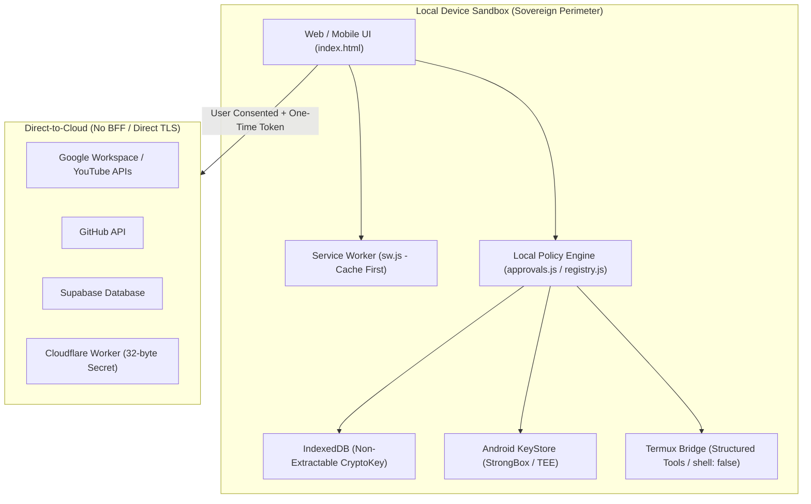

# Architecture Decision Record (ADR) 001: Sovereign Local-First Architecture Charter

- **Status:** Accepted
- **Deciders:** EG Nexus OS Architecture & Security Steering Team
- **Date:** 2026-11-13
- **Scope:** Runtime Security, Data Sovereignty, Local-First Boundaries, CI/CD Integrity

---

## 1. Context & Architectural Charter

EG Nexus OS is an autonomous, privacy-preserving AI operating workspace designed for mobile and web environments. Unlike conventional cloud-based or SaaS AI applications that funnel user data and credentials through a central proxy or Backend-for-Frontend (BFF), EG Nexus OS enforces a **Sovereign Local-First** architectural paradigm:

1. **Local Data Sovereignty:**  
   دستگاه محلی کاربر مرجع اصلی و حقیقت پایه (Primary Authoritative Source of Truth) برای تمامی داده‌ها و اسرار است و همگام‌سازی ابری (از طریق Cloudflare Worker یا Supabase) کاملاً اختیاری، رمزنگاری‌شده و منحصراً با فعال‌سازی و رضایت صریح کاربر (Opt-In) انجام می‌گیرد.  
   All user state, chat history, custom models, and sensitive API secrets reside exclusively on the user's physical device. Keys are managed using hardware-backed security modules (Android KeyStore with StrongBox / TEE) or non-extractable CryptoKey primitives inside browser IndexedDB. Cloud synchronization (via Cloudflare Worker or Supabase) is strictly opt-in, client-side encrypted, and never authoritative over local storage.
2. **Zero Central Intermediary (No BFF):**  
   EG Nexus OS eliminates central application servers, telemetry aggregators, and proxy middlewares. Outbound requests to third-party providers (Google OAuth, GitHub API, Cloudflare Workers, Supabase) occur directly from the user's runtime sandbox over TLS, ensuring credentials and prompt data are never exposed to intermediate infrastructure.
3. **Fail-Closed Offline Capability:**  
   The system relies on a high-resilience Service Worker (`sw.js`) caching core application assets with strict cryptographic integrity (SHA-256 parity). The application remains fully functional offline for local execution, termux scripting, and prompt drafting without reliance on external servers.

---

## 2. Threat Model & Security Mitigations

### 2.1 Threat Vector: Indirect Prompt Injection (IPI) & Capability Hijacking
- **Attack Scenario:** An untrusted LLM prompt or malicious web content attempts to trick the agent into executing sensitive mutating actions (e.g., repository deletion, unsolicited emails, unapproved file modifications).
- **Defense-in-Depth Mitigation:**
  - **Local Policy Engine & Default-Deny:** `validateProviderScope` rejects unmapped actions, unknown scopes, and wildcard operators (`*`, `all`, `admin`).
  - **One-Time Capability Approval Tokens (`approvalToken`):** For all mutating or sensitive operations (`isSensitiveProviderAction`), the system requires explicit user confirmation via the Approval Gate.
  - **Canonical JSON + SHA-256 Binding:** Approval tokens are bound to a 256-bit SHA-256 hash computed over recursively sorted canonical parameters (`canonicalizeJson(params)`). Any parameter alteration immediately invalidates the token.
  - **Single-Use Atomic Consumption:** Tokens are invalidated and deleted from memory immediately upon first use (`consumeApprovalToken`), preventing replay attacks and token harvesting.

### 2.2 Threat Vector: Arbitrary Command & Shell Injection via Termux Bridge
- **Attack Scenario:** Automated agents attempting to chain dangerous shell utilities or escape the workspace boundary using terminal commands.
- **Defense-in-Depth Mitigation:**
  - **Structured Tools Specification (`TERMUX_STRUCTURED_TOOLS`):** Automated invocations are confined to explicitly structured tasks (`git_status`, `git_diff`, `npm_test`, `npm_audit`, `python_audit`, `read_workspace_file`).
  - **Zero Shell Metacharacters:** Commands containing shell chaining characters (`;`, `&&`, `||`, `|`, `` ` ``, `$()`) are blocked outright in automated mode.
  - **Dangerous Flag Prohibition:** Flags like `-c`, `-e`, `--eval`, `--prefix`, `push`, `run` trigger immediate `403 ARGUMENT_POLICY_VIOLATION`.
  - **Execution Isolation:** Commands are executed strictly using Node.js `child_process.spawn` with `shell: false`, preventing shell interpretation or environment variable injection.

### 2.3 Threat Vector: Master Secret Compromise in Memory & Storage
- **Defense-in-Depth Mitigation:**
  - **Hardware Key Hierarchy:** On Android, AES-256-GCM master keys are generated within dedicated StrongBox or TEE hardware (`NexusKeystorePlugin.java`), with strict Additional Authenticated Data (`AAD`) verification.
  - **Non-Extractable WebCrypto Keys:** In browser environments, master session keys are generated with `extractable: false` in IndexedDB, preventing JavaScript scraping via memory dumps or XSS.
  - **Constant-Time HMAC & Worker Secret Verification:** Worker secrets enforce a minimum entropy of 32 characters (256 bits) and are verified using `crypto.timingSafeEqual` to eliminate side-channel timing attacks.

---

## 3. Boundaries: Offline Core vs. Online Direct Connect

---

## 4. Consequences & Verifications

- **Positive:** Maximum privacy, zero subscription-based backend hosting costs, immunity to central server breaches, strict auditability.
- **Negative / Constraints:** Mobile hardware limitations require careful memory management; cryptographic key rotation must be handled on-device with zero data loss.
- **Verification:** All security guarantees are verified automatically via `npm run test:mutation` (`verify-mutations.js`), AST syntax checks (`check-syntax.js`), and full regression test suites.
